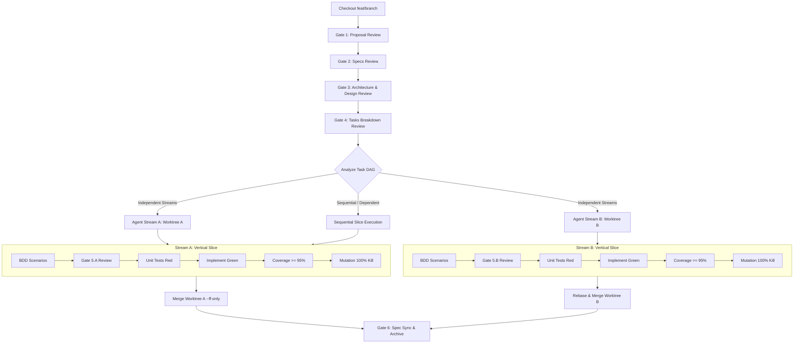
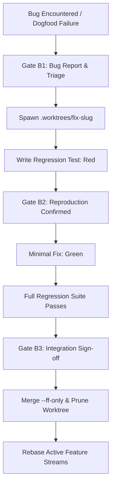

# Spec Driven, Testing Railed Development Workflow

## 1. Branching & Worktree Strategy

### Rule 1: Always Use a New Feature Branch
- **NEVER** work directly on `main` / `master`.
- Every OpenSpec feature proposal MUST originate on a dedicated feature branch:
  ```bash
  rtk git checkout -b feat/<feature-id>-<feature-name>
  ```
- All proposal, specs, design, tasks, and vertical slice work commits to this feature branch.

### Rule 2: Multi-Agent Parallel Streams via Git Worktrees
- When tasks/slices have **no mutual dependencies** (orthogonal modules, distinct capabilities, or decoupled tests):
  1. Ensure `.worktrees/` is present in `.gitignore`.
  2. For each independent task stream, spawn an isolated Git worktree:
     ```bash
     rtk git worktree add .worktrees/<feature-id>-<stream-name> -b feat/<feature-id>/<stream-name>
     ```
  3. Dispatch a dedicated subagent (`invoke_subagent`) per stream, pointing its workspace to the worktree path (`Workspace: 'share'` or direct path).
  4. Each agent stream executes its vertical slice concurrently in isolation:
     - BDD Scenarios (Gate 5.x)
     - Unit Tests (Red)
     - Implementation (Green)
     - Coverage (>= 95%)
     - Mutation Testing (100% kill)
  5. Upon completion and gate approval, the lead orchestrator integrates the stream back into the feature branch:
     ```bash
     rtk git checkout feat/<feature-id>-<feature-name>
     rtk git merge --ff-only feat/<feature-id>/<stream-name>
     rtk git worktree remove .worktrees/<feature-id>-<stream-name>
     ```
  6. If a completed stream introduces changes that subsequent dependent streams need, the dependent stream worktrees rebase onto the updated feature branch.

### Rule 3: Fast-Track Bugfix Protocol (Zero-Contamination Bug Isolation)
When a bug, regression, or runtime defect is discovered mid-development, during review, or via dogfooding:
- **HARD PROHIBITION**: NEVER modify production code on `main` or within a dirty feature working directory.
- **Protocol Steps**:
  1. **Log Defect**: File a minimal bug report in `openspec/bug-reports/<date>-<slug>.md` detailing root cause, reproduction, and expected behavior.
  2. **Spawn Worktree**: Create an isolated bugfix worktree branching off target base (e.g. `main`):
     ```bash
     rtk git worktree add .worktrees/fix-<bug-slug> -b fix/<bug-slug> main
     ```
  3. **Mandatory Red-First Regression Test**:
     - Write a targeted test replicating the defect *before touching any production code*.
     - Run test in the worktree: MUST fail (`Red`).
  4. **Minimal Fix (Green)**:
     - Apply the minimal surgical fix in the worktree to turn the test passing (`Green`).
     - Run full test suite to guarantee zero regressions.
  5. **Merge & Prune**:
     - Fast-forward merge the fix into `main`:
       ```bash
       rtk git checkout main
       rtk git merge --ff-only fix/<bug-slug>
       rtk git worktree remove .worktrees/fix-<bug-slug>
       rtk git branch -d fix/<bug-slug>
       ```
  6. **Rebase Active Feature Branches**:
     - If active feature streams or worktrees need the fix, rebase them on top of updated `main`.

---

## 2. Workflow Lifecycle & Human Gates



### Gate 1: Proposal Review
- **Artifact**: `openspec/features/<feature>/proposal.md`
- **Mandatory Sections**: Intent, Scope (In/Out-of-scope), Success Metrics, Assumptions (`ASM-GEN-*`).
- **Gate**: Human approval required before drafting specs.

### Gate 2: Specifications Review
- **Artifacts**: `openspec/features/<feature>/specs/<capability>/spec.md`
- **Mandatory Sections**: Requirements (`REQ-*`), Non-Functional Requirements & Performance Budgets (`NFR-*`), Assumptions (`ASM-*`), Edge Cases & Errors.
- **Traceability**: Every requirement MUST be uniquely keyed (`REQ-<DOMAIN>-<ID>`, `NFR-<DOMAIN>-<ID>`).
- **Gate**: Human approval required before technical design.

### Gate 3: Architecture & Design Review
- **Artifact**: `openspec/features/<feature>/design.md`
- **Mandatory Sections**:
  - Architecture Diagrams, Domain Models & Protocols, Tech Stack, Boundary Rules, Assumptions.
  - **Performance, Concurrency & Main-Loop Invariants**:
    - **Main Loop Budget**: UI render thread must maintain 60+ FPS (< 16ms frame deadline).
    - **Keystroke Latency Budget**: User input handling must complete in < 1µs (zero thread-hop latency; keep pure string/state edits on the event loop).
    - **Async Offloading**: Any disk I/O, heavy AST parsing, Git tree operations, or network calls MUST be offloaded to background threads/channels, never blocking the main loop.
    - **Hot-Path Allocation Profile**: Zero or minimal heap allocations during user input processing and viewport rendering.
- **ML/NLP Rule**: Tier 0 Dumb Baseline is mandatory before higher tiers.
- **Gate**: Human approval required before task breakdown.

### Gate 4: Tasks Breakdown Review
- **Artifact**: `openspec/features/<feature>/tasks.md`
- **Mandatory Sections**:
  - **Dependency DAG**: Clear mapping of task prerequisites.
  - **Multi-Agent Streams**: Tasks with zero inter-dependencies partitioned into explicit streams (`Stream A`, `Stream B`, etc.) with designated Git worktrees (`.worktrees/<feature>-<stream>`).
  - **Order of Execution**: Test-first implementation dependencies per stream.
  - **Integration & Rebase Plan**: Merge order and synchronization checkpoints across streams.
- **Gate**: Human approval required before launching agent worktrees or writing test code.

---

## 3. Bug Lifecycle & Fast-Track Gates



### Gate B1: Bug Report & Triage
- **Artifact**: `openspec/bug-reports/<date>-<slug>.md`
- **Mandatory Sections**: Summary, Steps to Reproduce, Expected vs Actual, Root Cause Analysis, Proposed Remediation.
- **Gate**: Human approval required before code execution.

### Worktree Spawn
- Isolate the bugfix from active feature streams:
  ```bash
  rtk git worktree add .worktrees/fix-<slug> -b fix/<slug> main
  ```

### Gate B2: Reproduction Confirmed (Red-First)
- Write targeted regression test replicating the defect *before touching any production code*.
- Test MUST fail (`Red`) on unmodified code.
- **Gate**: Human verifies the test reproduces the real defect.

### Green Implementation & Verification
- Apply minimal surgical code change.
- Verify regression test passes (`Green`).
- Run full test suite (`cargo test`) to ensure zero regressions.

### Gate B3: Integration Sign-off
- Human inspects final diff and test output.
- Fast-forward merge into `main`:
  ```bash
  rtk git checkout main
  rtk git merge --ff-only fix/<slug>
  rtk git worktree remove .worktrees/fix-<slug>
  rtk git branch -d fix/<slug>
  ```
- Mark bug report as resolved with commit hash.
- Rebase active feature worktrees if they depend on the fix.

---

## 4. Apply Phase: Vertical-Slice Test-Driven Implementation

For each functional component/slice:

### Step 5.x-A: BDD Behavior Scenarios (100% Behavior Coverage)
- Write Gherkin feature file (`tests/bdd/features/*.feature`) covering all requirements and boundary conditions.
- **Gate 5.x**: Human approval required before writing unit tests and implementation.

### Step 5.x-B: Unit Tests & Red-Green Implementation (>= 95% Coverage)
- **Red**: Write failing unit tests first. Verify test failure.
- **Green**: Implement minimal production code to make tests pass.
- **Refactor**: Clean code under green test protection.
- **Coverage**: Enforce line and branch coverage $\ge 95\%$ (e.g. `cargo llvm-cov` or `pytest --cov`).
- **Performance Budget**: Hot-path unit/benchmark tests must verify latency budgets (< 1µs for keystroke handling, < 16ms for render loop).

### Step 5.x-C: Mutation Testing (100% Kill Score)
- Execute mutation testing (`cargo mutants` or `mutmut run`).
- **Surviving Mutant Protocol**: Any surviving mutant is a critical defect:
  1. Add a targeted test assertion killing the mutant, OR
  2. Delete redundant unneeded code (Ponytail / YAGNI rule).
- Target: 100% mutation kill rate on domain and core logic.

---

## 5. Coding Agents & LGTM Harness Integration

- **Anchor Directives**: Support line-anchored feedback directives (`#ref file:line <directive>`) from code review harnesses (`lgtm`).
- **Review Inbox**: Check `.lgtm/reviews/` and user directives on every turn; resolve inline review feedback before advancing.
- **Test Integrity (Anti-Fraud)**:
  - NEVER delete assertions or drop tests to force a green run.
  - NEVER use vacuous assertions (`assert True`) or silent mock overrides.
  - NEVER add `@pytest.mark.skip` / `xit` without explicit user sign-off.
- **Architecture Boundaries & Cleanliness**:
  - Domain core (`sentiments.core`) must have zero dependencies on I/O, network, or external APIs.
  - Blast radius: Keep file touches strictly localized to the active vertical slice.
  - Zero scratch pollution: No debug dumps, `.env` leaks, or untracked scratch scripts in repo.

---

## 6. Gate 6: Living Spec Sync & Archive

1. Run full test suite (`uv run pytest --cov`) and verify 100% pass + $\ge 95\%$ coverage.
2. Run full mutation suite (`uv run mutmut run`) and verify 100% kill score.
3. Merge worktrees into feature branch.
4. Sync feature delta specs into canonical living directory (`openspec/specs/`).
5. Update `openspec/features/<feature>/tasks.md` and archive completed feature.
