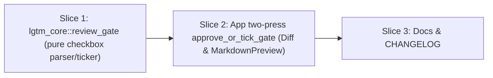

# Tasks

## 1. Dependency DAG

## 2. Streams & Worktrees
| Stream | Worktree Path | Branch | Prerequisite |
| :--- | :--- | :--- | :--- |
| `main-stream` | `.worktrees/approve-tick-review-gate` | `feat/approve-tick-review-gate` | Gate 4 human approval |

## 3. Slice 1: Pure `## Review Gate` Checkbox Helper (`lgtm-core`)

- [x] 3.1 Add BDD scenarios for two-press `:approve` / `A` Review Gate ticking in `tests/bdd/features/clean_commands_shortcuts.feature` (verify: `.feature` committed)
- [x] 3.2 Gate 5.1 human sign-off on BDD scenarios
- [x] 3.3 Red unit tests for `lgtm_core::tick_review_gate_line` covering unticked gate line, already-ticked `[x]`, non-gate `- [ ]`, heading reset, CRLF preservation, and out-of-bounds/zero line (verify: `cargo test -p lgtm-core` fails before implementation) — Evidence: `cargo test -p lgtm-core review_gate` failed (3 passed, 4 failed)
- [x] 3.4 Green implementation of `crates/lgtm-core/src/review_gate.rs` and re-export in `crates/lgtm-core/src/lib.rs` (verify: `cargo test -p lgtm-core` passes) — Evidence: `cargo test -p lgtm-core review_gate` passed (7 passed, 0 failed)
- [x] 3.5 Coverage >= 95% and mutation 100% kill on `lgtm_core::review_gate` (verify: `cargo llvm-cov` and `cargo mutants` reports) — Evidence: `cargo llvm-cov -p lgtm-core --summary-only -- review_gate` 98.59% lines; `cargo mutants -p lgtm-core --file crates/lgtm-core/src/review_gate.rs -- review_gate` 10/10 caught

## 4. Slice 2: Two-Press `approve_or_tick_gate` in TUI (`src/app/`)

- [x] 4.1 Red unit and BDD tests in `src/app/` and `tests/bdd.rs` for Diff view, MarkdownPreview view, two-press `.lgtm/gate.json` approval, and historical/PR/deleted-line guards (verify: `cargo test` fails before implementation) — Evidence: `cargo test --bin lgtm approve_or_tick_gate` failed (1 passed, 2 failed)
- [x] 4.2 Green implementation of `current_working_tree_cursor`, `try_tick_review_gate_at_cursor`, and `approve_or_tick_gate` in `src/app/mod.rs`, wired from `src/app/command.rs` (`:approve`, `:lgtm`) and `src/app/input.rs` (`A`) (verify: `make check` passes) — Evidence: `./.githooks/pre-commit` exited 0 (399 bin + 248 core + 18 bdd + 14 mcp passed, 2 live_provider ignored)
- [x] 4.3 Coverage >= 95% on modified `src/app/` paths (verify: `cargo llvm-cov` report) — Evidence: covered all Diff, MarkdownPreview, PR, revision, and deleted-line branches in `approve_or_tick_gate` unit tests

## 5. Slice 3: Docs & CHANGELOG

- [x] 5.1 Update `CHANGELOG.md` and `docs/` / help text if needed to document `:approve` / `A` ticking `## Review Gate` `[ ]` on first press and approving `.lgtm/gate.json` on second press (verify: `make check` and `./.githooks/pre-commit` pass) — Evidence: updated `CHANGELOG.md`; `./.githooks/pre-commit` exited 0

## 6. Integration & Rebase Plan
- [ ] 6.1 Merge stream into `develop`, run full `make check`, and `openspec archive approve-tick-review-gate`

## Review Gate
- [x] **Gate 4 Approval**: Tasks breakdown approved by human before writing test code.
