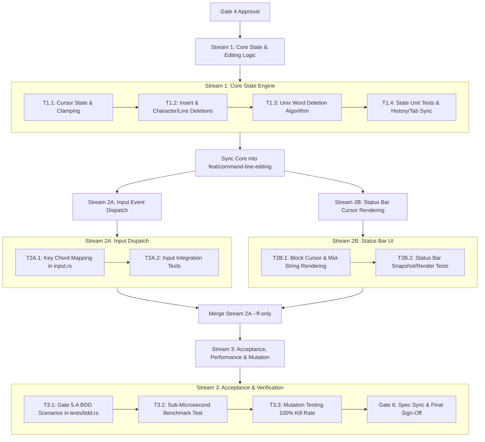

# Task Breakdown: Command Line Vim/Readline Editing Shortcuts

## 1. Dependency DAG & Stream Architecture

---

## 2. Multi-Agent Streams & Worktrees

| Stream | Designated Worktree | Branch | Responsibility | Prerequisites |
|---|---|---|---|---|
| **Stream 1: Core State** | `.worktrees/command-line-editing-core` | `feat/command-line-editing/core` | State struct fields, cursor navigation, char/line/word deletions, pure unit tests | Gate 4 Approval |
| **Stream 2A: Input Dispatch** | `.worktrees/command-line-editing-input` | `feat/command-line-editing/input` | Keystroke bindings in `handle_command_line_key`, event dispatch tests | Stream 1 Merged |
| **Stream 2B: Status UI** | `.worktrees/command-line-editing-ui` | `feat/command-line-editing/ui` | Block cursor styling, inverted mid-string character rendering, UI tests | Stream 1 Merged |
| **Stream 3: Verification** | Active worktree (`feat/command-line-editing`) | `feat/command-line-editing` | End-to-end BDD acceptance scenarios, latency benchmarks (< 1µs), mutation tests | Streams 2A & 2B Merged |

---

## 3. Detailed Task Definitions

### Stream 1: Core State & Editing Logic (`src/app/state.rs`)
- [x] **Task 1.1: Cursor Position State & Navigation (`REQ-1`)**
  - Add `pub cursor: usize` field to `CommandLine`.
  - Implement `move_left(&mut self)`, `move_right(&mut self)`, `move_home(&mut self)`, and `move_end(&mut self)`.
  - Enforce bounds invariant: `0 <= cursor <= input.chars().count()` using character indices (UTF-8 safe).
  - Implement `set_text(&mut self, text: String)` placing cursor at `input.chars().count()`.
  - Implement `reset(&mut self)` clearing text, history index, completions, prefix, and resetting cursor to 0.
- [x] **Task 1.2: Character Insertion & Deletion (`REQ-2`, `REQ-3`, `REQ-5`)**
  - Implement `insert_char(&mut self, c: char)` inserting at `cursor` index and advancing `cursor` by 1.
  - Implement `delete_backward(&mut self) -> bool` (Backspace):
    - If `cursor == 0 && input.is_empty()` -> return `false` (signal exit to Diff).
    - If `cursor == 0 && !input.is_empty()` -> return `true` (noop).
    - Otherwise -> delete character preceding `cursor`, decrement `cursor`, return `true`.
  - Implement `delete_forward(&mut self)` (Delete / Ctrl-d): delete character at `cursor` without moving `cursor`.
  - Implement `delete_to_start(&mut self)` (Ctrl-u): delete characters `0..cursor`, reset `cursor = 0`.
  - Implement `delete_to_end(&mut self)` (Ctrl-k): delete characters `cursor..input.chars().count()`.
- [x] **Task 1.3: Backward Word Deletion (`REQ-4`)**
  - Implement `delete_word_backward(&mut self)`:
    - Phase 1: Skip trailing whitespace backwards from `cursor`.
    - Phase 2: If previous char is alphanumeric or underscore (`c.is_alphanumeric() || c == '_'`), delete backward continuous alphanumeric/underscore chars. If punctuation, delete backward continuous punctuation chars.
    - Set `cursor` to new deletion position.
- [x] **Task 1.4: Autocomplete & History Cursor Alignment (`REQ-6`)**
  - Update `autocomplete_next` and `autocomplete_prev` to reposition `cursor` to the end of completed string.
  - Write pure unit tests in `src/app/state.rs` covering:
    - ASCII and multi-byte UTF-8 string insertions and deletions.
    - Word deletions with trailing spaces (`"audit   " -> ""`).
    - Punctuation vs word boundary behavior (`"foo-bar" -> "foo-" -> "foo"`).
    - Boundary clamping at index 0 and end of input.

---

### Stream 2A: Input Event Dispatch (`src/app/input.rs`)
- [x] **Task 2A.1: Command Line Key Bindings (`REQ-1` – `REQ-6`)**
  - Map `KeyCode::Left` -> `self.command.move_left()`
  - Map `KeyCode::Right` -> `self.command.move_right()`
  - Map `KeyCode::Home` / `(CONTROL, Char('a'))` -> `self.command.move_home()`
  - Map `KeyCode::End` / `(CONTROL, Char('e'))` -> `self.command.move_end()`
  - Map `KeyCode::Backspace` -> if `!self.command.delete_backward()` { `self.active_view = ActiveView::Diff` }
  - Map `KeyCode::Delete` / `(CONTROL, Char('d'))` -> `self.command.delete_forward()`
  - Map `(CONTROL, Char('w'))` / `(ALT, KeyCode::Backspace)` -> `self.command.delete_word_backward()`
  - Map `(CONTROL, Char('u'))` -> `self.command.delete_to_start()`
  - Map `(CONTROL, Char('k'))` -> `self.command.delete_to_end()`
  - Update `KeyCode::Up` / `KeyCode::Down` / `Ctrl-p` / `Ctrl-n` to update `self.command.cursor = self.command.input.chars().count()`.
  - Update `KeyCode::Char(c)` -> `self.command.insert_char(c)`.
- [x] **Task 2A.2: Input Unit & Integration Tests**
  - Unit tests in `src/app/input.rs` simulating synthetic `KeyEvent` sequences and asserting `app.command.input` and `app.command.cursor` state.

---

### Stream 2B: Visual Status Bar UI (`src/ui/status.rs`)
- [x] **Task 2B.1: Status Bar Cursor Rendering (`REQ-7`)**
  - In `render_status_bar`:
    - When `app.active_view == ActiveView::CommandLine`:
      - Partition `app.command.input` into `before_cursor`, `char_at_cursor`, `after_cursor`.
      - If `cursor < chars.len()`: render `char_at_cursor` with inverted style (`bg(Yellow), fg(Black), BOLD`).
      - If `cursor == chars.len()`: render `"█ "` with `fg(Yellow)`.
      - Keep completion chips and instructions rendering seamlessly after the input.
- [x] **Task 2B.2: UI Status Bar Rendering Tests**
  - Test terminal buffer output ensuring cursor character and style span correctly reflect cursor index.

---

### Stream 3: End-to-End Acceptance, Performance & Mutation Testing
- [x] **Task 3.1: Gate 5.A Behavior Acceptance Scenarios (`tests/bdd.rs`)**
  - Add BDD acceptance scenarios matching Scenarios 2.1 to 2.8 from `spec.md`:
    - Scenario 2.1: Cursor Movement (`Left`, `Right`, `Ctrl-a`, `Ctrl-e`)
    - Scenario 2.2: Mid-String Insertion (`:audi` -> `:audit`, left arrow, insert `x` -> `:auxdit`)
    - Scenario 2.3: Backward Word Deletion (`pr 12` -> `Ctrl-w` -> `pr ` -> `Ctrl-w` -> `""`)
    - Scenario 2.4: Word Deletion with Trailing Spaces (`audit   ` -> `Ctrl-w` -> `""`)
    - Scenario 2.5: Line Clear to Start (`scan repo` -> `Ctrl-u` -> `""`)
    - Scenario 2.6: Mid-String Line Clear (`diff main` at index 4 -> `Ctrl-u` -> ` main`; `Ctrl-k` -> `diff`)
    - Scenario 2.7: Character Deletion (`help` at index 2 -> `Backspace` -> `hlp`; `Delete`/`Ctrl-d` -> `hp`)
    - Scenario 2.8: Boundaries and Edge Cases (empty Backspace -> Diff view; index 0 noop)
- [x] **Task 3.2: Latency Budget & Allocation Verification**
  - Microbenchmark verifying `CommandLine` editing operations execute in < 1µs per keystroke.
  - Zero-heap allocation check on cursor movement and bounds clamping.
- [x] **Task 3.3: Mutation Testing (100% Kill Score)**
  - Run mutation analysis on `CommandLine` line-editing logic.
  - Kill 100% of generated mutants by strengthening assertions or removing dead branches.
- [ ] **Task 3.4: Gate 6 Specification Sync & Feature Archive**
  - Verify all test suites pass with $\ge 95\%$ line/branch coverage.
  - Sync specs to canonical directory and update feature status.

---

## 4. Integration & Rebase Plan

1. **Step 1**: Execute Stream 1 in worktree `.worktrees/command-line-editing-core`. Merge back to `feat/command-line-editing` via `--ff-only`.
2. **Step 2**: Rebase worktrees for Stream 2A (`.worktrees/command-line-editing-input`) and Stream 2B (`.worktrees/command-line-editing-ui`) onto the merged core branch.
3. **Step 3**: Execute Stream 2A and Stream 2B concurrently.
4. **Step 4**: Merge Stream 2A, then rebase and merge Stream 2B into `feat/command-line-editing`.
5. **Step 5**: Execute Stream 3 (Acceptance BDD, latency benchmarks, mutation testing) directly in the integrated feature branch.
6. **Step 6**: Submit Gate 6 for final sign-off.
