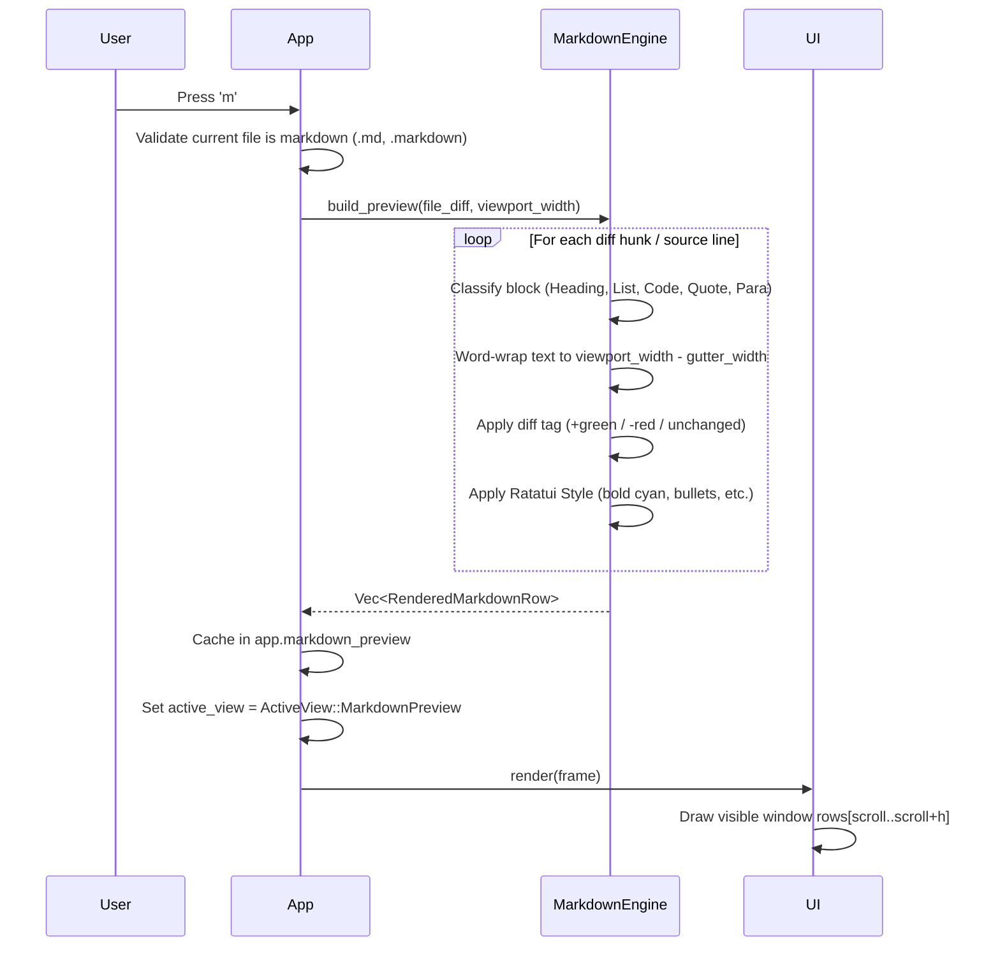

# Architecture & Technical Design: Markdown Preview with Diff Highlighting

## 1. Architectural Overview & Invariants

This design introduces a high-performance in-terminal rendered Markdown Preview mode for `lgtm`.
Reviewers can toggle (`m`, `:md`, `:preview`) from raw unified/split diffs to a formatted document view reflowed to the terminal width, styled with Ratatui primitives, and annotated with git diff additions (`+`, green) and deletions (`-`, red).

### System Architecture Flow

```mermaid
flowchart TD
    UserKey[Key Event / Command] --> Dispatcher[App::handle_key / handle_command]
    Dispatcher -->|Toggle 'm' / :md| ToggleHandler[App::toggle_markdown_preview]
    ToggleHandler --> CheckMd{Is Active File Markdown?}
    CheckMd -- No --> WarnMsg[Set Status Alert: Only .md supported]
    CheckMd -- Yes --> SwitchMode[Set ActiveView::MarkdownPreview]

    SwitchMode --> Engine[Markdown Engine: parse_and_reflow]
    FileDiff[lgtm-core::diff::FileDiff] --> Engine
    TermWidth[Viewport Width] --> Engine
    Engine --> PreRendered[MarkdownPreviewState: Vec<RenderedMarkdownRow>]

    Dispatcher -->|Navigation: j, k, g, G| NavHandler[Scroll Clamping O(1)]
    NavHandler --> UI[ui::diff::render_markdown_preview]
    PreRendered --> UI
    UI --> Frame[Ratatui Terminal Frame Buffer]
```

---

## 2. Main-Loop Invariants & Performance Budgets

To satisfy SDTRD workflow performance requirements:

1. **Main Loop Frame Budget (< 16ms, 60+ FPS)**:
   - Rendering slices directly from `MarkdownPreviewState.rendered_rows` into the Ratatui buffer based on `scroll_offset..scroll_offset + viewport_height`.
   - Drawing visible rows is $O(\text{viewport\_height})$ without iterating over off-screen lines.
2. **Keystroke Latency Budget (< 1µs)**:
   - Keystrokes (`j`, `k`, `g`, `G`, `PageDown`, `PageUp`) only update `scroll_offset: usize` with arithmetic bounds clamping.
   - Zero thread hops, zero heap allocations, zero regex or parser execution on navigation keystrokes.
3. **Async Offloading & Caching Invariants**:
   - Markdown parsing and line-wrapping are performed once when entering preview or when the viewport width/file changes.
   - The result is cached in `App.markdown_preview` state.
   - Subsequent frames and keystrokes read from cache with zero I/O.
4. **Hot-Path Allocation Profile**:
   - Zero heap allocations during scroll navigation.
   - Slicing cached `Line<'static>` / formatted spans into the visible frame buffer.

---

## 3. Domain Models & State Management

### 3.1 Preview State (`src/app/state.rs` or `src/app/markdown.rs`)

```rust
#[derive(Debug, Clone, Copy, PartialEq, Eq)]
pub enum MarkdownDiffKind {
    Unchanged,
    Addition,
    Deletion,
}

#[derive(Debug, Clone)]
pub struct RenderedMarkdownRow {
    /// Line number in the original/new file (if applicable)
    pub line_number: Option<usize>,
    /// Diff gutter status (+, -, or space)
    pub diff_kind: MarkdownDiffKind,
    /// Styled text spans for the line
    pub spans: Vec<ratatui::text::Span<'static>>,
}

#[derive(Debug, Default, Clone)]
pub struct MarkdownPreviewState {
    pub is_active: bool,
    pub scroll_offset: usize,
    pub rendered_rows: Vec<RenderedMarkdownRow>,
    pub cached_file_idx: Option<usize>,
    pub cached_width: u16,
    pub cached_revision: u64,
}

impl MarkdownPreviewState {
    pub fn scroll_down(&mut self, amount: usize, viewport_height: usize) {
        let max_scroll = self.rendered_rows.len().saturating_sub(viewport_height);
        self.scroll_offset = (self.scroll_offset + amount).min(max_scroll);
    }

    pub fn scroll_up(&mut self, amount: usize) {
        self.scroll_offset = self.scroll_offset.saturating_sub(amount);
    }

    pub fn scroll_to_top(&mut self) {
        self.scroll_offset = 0;
    }

    pub fn scroll_to_bottom(&mut self, viewport_height: usize) {
        self.scroll_offset = self.rendered_rows.len().saturating_sub(viewport_height);
    }
}
```

### 3.2 View Mode Extension (`src/app/mod.rs`)

Add `MarkdownPreview` to `ActiveView`:
```rust
#[derive(Debug, Clone, Copy, PartialEq, Eq)]
pub enum ActiveView {
    Diff,
    MarkdownPreview,
    FilePicker,
    // ...
}
```

---

## 4. Markdown Parsing & Diff Overlay Pipeline



### 4.1 Parser Design (Ponytail / YAGNI Compliance)
Rather than pulling external multi-megabyte dependencies requiring network crates, the markdown engine implements a deterministic, zero-dependency CommonMark block & inline lexer:
- **Block Formats**:
  - Headings: Prefixed by `#{1,6} `. Rendered with tiered bold colors (`#` cyan underline, `##` cyan bold, `###` blue bold).
  - Unordered Lists: Prefixed by `- `, `* `, `+ `. Rendered with bullet `• ` and depth indentation.
  - Ordered Lists: Prefixed by `\d+\. `. Rendered with aligned numbers.
  - Blockquotes: Prefixed by `> `. Rendered with vertical bar `│ ` in dim gray.
  - Fenced Code Blocks: Delimited by ```` ``` ````. Rendered with contrasting background box and `[lang]` tag.
- **Inline Styling**:
  - `**bold**` / `__bold__` -> `Modifier::BOLD`
  - `*italic*` / `_italic_` -> `Modifier::ITALIC`
  - `` `code` `` -> Monospace contrast background
  - `[label](url)` -> Underline style with dim url annotation
- **Diff Attribution**:
  - Correlates lines against `lgtm_core::model::DiffLine`.
  - Lines originating from `LineType::Addition` receive green tint + `+` gutter marker.
  - Lines originating from `LineType::Deletion` receive red tint + `-` gutter marker.
  - Unchanged lines receive neutral style + ` ` gutter marker.

---

## 5. UI Rendering & Gutter Layout

```
┌─ [MARKDOWN PREVIEW] README.md (+12 -3) ──────────────────────┐
│  1   │ # System Architecture                                 │
│  2   │                                                       │
│+ 3   │ LGTM provides real-time in-terminal diff streaming   │
│+ 4   │ with sub-millisecond keystroke responsiveness.        │
│  5   │                                                       │
│- 6   │ Old architecture description here.                   │
│  7   │                                                       │
│  8   │ ## Features                                           │
│  9   │ • Fast keyboard navigation                            │
│ 10   │ • Inline terminal markdown preview                    │
│ 11   │                                                       │
│ 12   │ ```rust                                               │
│ 13   │ fn main() { println!("LGTM"); }                       │
│ 14   │ ```                                                   │
└──────────────────────────────────────────────────────────────┘
```

- **Gutter Width**: Dynamic width based on line number digits + 3 (e.g. `+ 124 │ `).
- **Text Width**: `area.width - gutter_width`.
- **Wrapping**: Words wrapped cleanly at whitespace boundaries; long unbreakable words clipped or wrapped at width boundary.

---

## 6. Boundary Rules & Cleanliness

1. **Architecture Boundary**:
   - `lgtm-core` remains UI-free; diff models and line types are consumed read-only.
   - Markdown parsing and rendering reside cleanly in `src/ui/markdown.rs` and `src/app/markdown.rs`.
2. **Blast Radius**:
   - Limited strictly to:
     - `src/app/mod.rs` (View enum & state field)
     - `src/app/input.rs` (Key bindings for `m` and navigation)
     - `src/app/command.rs` (`:md` and `:preview` command dispatch)
     - `src/app/markdown.rs` (Markdown state and parsing logic)
     - `src/ui/mod.rs` & `src/ui/markdown.rs` (TUI rendering)
     - `src/ui/status.rs` (Status bar badge indicator)
3. **Zero Contamination**:
   - No modifications to git engines, watchers, or audit logic.
   - All tests run hermetically without filesystem side effects.
