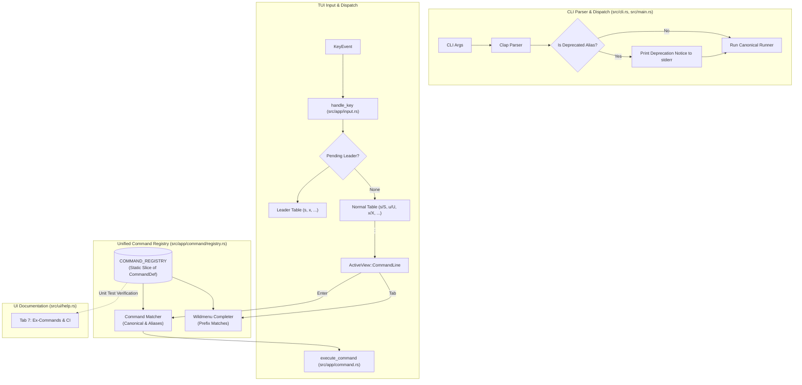

# Architecture & Design: Clean Commands and Shortcuts

- **Status:** Approved / Specification Ready
- **Feature:** Unified Command Registry, Reconciled Shortcuts, and CLI Consolidation

---

## 1. Architectural Overview

The system consolidates command and shortcut routing into a unified, zero-duplication architecture. A single **Command Registry** serves as the canonical source of truth for:
1. **Wildmenu Auto-completion** in `src/app/state.rs` (`CommandLine`).
2. **Ex Command Dispatch** in `src/app/command.rs` (`execute_command`).
3. **Help Modal Reference** in `src/ui/help.rs` (Tab 7).

Simultaneously, the TUI **Input Handler** (`src/app/input.rs`) is streamlined to eliminate shadowed handlers, ensure symmetric Git staging bindings, and cleanly separate single keys from leader chords.



---

## 2. Unified Command Registry Design

### 2.1 Registry Data Structures

Located in `src/app/command/registry.rs` (or within `src/app/command.rs`):

```rust
#[derive(Debug, Clone, Copy, PartialEq, Eq)]
pub enum CommandCategory {
    NavigationLayout,
    DirectivesThreads,
    AgentSteering,
    PrRemote,
    AuditGit,
}

#[derive(Debug, Clone, Copy)]
pub struct CommandDef {
    pub name: &'static str,
    pub aliases: &'static [&'static str],
    pub category: CommandCategory,
    pub args_summary: &'static str,
    pub description: &'static str,
}

pub static COMMAND_REGISTRY: &[CommandDef] = &[
    // Navigation & Layout
    CommandDef {
        name: "quit",
        aliases: &["q"],
        category: CommandCategory::NavigationLayout,
        args_summary: "",
        description: "Request safe quit",
    },
    CommandDef {
        name: "quit!",
        aliases: &["q!"],
        category: CommandCategory::NavigationLayout,
        args_summary: "",
        description: "Force quit immediately without saving",
    },
    CommandDef {
        name: "write",
        aliases: &["w"],
        category: CommandCategory::NavigationLayout,
        args_summary: "[path]",
        description: "Save review directives or write audit scorecard",
    },
    CommandDef {
        name: "exit",
        aliases: &["wq", "x"],
        category: CommandCategory::NavigationLayout,
        args_summary: "",
        description: "Save directives and exit",
    },
    CommandDef {
        name: "diff",
        aliases: &["rev", "range"],
        category: CommandCategory::NavigationLayout,
        args_summary: "[revision]",
        description: "Switch to diff view or review revision range",
    },
    CommandDef {
        name: "split",
        aliases: &["sp", "vsp", "vsplit"],
        category: CommandCategory::NavigationLayout,
        args_summary: "",
        description: "Toggle Unified vs Side-by-Side split diff view",
    },
    CommandDef {
        name: "drawer",
        aliases: &["tree", "sidebar"],
        category: CommandCategory::NavigationLayout,
        args_summary: "",
        description: "Toggle file tree sidebar drawer",
    },
    CommandDef {
        name: "find",
        aliases: &["f", "files"],
        category: CommandCategory::NavigationLayout,
        args_summary: "",
        description: "Open fuzzy file switcher modal",
    },
    CommandDef {
        name: "preview",
        aliases: &["md"],
        category: CommandCategory::NavigationLayout,
        args_summary: "",
        description: "Toggle rendered Markdown preview",
    },
    CommandDef {
        name: "reload",
        aliases: &["e", "edit"],
        category: CommandCategory::NavigationLayout,
        args_summary: "",
        description: "Reload diff from disk",
    },

    // Review Directives & Threads
    CommandDef {
        name: "comments",
        aliases: &["c", "directives", "todo"],
        category: CommandCategory::DirectivesThreads,
        args_summary: "[recheck|orphans]",
        description: "Open review directives drawer",
    },
    CommandDef {
        name: "reply",
        aliases: &["rep"],
        category: CommandCategory::DirectivesThreads,
        args_summary: "[text]",
        description: "Reply to comment or thread at cursor",
    },
    CommandDef {
        name: "resolve",
        aliases: &["res"],
        category: CommandCategory::DirectivesThreads,
        args_summary: "[all]",
        description: "Toggle resolved status on comment/thread (or resolve all)",
    },
    CommandDef {
        name: "unresolve",
        aliases: &[],
        category: CommandCategory::DirectivesThreads,
        args_summary: "[all]",
        description: "Mark comment/thread active (or unresolve all)",
    },
    CommandDef {
        name: "clear",
        aliases: &[],
        category: CommandCategory::DirectivesThreads,
        args_summary: "",
        description: "Clear all review directives",
    },
    CommandDef {
        name: "clear-resolved",
        aliases: &[],
        category: CommandCategory::DirectivesThreads,
        args_summary: "",
        description: "Remove only resolved review directives",
    },

    // Agent Steering & Execution
    CommandDef {
        name: "send",
        aliases: &["review", "push"],
        category: CommandCategory::AgentSteering,
        args_summary: "",
        description: "Compile batch directives and dispatch to agent sink",
    },
    CommandDef {
        name: "prompt",
        aliases: &["context"],
        category: CommandCategory::AgentSteering,
        args_summary: "",
        description: "Open agent prompt / gate context modal",
    },
    CommandDef {
        name: "approve",
        aliases: &["lgtm"],
        category: CommandCategory::AgentSteering,
        args_summary: "",
        description: "Approve waiting agent breakpoint gate",
    },
    CommandDef {
        name: "reject",
        aliases: &[],
        category: CommandCategory::AgentSteering,
        args_summary: "",
        description: "Revert hunk and dispatch prompt with rejection reason",
    },
    CommandDef {
        name: "reject-all",
        aliases: &["reject-gate"],
        category: CommandCategory::AgentSteering,
        args_summary: "",
        description: "Reject waiting agent breakpoint gate",
    },
    CommandDef {
        name: "pane",
        aliases: &["panes"],
        category: CommandCategory::AgentSteering,
        args_summary: "[id]",
        description: "View or set agent target pane ID",
    },
    CommandDef {
        name: "sink",
        aliases: &[],
        category: CommandCategory::AgentSteering,
        args_summary: "[name]",
        description: "Configure multiplexer agent sink",
    },
    CommandDef {
        name: "inject",
        aliases: &[],
        category: CommandCategory::AgentSteering,
        args_summary: "[all]",
        description: "Inject audit violation directive to agent",
    },

    // PR & Remote Lifecycle
    CommandDef {
        name: "pr",
        aliases: &[],
        category: CommandCategory::PrRemote,
        args_summary: "<num> | post [--yes]",
        description: "Review pull request by number or post comments",
    },
    CommandDef {
        name: "prs",
        aliases: &[],
        category: CommandCategory::PrRemote,
        args_summary: "[open|closed|all]",
        description: "Open pull request list picker",
    },
    CommandDef {
        name: "threads",
        aliases: &["thread"],
        category: CommandCategory::PrRemote,
        args_summary: "[view]",
        description: "Inspect remote PR review threads",
    },
    CommandDef {
        name: "checks",
        aliases: &[],
        category: CommandCategory::PrRemote,
        args_summary: "",
        description: "Refresh and inspect CI status checks",
    },

    // Audit, Security & Git Lifecycle
    CommandDef {
        name: "audit",
        aliases: &[],
        category: CommandCategory::AuditGit,
        args_summary: "",
        description: "Run full codebase security and architecture audit",
    },
    CommandDef {
        name: "scan",
        aliases: &["issues"],
        category: CommandCategory::AuditGit,
        args_summary: "[repo]",
        description: "Scan diff changes (or full repo) for guard alerts",
    },
    CommandDef {
        name: "risk",
        aliases: &[],
        category: CommandCategory::AuditGit,
        args_summary: "",
        description: "Run security and fraud risk scan",
    },
    CommandDef {
        name: "filter",
        aliases: &["sev"],
        category: CommandCategory::AuditGit,
        args_summary: "<crit|high|all>",
        description: "Filter audit alerts by severity level",
    },
    CommandDef {
        name: "commit",
        aliases: &["ci"],
        category: CommandCategory::AuditGit,
        args_summary: "[message]",
        description: "Commit staged hunks (or open Commit Forge)",
    },
    CommandDef {
        name: "worktrees",
        aliases: &["wt"],
        category: CommandCategory::AuditGit,
        args_summary: "[name|path]",
        description: "Open worktree switcher modal",
    },
    CommandDef {
        name: "hook",
        aliases: &[],
        category: CommandCategory::AuditGit,
        args_summary: "[install|uninstall|status]",
        description: "Inspect or manage Git pre-commit hook",
    },
    CommandDef {
        name: "editor",
        aliases: &[],
        category: CommandCategory::AuditGit,
        args_summary: "[name]",
        description: "Configure external editor command",
    },
    CommandDef {
        name: "export",
        aliases: &[],
        category: CommandCategory::AuditGit,
        args_summary: "[path]",
        description: "Export audit scorecard markdown report",
    },
    CommandDef {
        name: "hidden",
        aliases: &[],
        category: CommandCategory::AuditGit,
        args_summary: "",
        description: "Display baselined and suppressed findings",
    },
    CommandDef {
        name: "help",
        aliases: &["h", "?"],
        category: CommandCategory::AuditGit,
        args_summary: "",
        description: "Open interactive documentation modal",
    },
];
```

### 2.2 Wildmenu Autocomplete Integration

In `src/app/state.rs`:
```rust
impl CommandLine {
    pub fn autocomplete_next(&mut self) {
        if self.completions.is_empty() {
            let current = self.input.trim_start_matches(':').trim();
            self.prefix = current.to_string();
            
            // Query unified registry
            let mut matches: Vec<String> = Vec::new();
            for def in COMMAND_REGISTRY {
                if current.is_empty() || def.name.starts_with(current) {
                    matches.push(def.name.to_string());
                }
                for &alias in def.aliases {
                    if !current.is_empty() && alias.starts_with(current) {
                        matches.push(alias.to_string());
                    }
                }
            }
            matches.sort();
            matches.dedup();

            if !matches.is_empty() {
                self.completions = matches;
                self.completion_idx = Some(0);
                self.input = self.completions[0].clone();
                self.cursor = self.input.chars().count();
            }
        } else if let Some(idx) = self.completion_idx {
            let next_idx = (idx + 1) % self.completions.len();
            self.completion_idx = Some(next_idx);
            self.input = self.completions[next_idx].clone();
            self.cursor = self.input.chars().count();
        }
    }
}
```

This immediately replaces the 58-line hardcoded string array in `src/app/state.rs`.

---

## 3. Input Handler Cleanups (`src/app/input.rs`)

### 3.1 Removing the Line 264 Shadowing Bug

In `handle_diff_key`:
1. **Remove** lines 264–267:
   ```rust
   // DELETED:
   (KeyModifiers::SHIFT, KeyCode::Char('X'))
   | (KeyModifiers::NONE, KeyCode::Char('X')) => {
       self.reject_hunk_and_reprompt();
   }
   ```
2. **Preserve** line 405:
   ```rust
   (_, KeyCode::Char('X')) => {
       self.discard_current_file_changes();
   }
   ```
3. **Add** `<Space>x` in the leader block:
   ```rust
   (' ', KeyCode::Char('x')) => {
       self.reject_hunk_and_reprompt();
       return;
   }
   ```

### 3.2 Symmetrical Staging Layout
The staging and discarding matrix in `src/app/input.rs` becomes clean and symmetrical:

| Entity | Stage (Normal) | Unstage (Normal) | Discard (Normal) | Reject & Reprompt (Leader / Ex) |
| :--- | :--- | :--- | :--- | :--- |
| **Hunk / Lines** | `s` | `u` | `x` | `<Space>x` or `:reject` |
| **Entire File** | `S` | `U` | `X` | `:diff` / `git checkout` |

---

## 4. CLI Dispatcher Cleanups (`src/cli.rs` & `src/main.rs`)

### 4.1 CLI Consolidation Matrix

1. **`lgtm check` & `lgtm ci`**:
   - `lgtm ci` marked as `#[command(hide = true)]` or aliased with deprecation notice.
   - When `lgtm ci` is run:
     ```rust
     eprintln!("⚠️  Notice: 'lgtm ci' is deprecated. Use 'lgtm check --no-user-config'.");
     ```
     Executes `run_check` with `no_user_config: true`.
2. **`lgtm scan` & `lgtm audit`**:
   - `lgtm audit` is the canonical interactive TUI launcher for full-repo issues.
   - `lgtm scan` default runs headless scanning to markdown or json.
   - If `lgtm scan --tui` or `lgtm scan repo` is invoked:
     ```rust
     eprintln!("⚠️  Notice: 'lgtm scan --tui' is deprecated. Use 'lgtm audit'.");
     ```
     Dispatches directly to `run_tui(..., Some(AuditStartMode::FullRepo))`.
3. **`lgtm prs` & `lgtm pr list`**:
   - Add `PrSubcommand::List { state: String }`.
   - `lgtm prs` prints notice and delegates to `pr list`.
4. **`lgtm mcp` & `lgtm serve --mcp`**:
   - `lgtm serve --mcp` prints notice and launches stdio MCP server.
5. **`lgtm diff` & `lgtm status`**:
   - `lgtm status` prints notice and launches diff TUI.

---

## 5. Documentation & Sync Strategy

### 5.1 Help Modal (`src/ui/help.rs`) Updates

- **Tab 3**: Update reject hunk documentation:
  `Span::styled("  <Space>x (or :reject)", Style::default().fg(Color::Cyan))`
- **Tab 4**: Clarify file discard documentation:
  `Span::styled("  X                ", Style::default().fg(Color::Cyan))`
  `Span::raw("Discard all working tree changes in current file (git restore)")`
- **Tab 7**: Synchronize all Ex command listings with the canonical names and aliases in `COMMAND_REGISTRY`.

### 5.2 Automated Registry Sync Test

Add an automated unit test in `src/app/command.rs`:
```rust
#[test]
fn test_registry_contains_all_dispatched_commands() {
    for def in COMMAND_REGISTRY {
        assert!(!def.name.is_empty());
        assert!(!def.description.is_empty());
    }
}

#[test]
fn test_help_modal_references_canonical_commands() {
    let help_code = include_str!("../ui/help.rs");
    for def in COMMAND_REGISTRY {
        let expected = format!(":{}", def.name);
        assert!(
            help_code.contains(&expected) || def.aliases.iter().any(|a| help_code.contains(&format!(":{}", a))),
            "Help modal missing command reference: :{}", def.name
        );
    }
}
```
