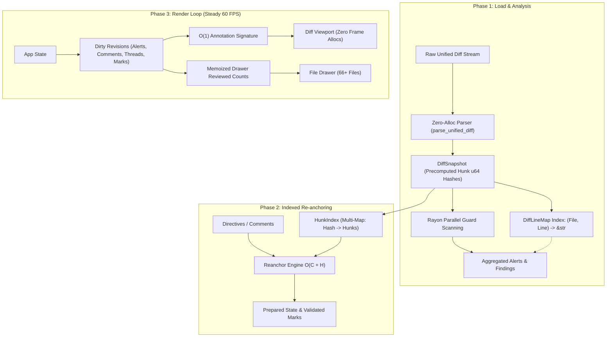

# Technical Design: Large PR Performance Optimization

## Architecture Overview

The optimization targets three distinct operational phases:
1. **Load Phase**: Diff parsing, line index generation, and parallel guard execution.
2. **Re-anchor Phase**: Fast integer hunk hashing and indexed hash-to-hunk comment alignment.
3. **Render Phase**: Event-driven dirty revision tracking and memoized file drawer metrics.



---

## 1. Unified Diff Parser Optimization (`lgtm-core::pr`)

### 1.1 Zero-Allocation Hunk Header Parser
The existing header parser splits strings by `"@@"` and whitespace, allocating vectors for every hunk:
```rust
// Legacy: Allocates 2 vectors and 4 string slices
let parts: Vec<&str> = header.split("@@").collect();
for section in range_part.split_whitespace() { ... }
```

The optimized implementation slices directly through byte offsets:
```rust
pub fn parse_hunk_header_fast(header: &str) -> (u32, u32, u32, u32) {
    let bytes = header.as_bytes();
    if !header.starts_with("@@ ") {
        return (1, 1, 1, 1);
    }
    // Locate the second "@@" boundary
    let Some(end_idx) = header[3..].find("@@") else {
        return (1, 1, 1, 1);
    };
    let content = &header[3..3 + end_idx].trim();
    
    // Parse -old_start,old_count +new_start,new_count directly
    let mut old_start = 1;
    let mut old_lines = 1;
    let mut new_start = 1;
    let mut new_lines = 1;

    for part in content.split_ascii_whitespace() {
        if let Some(rest) = part.strip_prefix('-') {
            parse_range(rest, &mut old_start, &mut old_lines);
        } else if let Some(rest) = part.strip_prefix('+') {
            parse_range(rest, &mut new_start, &mut new_lines);
        }
    }
    (old_start, old_lines, new_start, new_lines)
}

#[inline(always)]
fn parse_range(s: &str, start: &mut u32, lines: &mut u32) {
    if let Some((first, second)) = s.split_once(',') {
        *start = first.parse().unwrap_or(1);
        *lines = second.parse().unwrap_or(1);
    } else {
        *start = s.parse().unwrap_or(1);
        *lines = 1;
    }
}
```

### 1.2 Capacity Pre-sizing
- `DiffHunk::lines` pre-allocated using `new_lines.max(old_lines) as usize`.
- `FileDiff::hunks` pre-allocated with an initial capacity of 8.
- `DiffSnapshot::files` pre-allocated with estimated file count (e.g. 64).

---

## 2. Hunk Hashing & Indexed Re-anchoring (`lgtm-core::review`)

### 2.1 Native `u64` Content Hashing
`hunk_hash` currently formats a heap `String` on every call:
```rust
// Legacy: Allocates on heap every invocation
pub fn hunk_hash(h: &DiffHunk) -> String {
    let mut hash = 0xcbf29ce484222325u64;
    // ... byte loops ...
    format!("{:016x}", hash)
}
```

We split this into a zero-allocation integer hash and a cached formatter:
```rust
pub fn hunk_hash_u64(h: &DiffHunk) -> u64 {
    let mut hash = 0xcbf29ce484222325u64;
    let mut feed_byte = |b: u8| {
        hash = (hash ^ b as u64).wrapping_mul(0x100000001b3);
    };

    let mut first_line = true;
    for l in &h.lines {
        let sign = match l.line_type {
            LineType::Addition => b'+',
            LineType::Deletion => b'-',
            _ => continue,
        };

        if !first_line {
            feed_byte(b'\n');
        }
        first_line = false;
        feed_byte(sign);

        let mut first_word = true;
        for word in l.content.split_whitespace() {
            if !first_word {
                feed_byte(b' ');
            }
            first_word = false;
            for &b in word.as_bytes() {
                feed_byte(b);
            }
        }
    }
    hash
}

#[inline(always)]
pub fn format_hunk_hash(hash: u64) -> String {
    format!("{:016x}", hash)
}

pub fn hunk_hash(h: &DiffHunk) -> String {
    format_hunk_hash(hunk_hash_u64(h))
}
```

### 2.2 Cached Hunk Hashes on `DiffHunk`
`DiffHunk` adds a cached hash field populated either lazily or during snapshot parsing:
```rust
#[derive(Debug, Clone, PartialEq, Eq, Serialize, Deserialize, Default)]
pub struct DiffHunk {
    // ... existing fields ...
    #[serde(skip)]
    pub cached_hash: Option<u64>,
}

impl DiffHunk {
    #[inline(always)]
    pub fn hash_u64(&self) -> u64 {
        if let Some(h) = self.cached_hash {
            h
        } else {
            hunk_hash_u64(self)
        }
    }
}
```

### 2.3 `HunkIndex` Re-anchoring ($O(C + H)$)
Re-anchoring comments against diffs currently scans every hunk of every file for each comment ($O(C \times F \times H)$).

We introduce `HunkIndex` to index hunks prior to re-anchoring:
```rust
pub struct IndexedHunk<'a> {
    pub file_name: &'a str,
    pub hunk_idx: usize,
    pub hunk: &'a DiffHunk,
    pub hash_str: String,
}

pub struct HunkIndex<'a> {
    pub hunks_by_hash: std::collections::HashMap<u64, Vec<IndexedHunk<'a>>>,
    pub file_hunks: std::collections::HashMap<&'a str, Vec<&'a DiffHunk>>,
}

impl<'a> HunkIndex<'a> {
    pub fn build(files: &'a [FileDiff]) -> Self {
        let mut hunks_by_hash = std::collections::HashMap::new();
        let mut file_hunks = std::collections::HashMap::new();

        for file in files {
            let name = file.display_name();
            for (hi, hunk) in file.hunks.iter().enumerate() {
                let h_u64 = hunk.hash_u64();
                hunks_by_hash.entry(h_u64).or_default().push(IndexedHunk {
                    file_name: &name,
                    hunk_idx: hi,
                    hunk,
                    hash_str: format_hunk_hash(h_u64),
                });
                file_hunks.entry(&name).or_default().push(hunk);
            }
        }
        Self { hunks_by_hash, file_hunks }
    }
}
```

Exact re-anchoring is then reduced to an $O(1)$ map lookup:
```rust
pub fn reanchor_exact_indexed(
    c: &mut ReviewComment,
    index: &HunkIndex,
) -> bool {
    // Parse comment's content_hash hex into u64 once
    let Ok(target_u64) = u64::from_str_radix(&c.content_hash, 16) else {
        return false;
    };
    let Some(candidates) = index.hunks_by_hash.get(&target_u64) else {
        return false;
    };

    let mut best: Option<((bool, u32), &IndexedHunk)> = None;
    for cand in candidates {
        let other = cand.file_name != c.anchor.file_path;
        let diff = cand.hunk.new_start.abs_diff(c.hunk_start);
        let key = (other, diff);
        if best.is_none_or(|(k, _)| key < k) {
            best = Some((key, cand));
        }
    }

    let Some((_, cand)) = best else { return false };
    let Some(line) = line_at(cand.hunk, c.line_idx) else { return false };
    c.hunk_start = cand.hunk.new_start;
    c.settle(cand.file_name, line);
    true
}
```

### 2.4 Vectorized Reviewed Flags
`reviewed_flags` pairs hunk marks by matching content hashes. With `hunk.hash_u64()` and pre-hashed marks, duplicate pairing takes $O(H \log H + M \log M)$ instead of quadratic string comparisons.

---

## 3. Finding Pipeline & Parallel Rayon Scanning

### 3.1 `DiffLineMap` Index
Instead of running $O(F \times H \times L)$ scans inside `line_text(files, alert)`, build an indexed line lookup map once:
```rust
pub struct DiffLineMap<'a> {
    // Key: (file_path, new_line_num) -> line content
    lines: std::collections::HashMap<(&'a str, u32), &'a str>,
}

impl<'a> DiffLineMap<'a> {
    pub fn build(files: &'a [FileDiff]) -> Self {
        let mut lines = std::collections::HashMap::new();
        for f in files {
            let path = f.display_name();
            for hunk in &f.hunks {
                for line in &hunk.lines {
                    if let Some(new_no) = line.new_line_num {
                        lines.insert((&path, new_no), line.content.as_str());
                    }
                }
            }
        }
        Self { lines }
    }

    #[inline(always)]
    pub fn get(&self, file_path: &str, line_no: u32) -> Option<&'a str> {
        self.lines.get(&(file_path, line_no)).copied()
    }
}
```

### 3.2 Allocation-Free Fingerprint Assignment
Streaming FNV-1a directly into the hasher:
```rust
pub fn assign_fingerprints_fast(alerts: &mut [GuardAlert], line_map: &DiffLineMap) {
    let mut seen: std::collections::HashMap<u64, u32> = std::collections::HashMap::new();
    for a in alerts.iter_mut() {
        let text = a.line_no
            .and_then(|n| line_map.get(&a.file_path, n))
            .unwrap_or(&a.title);

        // Stream rule_id, file_path, and whitespace-normalized tokens directly into fnv1a
        let mut hasher = Fnv1aStreamer::new();
        hasher.write_str(&a.rule_id);
        hasher.write_byte(0);
        hasher.write_str(&a.file_path);
        hasher.write_byte(0);
        for word in text.split_whitespace() {
            hasher.write_str(word);
            hasher.write_byte(b' ');
        }
        let key_hash = hasher.finish();

        let n = seen.entry(key_hash).and_modify(|c| *c += 1).or_insert(0);
        
        let mut final_hasher = Fnv1aStreamer::new();
        final_hasher.write_u64(key_hash);
        final_hasher.write_byte(0);
        final_hasher.write_u32(*n);
        a.fingerprint = format!("{:016x}", final_hasher.finish());
    }
}
```

### 3.3 Parallel Rayon Scanning
In `SecurityAndTestGuard::scan_snapshot`:
```rust
use rayon::prelude::*;

pub fn scan_snapshot(files: &[FileDiff]) -> Vec<GuardAlert> {
    // Parallel map-reduce over files
    let (mut all_alerts, total_logic_lines, total_assert_additions) = files
        .par_iter()
        .map(|file| {
            let alerts = Self::scan_file(file);
            let (logic, asserts) = count_file_metrics(file);
            (alerts, logic, asserts)
        })
        .reduce(
            || (Vec::new(), 0, 0),
            |mut a, b| {
                a.0.extend(b.0);
                (a.0, a.1 + b.1, a.2 + b.2)
            },
        );

    // Global assertions density check
    if total_logic_lines >= 30 && total_assert_additions == 0 {
        all_alerts.push(GuardAlert {
            severity: Severity::High,
            rule_id: "test/zero-assertions".to_string(),
            fingerprint: String::new(),
            title: "Zero Assertions for New Logic".to_string(),
            description: format!("Added {total_logic_lines} lines of production code with 0 new test assertions"),
            line_no: None,
            file_path: "diff".to_string(),
        });
    }

    // Snapshot-level guards
    for g in registry() {
        all_alerts.extend(g.scan_snapshot(files));
    }

    let line_map = DiffLineMap::build(files);
    assign_fingerprints_fast(&mut all_alerts, &line_map);
    all_alerts
}
```

---

## 4. Render Loop & Dirty Revision Architecture

### 4.1 Dirty Revision Tracking
Instead of hashing every alert, comment, and thread string twice every frame, `App` tracks monotonically increasing revision counters:

```rust
pub struct App {
    // ...
    pub alerts_revision: u64,
    pub comments_revision: u64,
    pub threads_revision: u64,
    pub marks_revision: u64,
}
```

Mutations increment the corresponding revision:
- When background findings arrive: `app.alerts_revision += 1;`
- When local comments change (insert/reply/resolve): `app.comments_revision += 1;`
- When PR threads reload: `app.threads_revision += 1;`
- When marks are toggled: `app.marks_revision += 1;`

### 4.2 $O(1)$ Compound Annotation Signature
```rust
#[inline(always)]
pub fn annotation_signature(app: &App) -> u64 {
    // Fast O(1) hash combining revisions and selected file index
    let mut h = 0xcbf29ce484222325u64;
    h = (h ^ app.selected_file_idx as u64).wrapping_mul(0x100000001b3);
    h = (h ^ app.alerts_revision).wrapping_mul(0x100000001b3);
    h = (h ^ app.comments_revision).wrapping_mul(0x100000001b3);
    h = (h ^ app.threads_revision).wrapping_mul(0x100000001b3);
    h
}
```

### 4.3 Memoized File Drawer Review Counts
In `RenderCache`:
```rust
pub struct RenderCache {
    // ...
    reviewed_source: Option<(Key, u64)>, // (Key, marks_revision)
    reviewed_counts: HashMap<usize, usize>,
}

impl RenderCache {
    pub fn prepare_reviewed(&mut self, app: &App) {
        let key = Key::of(app).content().for_document();
        let source = (key, app.marks_revision);
        if self.reviewed_source != Some(source) {
            self.reviewed_source = Some(source);
            self.reviewed_counts.clear();
        }
    }

    pub fn reviewed_count(&mut self, app: &App, file_idx: usize) -> usize {
        if app.marks.is_empty() {
            return 0;
        }
        *self.reviewed_counts.entry(file_idx).or_insert_with(|| {
            lgtm_core::review::reviewed_flags(&app.marks, &app.snapshot.files[file_idx])
                .into_iter()
                .filter(|b| *b)
                .count()
        })
    }
}
```
