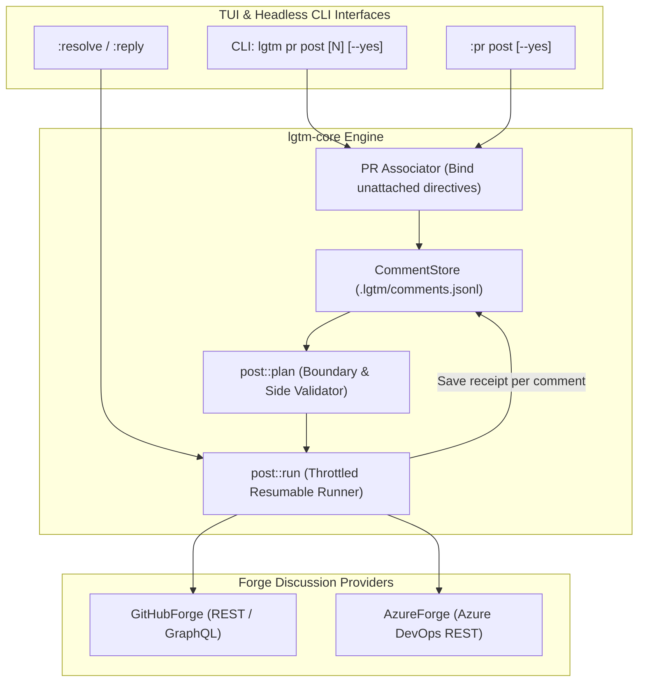
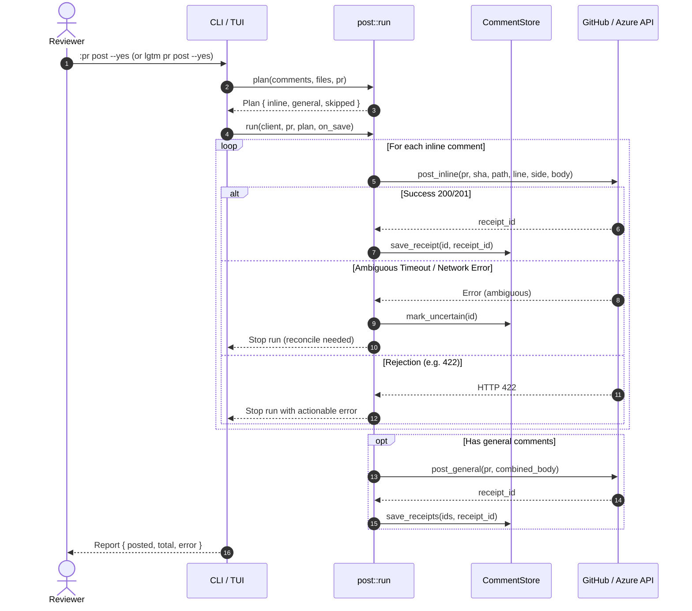

# Consolidated Comments Workflow (Design Document)

- **Date:** 2026-10-27
- **Status:** Approved / Specification Ready
- **Feature:** Consolidated Comments, Posting, Replying, and Resolving Workflow

---

## 1. Architectural Overview

The consolidated comments workflow provides an end-to-end bridge between offline local review directives and remote PR discussion threads. It standardizes comment planning, diff boundary checking, side calculation, dual-mode execution (CLI and TUI), and durable receipt storage.



---

## 2. Data Model Updates

### 2.1 Diff Side Tracking in `lgtm-core::comment`
```rust
#[derive(Debug, Clone, Copy, PartialEq, Eq, Serialize, Deserialize, Default)]
#[serde(rename_all = "UPPERCASE")]
pub enum CommentSide {
    #[default]
    Right,
    Left,
}

impl CommentSide {
    pub fn as_github_str(&self) -> &'static str {
        match self {
            Self::Right => "RIGHT",
            Self::Left => "LEFT",
        }
    }
}
```

### 2.2 Updating `CommentAnchor`
Add `side` field with serde default to maintain complete backward compatibility with existing `.lgtm/comments.jsonl` files:
```rust
pub struct CommentAnchor {
    #[serde(default)]
    pub id: String,
    pub file_path: String,
    pub target_line_no: u32,
    #[serde(default)]
    pub side: CommentSide,
    pub target_code: String,
    pub context_before: Vec<String>,
    pub context_after: Vec<String>,
    pub comment_text: String,
    #[serde(default)]
    pub replies: Vec<String>,
    pub created_at_turn: u64,
    pub is_resolved: bool,
    #[serde(default)]
    pub pr_number: Option<u64>,
    #[serde(default)]
    pub remote_id: Option<u64>,
    #[serde(default)]
    pub orphaned: bool,
    #[serde(default)]
    pub track: crate::outcome::Tracking,
}
```

### 2.3 Structured Planning Types in `lgtm-core::github::post`
```rust
#[derive(Debug, Clone, PartialEq, Eq)]
pub enum SkipReason {
    AlreadyPosted(u64),
    Resolved,
    RemoteUncertain,
    BelongsToOtherPr(u64),
    FileNotInPrDiff,
    Orphaned,
}

#[derive(Debug, Clone, PartialEq, Eq)]
pub struct SkippedComment {
    pub index: usize,
    pub comment_id: String,
    pub file_path: String,
    pub line: u32,
    pub reason: SkipReason,
}

#[derive(Debug, Clone, PartialEq, Eq)]
pub struct PlanItem {
    pub index: usize,
    pub comment_id: String,
    pub file_path: String,
    pub line: u32,
    pub side: CommentSide,
    pub preview: String,
}

#[derive(Debug, Default, PartialEq, Eq)]
pub struct Plan {
    pub inline: Vec<PlanItem>,
    pub general: Vec<PlanItem>,
    pub skipped: Vec<SkippedComment>,
}

impl Plan {
    pub fn total_to_post(&self) -> usize {
        self.inline.len() + self.general.len()
    }
}
```

---

## 3. Forge Trait & Provider Refactoring

### 3.1 `PrDiscussion` Trait Update
Update `post_inline` to accept `CommentSide`:
```rust
pub trait PrDiscussion {
    // ...
    fn post_inline(
        &self,
        pr: u64,
        sha: &str,
        path: &str,
        line: u32,
        side: CommentSide,
        body: &str,
    ) -> Result<u64>;
    // ...
}
```

### 3.2 GitHub Forge (`GitHubForge` & `GhClient`)
- In `post_inline`:
  ```rust
  let payload = serde_json::json!({
      "body": body,
      "commit_id": sha,
      "path": path,
      "line": line,
      "side": side.as_github_str()
  });
  ```
- Detailed HTTP 422 classification:
  If response body contains `"Unprocessable Entity"`, enrich the error with:
  `"GitHub API rejected inline comment on {path}:{line} ({side}): Line is outside PR diff hunks or side is invalid. Consider re-anchoring or posting as a general comment."`

### 3.3 Azure DevOps Forge (`AzureForge`)
- In `post_inline`:
  ```rust
  let pos = serde_json::json!({"line": line, "offset": 1});
  let ctx = match side {
      CommentSide::Left => serde_json::json!({
          "filePath": format!("/{path}"),
          "leftFileStart": pos,
          "leftFileEnd": pos,
      }),
      CommentSide::Right => serde_json::json!({
          "filePath": format!("/{path}"),
          "rightFileStart": pos,
          "rightFileEnd": pos,
      }),
  };
  self.new_thread(pr, body, Some(ctx))
  ```

---

## 4. Sequence Workflows

### 4.1 Resumable Batch Posting Sequence


---

## 5. CLI & TUI Command Architecture

### 5.1 CLI Clap Parsing
In `src/cli.rs`, structure `Commands::Pr` to support both direct number review and subcommands:
```rust
#[derive(clap::Subcommand, Debug)]
pub enum Commands {
    // ...
    /// Review pull requests or manage PR comment threads
    Pr {
        /// Target PR number (when opening review TUI directly)
        #[arg(value_name = "NUMBER")]
        number: Option<u64>,

        #[command(subcommand)]
        action: Option<PrSubcommand>,
    },
}

#[derive(clap::Subcommand, Debug)]
pub enum PrSubcommand {
    /// Post unposted local comments to PR
    Post {
        /// PR number (defaults to active/associated PR)
        #[arg(value_name = "PR")]
        pr: Option<u64>,
        /// Send without confirmation preview
        #[arg(long, short = 'y')]
        yes: bool,
    },
    /// Reply to a PR review thread
    Reply {
        thread_id: String,
        text: String,
        #[arg(long)]
        pr: Option<u64>,
        #[arg(long, short = 'y')]
        yes: bool,
    },
    /// Resolve a PR review thread
    Resolve {
        thread_id: String,
        #[arg(long)]
        pr: Option<u64>,
        #[arg(long, short = 'y')]
        yes: bool,
    },
}
```

### 5.2 Unified Resolution in TUI (`:resolve`)
When `:resolve` or `<Space>` is triggered:
```rust
pub fn resolve_cursor_or_index(&mut self, index: Option<usize>, confirmed: bool) {
    if let Some(thread_idx) = index.or_else(|| self.thread_at_cursor()) {
        // Targets remote thread
        let thread = &self.threads[thread_idx];
        if !confirmed {
            self.status_message = Some(format!(
                "Would resolve remote thread on {}:{}; append --yes to confirm",
                thread.path, thread.line.unwrap_or(0)
            ));
            return;
        }
        self.set_thread_resolved_async(self.pr.current_number.unwrap(), thread.id.clone(), true);
    } else if let Some(comment_idx) = index.or_else(|| self.comment_idx_at_cursor()) {
        // Targets local directive
        let is_res = self.comments[comment_idx].toggle_resolved();
        let _ = self.comment_store.save_comments(&self.comments);
        self.status_message = Some(if is_res {
            "✅ Directive marked resolved".into()
        } else {
            "💬 Directive marked active".into()
        });
    } else {
        self.status_message = Some("No thread or directive on current line".into());
    }
}
```

---

## 6. Error Handling & Remediation Strategy

| Error Condition | Root Cause | System Response | User Remediation |
|---|---|---|---|
| HTTP 422 Unprocessable Entity | Comment placed on line not included in diff patch or wrong side | Post aborted; prior receipts saved; comment marked with failed status | Suggest posting as general comment or moving anchor to adjacent modified line |
| HTTP 401 / 403 Forbidden | Missing or invalid auth token, or repository read-only token | Abort before sending further comments; retain all drafts | Prompt user to run `gh auth login` or export `GITHUB_TOKEN` |
| Ambiguous Timeout | Write request sent but connection dropped before receipt | Directive flagged `remote_uncertain = true`; save state | Instruct user to run `:threads` or `lgtm pr reconcile` |
| PR Not Found (404) | Invalid PR number or branch deleted | Abort plan; clear active PR association | Check active PR with `lgtm prs` |
| Unattached Directives | Comment written before PR opened | Automatically associate to PR if file matches diff | Included in dry-run preview with count |

---

## 7. Tradeoffs & Ponytail Justifications

1. **Explicit Confirmation (`--yes`)**:
   - *Alternative*: Post automatically when closing TUI or immediately on comment submit.
   - *Decision*: Strictly require `--yes` in CLI and preview in TUI. Avoids spamming remote PR reviews with incomplete or test directives.
2. **Batch General Comment for Off-Diff Lines**:
   - *Alternative*: Reject any comment whose line is not in the diff.
   - *Decision*: Consolidate all off-diff comments into a single general conversation comment. Reviewers frequently comment on architectural context adjacent to diff hunks.
3. **No Heavy Database**:
   - *Alternative*: Introduce SQLite or sled for comments state.
   - *Decision*: Stick to simple `.lgtm/comments.jsonl` with atomic rewrite. Fast, human-inspectable, zero extra dependencies.
