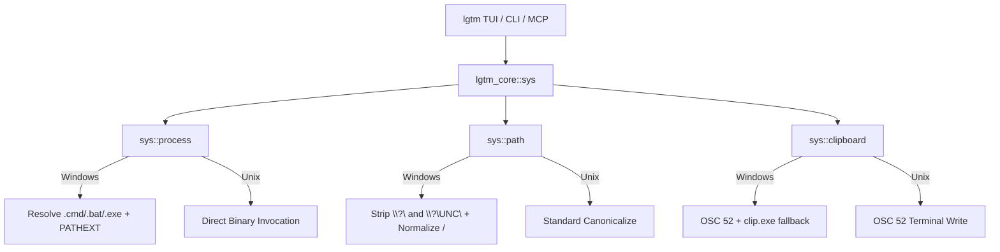

# Windows Native Support (Design Document)

- **Date:** 2026-10-29
- **Status:** Draft / Ready for Builder Review
- **Feature:** Windows Native Support & CI Automation

---

## 1. Intent & Problem Statement

`lgtm` is designed as a high-performance terminal diff reviewer and AI agent steering cockpit. Currently, Windows users face systemic issues when attempting to run `lgtm`:
- Batch wrapper commands (`az.cmd`, `code.cmd`) cannot be spawned directly via `std::process::Command::new` on Windows.
- Filesystem canonicalization produces verbatim UNC prefixes (`\\?\`) that break Git CLI interop and relative path calculations (`strip_prefix`).
- Git checkouts with `core.autocrlf = true` introduce `\r\n` line endings that destabilize hunk hashing and comment re-anchoring.
- Legacy console windows ignore OSC 52 clipboard sequences, breaking code and directive yanking.
- The CI pipeline lacks a Windows quality gate, and official releases omit Windows binary packages.

This design establishes a clean, decoupled OS abstraction layer in `lgtm-core::sys` that solves these platform discrepancies once, keeps UI and business logic platform-agnostic, and adds `windows-latest` to CI and release packaging.

---

## 2. Goals, Non-Goals, and Anti-Goals

### Goals
- **Clean OS Abstraction**: Centralize all OS-specific subprocess resolution, path canonicalization, and clipboard access in `crates/lgtm-core/src/sys/`.
- **Zero UI Leakage**: Ensure UI code, modal controllers, and command parsers remain 100% platform-agnostic.
- **Robust Command Execution**: Automatically resolve `.cmd` and `.bat` wrappers on Windows without requiring manual user path overrides.
- **Continuous Quality Gate**: Validate every commit against `windows-latest` alongside `ubuntu-latest` and `macos-latest`.
- **Portable Distribution**: Package and publish standalone `lgtm-v<VERSION>-windows-x86_64.zip` archives with SHA-256 checksums on every release.

### Non-Goals (YAGNI)
- No Win32 custom console render loops; rely on Crossterm's native Windows Virtual Terminal Processing (VT) implementation.
- No MSI/WiX installer pipelines; portable `.zip` archives meet developer needs.
- No third-party Windows clipboard crates that bring heavyweight dependencies; lightweight invocation of `%SystemRoot%\System32\clip.exe` satisfies all requirements.

### Anti-Goals
- Never leak `#[cfg(windows)]` conditionals into presentation or diff rendering components.
- Never alter on-disk files or Git index objects when normalizing line endings for in-memory diff comparison.

---

## 3. Architecture & OS Abstraction Layer

### 3.1 Module Structure (`crates/lgtm-core/src/sys/`)

The OS abstraction layer is positioned inside `crates/lgtm-core/src/sys/` and conditionally compiled or dispatched across platforms:

```text
crates/lgtm-core/src/sys/
├── mod.rs         // Re-exports sys APIs: process, path, clipboard
├── process.rs     // Cross-platform command resolution (PATHEXT, az.cmd, code.cmd)
├── path.rs        // Verbatim prefix removal (\\?\), Git slash normalization
└── clipboard.rs   // Tiered clipboard delivery (OSC 52 -> clip.exe -> PowerShell)
```



---

### 3.2 Process Execution & Resolver (`sys::process`)

On Windows, `std::process::Command::new("az")` fails because `CreateProcessW` requires the full binary name (`az.cmd`). The resolver probes extensions and resolves executables:

```rust
// crates/lgtm-core/src/sys/process.rs

use std::borrow::Cow;
use std::path::{Path, PathBuf};

/// Resolves an executable program name for the current operating system.
pub fn resolve_program<'a>(program: &'a str) -> Cow<'a, str> {
    #[cfg(target_os = "windows")]
    {
        resolve_windows_program(program)
    }
    #[cfg(not(target_os = "windows"))]
    {
        Cow::Borrowed(program)
    }
}

#[cfg(target_os = "windows")]
fn resolve_windows_program<'a>(program: &'a str) -> Cow<'a, str> {
    // If the program already contains an extension or directory separator, return as is
    if program.contains('.') || program.contains('\\') || program.contains('/') {
        return Cow::Borrowed(program);
    }

    // Fast-path lookup for known CLI utilities
    match program.to_ascii_lowercase().as_str() {
        "az" => return Cow::Borrowed("az.cmd"),
        "code" => return Cow::Borrowed("code.cmd"),
        "cursor" => return Cow::Borrowed("cursor.cmd"),
        _ => {}
    }

    // Probe PATHEXT if not in fast-path
    if let Ok(path_var) = std::env::var("PATH") {
        let pathext_var = std::env::var("PATHEXT").unwrap_or_else(|_| ".COM;.EXE;.BAT;.CMD".into());
        let extensions: Vec<&str> = pathext_var.split(';').filter(|e| !e.is_empty()).collect();

        for dir in std::env::split_paths(&path_var) {
            for ext in &extensions {
                let candidate = dir.join(format!("{}{}", program, ext.to_ascii_lowercase()));
                if candidate.is_file() {
                    return Cow::Owned(format!("{}{}", program, ext.to_ascii_lowercase()));
                }
            }
        }
    }

    Cow::Borrowed(program)
}

/// Helper to configure a Command instance with safe Windows process flags.
pub fn create_command(program: &str) -> std::process::Command {
    let resolved = resolve_program(program);
    let mut cmd = std::process::Command::new(resolved.as_ref());

    #[cfg(target_os = "windows")]
    {
        use std::os::windows::process::CommandExt;
        const CREATE_NO_WINDOW: u32 = 0x08000000;
        // Suppress console window popups for non-interactive helper utilities
        if program == "clip" || program == "powershell" {
            cmd.creation_flags(CREATE_NO_WINDOW);
        }
    }

    cmd
}
```

---

### 3.3 Path Sanitization & Normalization (`sys::path`)

When `std::fs::canonicalize()` executes on Windows, it returns paths prefixed with `\\?\` (e.g. `\\?\C:\repo` or `\\?\UNC\server\share`). The `sys::path` module strips verbatim prefixes cleanly and guarantees slash uniformity:

```rust
// crates/lgtm-core/src/sys/path.rs

use std::borrow::Cow;
use std::fs;
use std::io;
use std::path::{Component, Path, PathBuf, Prefix};

/// Canonicalizes a path and strips Windows verbatim extended-length prefixes.
pub fn canonicalize_clean<P: AsRef<Path>>(path: P) -> io::Result<PathBuf> {
    let canonical = fs::canonicalize(path)?;
    Ok(strip_verbatim_prefix(canonical))
}

/// Strips `\\?\` and `\\?\UNC\` prefixes from a PathBuf.
pub fn strip_verbatim_prefix(path: PathBuf) -> PathBuf {
    #[cfg(target_os = "windows")]
    {
        let mut components = path.components();
        match components.next() {
            Some(Component::Prefix(prefix_component)) => {
                match prefix_component.kind() {
                    Prefix::Verbatim(disk) => {
                        let mut cleaned = PathBuf::from(format!("{}:", disk.to_ascii_uppercase() as char));
                        cleaned.extend(components);
                        cleaned
                    }
                    Prefix::VerbatimDisk(disk) => {
                        let mut cleaned = PathBuf::from(format!("{}:", disk as char));
                        cleaned.extend(components);
                        cleaned
                    }
                    Prefix::VerbatimUNC(server, share) => {
                        let mut cleaned = PathBuf::from(format!(r"\\{}\{}", server.to_string_lossy(), share.to_string_lossy()));
                        cleaned.extend(components);
                        cleaned
                    }
                    _ => path,
                }
            }
            _ => path,
        }
    }
    #[cfg(not(target_os = "windows"))]
    {
        path
    }
}

/// Normalizes path to use forward slashes (/) for deterministic Git indexing and comment references.
pub fn normalize_git_path(path: &Path) -> String {
    let s = path.to_string_lossy();
    if s.contains('\\') {
        s.replace('\\', "/")
    } else {
        s.into_owned()
    }
}
```

---

### 3.4 Tiered Clipboard Delivery (`sys::clipboard`)

Clipboard delivery uses a three-tier resilience strategy:
1. ANSI OSC 52 sequence to standard output.
2. If on Windows, pipe UTF-8 text to `clip.exe`.
3. If `clip.exe` fails, pipe to PowerShell `Set-Clipboard`.

```rust
// crates/lgtm-core/src/sys/clipboard.rs

use std::io::{self, Write};
use crate::ipc::base64_encode;

pub fn copy_to_clipboard(text: &str) -> io::Result<()> {
    // 1. Emit OSC 52 sequence to stdout (works in Windows Terminal, WezTerm, Alacritty)
    let b64 = base64_encode(text.as_bytes());
    let osc_sequence = format!("\x1b]52;c;{}\x07", b64);
    let mut stdout = io::stdout();
    let _ = stdout.write_all(osc_sequence.as_bytes());
    let _ = stdout.flush();

    // 2. On Windows, pipe to native clip.exe as fallback for conhost / CMD
    #[cfg(target_os = "windows")]
    {
        if let Err(e) = copy_via_clip_exe(text) {
            // 3. Secondary fallback to PowerShell
            let _ = copy_via_powershell(text);
        }
    }

    Ok(())
}

#[cfg(target_os = "windows")]
fn copy_via_clip_exe(text: &str) -> io::Result<()> {
    use std::os::windows::process::CommandExt;
    const CREATE_NO_WINDOW: u32 = 0x08000000;

    let mut child = std::process::Command::new("clip.exe")
        .stdin(std::process::Stdio::piped())
        .stdout(std::process::Stdio::null())
        .stderr(std::process::Stdio::null())
        .creation_flags(CREATE_NO_WINDOW)
        .spawn()?;

    if let Some(mut stdin) = child.stdin.take() {
        stdin.write_all(text.as_bytes())?;
        stdin.flush()?;
    }

    let status = child.wait()?;
    if status.success() {
        Ok(())
    } else {
        Err(io::Error::new(io::ErrorKind::Other, "clip.exe failed"))
    }
}

#[cfg(target_os = "windows")]
fn copy_via_powershell(text: &str) -> io::Result<()> {
    use std::os::windows::process::CommandExt;
    const CREATE_NO_WINDOW: u32 = 0x08000000;

    let mut child = std::process::Command::new("powershell.exe")
        .args(["-NoProfile", "-NonInteractive", "-Command", "Set-Clipboard -Value $input"])
        .stdin(std::process::Stdio::piped())
        .stdout(std::process::Stdio::null())
        .stderr(std::process::Stdio::null())
        .creation_flags(CREATE_NO_WINDOW)
        .spawn()?;

    if let Some(mut stdin) = child.stdin.take() {
        stdin.write_all(text.as_bytes())?;
        stdin.flush()?;
    }

    let status = child.wait()?;
    if status.success() {
        Ok(())
    } else {
        Err(io::Error::new(io::ErrorKind::Other, "powershell Set-Clipboard failed"))
    }
}
```

---

### 3.5 Line Ending Invariance (CRLF Normalization)

Diff parsers and hashing algorithms are updated to strictly strip trailing `\r` and `\n`:

```rust
// Unified Diff Parser (crates/lgtm-core/src/pr/mod.rs)
let line_content = raw_line.strip_prefix(' ').unwrap_or(raw_line);
let normalized_content = line_content.trim_end_matches(['\r', '\n']);

// Git2 Diff Callback (crates/lgtm-core/src/git/mod.rs)
let line_content = String::from_utf8_lossy(line_cb.content())
    .trim_end_matches(['\r', '\n'])
    .to_string();
```

---

## 4. GitHub Actions CI/CD Workflow Updates

### 4.1 Matrix Update (`.github/workflows/ci.yml`)

Add `windows-latest` to the `quality-gate` matrix strategy:

```yaml
jobs:
  quality-gate:
    name: Quality Gate & Test Coverage (${{ matrix.os }})
    runs-on: ${{ matrix.os }}
    strategy:
      fail-fast: false
      matrix:
        os: [ubuntu-latest, macos-latest, windows-latest]

    steps:
      - name: Checkout Repository
        uses: actions/checkout@v4
        with:
          fetch-depth: 0

      - name: Install Rust Toolchain
        uses: dtolnay/rust-toolchain@stable
        with:
          components: rustfmt, clippy

      - name: Cache Cargo Dependencies
        uses: Swatinem/rust-cache@v2

      - name: Check Formatting
        shell: bash
        run: cargo fmt --all -- --check

      - name: Run Clippy Linter
        shell: bash
        run: cargo clippy --workspace --all-targets --all-features -- -D warnings

      - name: Check Crate Boundaries
        shell: bash
        run: bash ./scripts/check-boundaries.sh

      - name: Run Unit & Integration Tests
        shell: bash
        run: cargo test --workspace --verbose -- --nocapture

      - name: Build Optimized Release Binary
        shell: bash
        run: cargo build --release

      - name: Package Release Binary (Unix)
        if: matrix.os != 'windows-latest'
        shell: bash
        run: |
          VERSION=$(grep '^version =' Cargo.toml | head -1 | cut -d '"' -f2)
          ARCH=$(uname -m)
          OS_NAME=$(uname -s | tr '[:upper:]' '[:lower:]')
          TAR_NAME="lgtm-v${VERSION}-${OS_NAME}-${ARCH}.tar.gz"
          tar -czf "$TAR_NAME" -C target/release lgtm
          shasum -a 256 "$TAR_NAME" > "${TAR_NAME}.sha256"

      - name: Package Release Binary (Windows)
        if: matrix.os == 'windows-latest'
        shell: bash
        run: |
          VERSION=$(grep '^version =' Cargo.toml | head -1 | cut -d '"' -f2)
          ZIP_NAME="lgtm-v${VERSION}-windows-x86_64.zip"
          powershell -Command "Compress-Archive -Path target/release/lgtm.exe -DestinationPath $ZIP_NAME -Force"
          powershell -Command "(Get-FileHash -Algorithm SHA256 $ZIP_NAME).Hash.ToLower() + '  ' + '$ZIP_NAME'" > "${ZIP_NAME}.sha256"

      - name: Upload Release Asset Artifact
        uses: actions/upload-artifact@v4
        with:
          name: lgtm-${{ matrix.os }}-bundle
          path: |
            lgtm-*.tar.gz
            lgtm-*.zip
            lgtm-*.sha256
          retention-days: 7
```

---

## 5. BDD Acceptance Criteria

### Feature: Windows Platform Support

```gherkin
Feature: Windows Platform Support & Tool Interoperability
  As a developer running lgtm on Windows
  I want commands, paths, line endings, and clipboard operations to function seamlessly
  So that I have feature parity with Unix environments.

  Scenario: Resolving Azure CLI batch file on Windows
    Given the operating system is Windows
    And the Azure CLI executable exists as "az.cmd" in the system PATH
    When lgtm resolves the program "az"
    Then the resolved executable name is "az.cmd"
    And executing the command returns the Azure DevOps authentication token without error

  Scenario: Resolving VS Code batch file on Windows
    Given the operating system is Windows
    And VS Code exists as "code.cmd" in the system PATH
    When lgtm triggers the external editor for "code"
    Then the resolved executable name is "code.cmd"
    And the process launches successfully

  Scenario: Stripping extended-length path prefix
    Given a Windows path canonicalized by std::fs to "\\?\C:\Users\tester\repo"
    When canonicalize_clean is invoked on the path
    Then the resulting path is "C:\Users\tester\repo"
    And stripping the repo prefix from "C:\Users\tester\repo\src\main.rs" returns "src\main.rs"

  Scenario: Stripping extended-length UNC path prefix
    Given a Windows UNC path canonicalized to "\\?\UNC\fileserver\shared\repo"
    When canonicalize_clean is invoked on the path
    Then the resulting path is "\\fileserver\shared\repo"

  Scenario: Copying reference to clipboard via clip.exe
    Given lgtm is running in a Windows terminal without OSC 52 terminal support
    When the user yanks reference "#ref src/lib.rs:15"
    Then lgtm pipes the reference text to "clip.exe"
    And the Windows system clipboard contains "#ref src/lib.rs:15"

  Scenario: CRLF line ending invariance in diff hashing
    Given a unified diff file with CRLF ("\r\n") line endings
    And an identical unified diff file with LF ("\n") line endings
    When lgtm computes hunk hashes for both diff streams
    Then both hunk hashes evaluate to the exact same 64-bit integer
```
