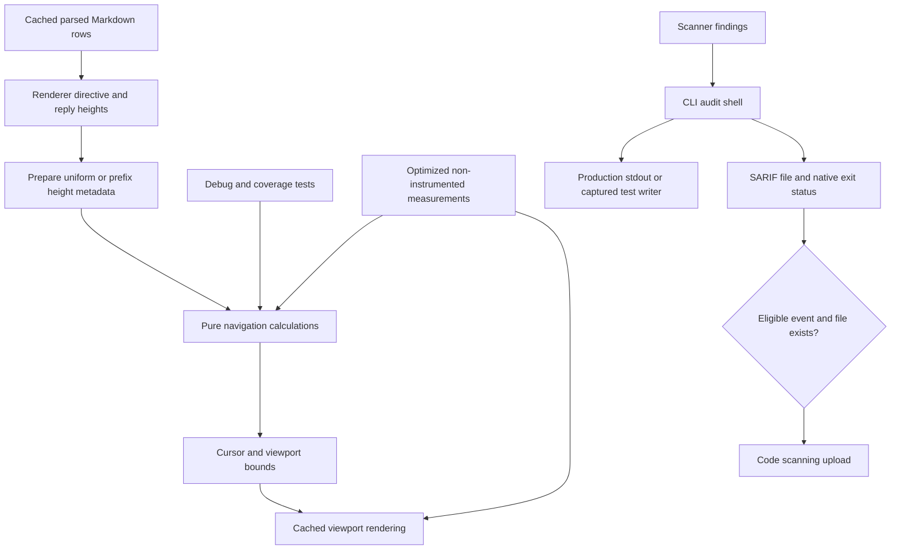

# Architecture & Technical Design

## 1. Overview & Invariants

Separate deterministic preview behavior from machine-dependent measurements, optimize cached navigation, and make CI output accurately describe the failing gate. Changes stay in the application crate, its tests, workflow, and documentation; no core behavior or release version changes.

- Ordinary and instrumented suites retain parsing, navigation, directive, and layout assertions.
- Timing budgets remain strict in an explicitly selected optimized, non-instrumented suite.
- Navigation preserves existing row-based offsets, source-line attribution, and directive/reply accounting.
- Cached parsed rows and their span buffers are not recreated by navigation.
- A scanner finding or tool failure remains a failure, whether or not SARIF is uploaded.
- Synthetic annotations are captured as data, never forwarded as active workflow commands.

The user's `k` approved proceeding from Gate 2 to design. Human gate checkboxes remain untouched. Existing unkeyed Markdown performance requirements remain authoritative: the new keyed delta requirements supplement them without renaming or weakening them.

## 2. Domain Models, State & Interface Contracts

### Navigation metadata

Keep `MarkdownPreviewState` as the navigation owner. Add prepared height metadata with two representations:

- **Uniform**: row count and a common height of one, including the empty-metadata fallback.
- **Expanded**: positive row heights and cumulative screen-line totals, with one prefix entry per row boundary.

Use a single height replacement/preparation method rather than permitting renderer assignments to leave the index stale. Audit existing struct literals and direct height mutations and update dependent callers together. Treat missing heights as one, matching current behavior; normalize unusable zero heights to one. Clear or replace metadata when rendered rows change.

Uniform `max_scroll`, visible bounds, and cursor visibility use saturating arithmetic in O(1). Expanded calculations use prefix differences and binary searches in O(log n), eliminating repeated overlapping sums. Preserve the current full-row fit behavior, including retaining the first row when it exceeds the viewport; do not silently switch to a different partial-row visibility rule. Empty rows use cursor/offset zero, and zero-height viewports have explicit, bounded behavior.

The renderer prepares metadata after computing current directive/reply heights and before clamping the viewport. It does not cache comment identity or introduce a separate revision counter: rebuilding height metadata on each existing height refresh is sufficient for coherence. Preparation is O(n), outside navigation timing. Future renderer-wide caching is out of scope.

### Measurement selection

Add an opt-in `perf-budgets` Cargo feature for the application crate's dedicated budget tests. The default tests retain deterministic assertions; enabling the feature adds measurement cases rather than removing behavioral cases. Budget tests reject debug builds. The CI measurement command uses release mode, a separate target directory, and no coverage instrumentation or inherited Rust coverage flags.

Before execution, list the selected tests and require the expected named cases; a zero-match selector fails. Use the same explicit selection locally and on all three CI platforms. No benchmark dependency is needed.

Measurement policy:

- Prepare a mixed 5,000-line document and renderer-representative uniform/expanded heights outside navigation timing.
- Warm each workload, then take seven samples; report the median sample's per-operation elapsed time and all sample values.
- Scroll forward and backward within the document so every timed operation moves state; include cursor moves and top/bottom navigation as separate workloads.
- Use `std::hint::black_box` for inputs and consume final cursor/offset and parsed/rendered results; fixture setup, reset, and diagnostics remain outside timing.
- Measure parsing and cached rendering separately. Rendering uses an in-memory Ratatui test backend with existing cached rows, not terminal/network I/O.
- Print workload, release mode, sample count, operation count, statistic, measured value, and budget. Median reporting mitigates scheduling outliers without increasing limits.

### Scanner output boundary

Keep the public CLI-facing `run_ci_audit` signature and exit semantics. Introduce a private writer-taking implementation for its stdout output, including annotations and report messages. The CLI wrapper supplies real stdout; synthetic audit tests supply an in-memory byte buffer and verify annotations there. Keep annotation formatting and provider precedence unchanged, including GitHub environment detection and explicit formats.

Captured subprocess tests must not print raw workflow-command lines on success or failure; assertion diagnostics quote/escape captured text. Do not mutate shared CI environment variables in parallel tests or globally disable production annotations. Filesystem report writes remain fallible and preserve their errors.

### SARIF workflow contract

Retain generation eligibility and native scanner exit status. Upload uses the existing `always()`, Ubuntu, and non-PR conditions plus report-file existence. Thus generation skipped by an upstream failure produces no missing-path upload error, while a written report from a blocking scanner remains eligible. Do not use `continue-on-error` to turn scanner errors into success or manufacture empty reports.

## 3. Architecture Diagram & Data Flow

## 4. Boundary Rules & Budgets

- **Pure Core vs. I/O Shell**: Navigation calculations and annotation formatting remain deterministic application helpers. Terminal rendering, writer output, filesystem reports, and workflow orchestration remain shell concerns. `lgtm-core` gains no I/O, framework, or network coupling.
- **Concurrency**: No new threads or asynchronous state. Metadata replacement completes before navigation consumes it. Tests capture output per invocation rather than changing process-global stdout/environment.
- **Latency**: `NFR-MDPERF-1` requires scrolling below 1 microsecond per operation, parsing/wrapping 5,000 lines below 50 ms, and cached rendering below 16 ms. Enforce them in release measurements on Ubuntu, macOS, and Windows; debug/coverage results are correctness evidence only.
- **Resources**: Uniform navigation needs no prefix allocation; expanded metadata costs O(n) integers and is prepared outside input handling. Preserve the existing rendered-memory ceiling of 10 times raw text, accounting for added metadata. Allocation checks distinguish navigation's zero new line buffers from the renderer's existing viewport construction.

### Rejected alternatives

- Raise timing thresholds or remove coverage: masks the regression and violates the selected requirements.
- Treat only empty height metadata as uniform: misses the populated state produced by normal rendering.
- Scan the viewport or repeatedly sum ranges for every key: leaves the hot path dependent on visible/document size.
- Add a tree-based dynamic index or comment revision system: unnecessary when the renderer already refreshes all heights.
- Merely remove `--nocapture`: failing tests and subprocess diagnostics can still emit workflow commands.
- Disable GitHub annotations globally in tests or swallow scanner exit codes: weakens real CLI coverage and hides genuine failures.

## 5. Testing Strategy

1. **BDD Scenarios**: Map tests to both delta specs: populated uniform navigation, expanded directives/replies, resize/rebuild, empty/zero viewport, measurement selection, missing versus available SARIF, captured fixture annotations, and genuine CLI annotations. Establish failing regressions before implementation.
2. **Unit Tests (>= 95% coverage)**: Target changed navigation/output logic for at least 95% line and branch coverage, while retaining the workspace CI's existing 90% line gate. Compare optimized bounds against a small reference implementation across representative height sequences and viewport sizes. Cover tall rows, missing metadata, boundaries, cursor jumps, and metadata replacement. Verify row/span buffers remain stable across navigation. Writer tests assert formatted annotations and native finding/error status; real CLI subprocess tests capture output. Coverage percentages are validation targets, not claims already achieved.
3. **Mutation Testing (100% kill)**: No `lgtm-core` logic changes are planned, so its required mutation scope is unchanged. If implementation touches core logic, require 100% kill for that changed scope before acceptance. For application navigation, strengthen tests against off-by-one inequalities, stale indexes, and omitted clamping; do not claim a mutation result without running it.

Run focused tests and formatting/Clippy first, then workspace behavior and coverage once integrated. Exercise report generation with clean, blocking, and invalid-output cases; inspect eligible upload conditions against missing/present files without publishing synthetic data. Record exact commands and results in implementation evidence. Local macOS performance does not establish Linux/Windows success: all matrix gates must provide evidence before claiming the original CI failure resolved.

## Review Gate

- [ ] **Gate 3 Approval**: Architecture & design reviewed and approved by human before task breakdown.
