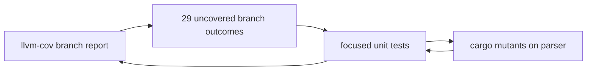

# Architecture & Technical Design

## 1. Overview & Invariants
Test-only change to `src/app/markdown.rs`. Production code and rendered output stay byte-identical; only `#[cfg(test)]` code and docs change.

## 2. Domain Models, State & Interface Contracts
Tests call the existing `build_markdown_preview(&FileDiff, width)` and `MarkdownPreviewState`, using the `make_test_file_diff` helper. Each case builds a few `DiffLine`s and asserts on `rendered_rows` (text, style, source line).

## 3. Architecture Diagram & Data Flow

## 4. Boundary Rules & Budgets
- **Pure Core vs. I/O Shell**: the parser is pure presentation in the `lgtm` crate; tests add no I/O.
- **Concurrency, Latency & Resource Budgets**: existing `NFR-MDPERF-1` budgets and tests are untouched; new tests are small and add negligible suite time.

## 5. Testing Strategy
1. **BDD Scenarios**: one scenario in `tests/bdd/features/markdown_preview.feature` tagged `REQ-MDCOV-1` and `NFR-MDCOV-1` (also satisfies the traceability check).
2. **Unit Tests (>= 95% coverage)**: list uncovered outcomes from `cargo +nightly llvm-cov -p lgtm --bin lgtm --branch --text`, group by construct, add one test per group, remeasure. Measurement policy: nightly toolchain, `-p lgtm --bin lgtm`, `app/markdown.rs` row, each source location once.
3. **Mutation Testing (100% kill)**: `cargo mutants -p lgtm --file src/app/markdown.rs`; kill survivors with stronger assertions, delete dead code only in a separate change, and record equivalent mutants in `tasks.md` evidence.

## Review Gate
- [x] **Gate 3 Approval**: Architecture & design reviewed and approved by human before task breakdown, approved by the user on 2026-11-02.
