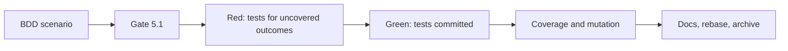

# Tasks

## 1. Dependency DAG

## 2. Streams & Worktrees
| Stream | Worktree Path | Branch | Prerequisite |
| :--- | :--- | :--- | :--- |
| main | `.` | `feat/markdown-parser-coverage` | none (single stream; one file) |

## 3. Slice 1: Parser coverage

- [x] 3.1 BDD scenario tagged `REQ-MDCOV-1` / `NFR-MDCOV-1` in `tests/bdd/features/markdown_preview.feature` (verify: `.feature` committed)
- [x] 3.2 Gate 5.1 human sign-off on BDD scenarios (approved by the user on 2026-11-02, "tick n go")
- [x] 3.3 Red: add tests for the 29 uncovered branch outcomes; no production change, so Red means the new assertions are first run against the baseline report to confirm they hit the listed gaps (verify: before/after branch counts shown). Evidence: `cargo +nightly llvm-cov -p lgtm --bin lgtm --branch` branches 137/166 before, 162/166 after the first 8 tests
- [x] 3.4 Green: tests committed, full suite passes and production code is unchanged (verify: `git diff` limited to `#[cfg(test)]`, docs and openspec). Evidence: `cargo test -p lgtm --bin lgtm` 380 passed, 0 failed
- [x] 3.5 Coverage >= 95% line and branch on `src/app/markdown.rs` and mutation 100% kill (verify: llvm-cov and cargo-mutants). Evidence: llvm-cov app/markdown.rs 99.73% lines, 98.19% branches (163/166; 3 unreachable: `!contains('*')` at the italic check, `!chunk.is_empty()` and final `!current_line.is_empty()` in wrap_text); `cargo mutants -p lgtm --file src/app/markdown.rs` 222 mutants, 0 non-equivalent survivors; equivalent: `i + 1`/`1 + end_rel` slice bounds at the italic check (x2) and `>` to `>=` on the word-length check in wrap_text
- [x] 3.6 Document the measurement command in `docs/WIKI.md` and add a `CHANGELOG.md` entry (verify: diff)

## 4. Integration & Rebase Plan
- [x] 4.1 Rebase on develop, re-verify rails (`spec-rails-check`, `openspec validate --all`), `openspec archive`

## Review Gate
- [x] **Gate 4 Approval**: Tasks breakdown approved by human before writing test code, approved by the user on 2026-11-02.
