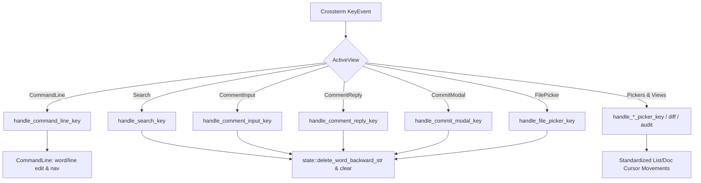

# Architecture & Technical Design

## 1. Overview & Invariants
This design introduces universal text editing primitives in `src/app/state.rs` and normalizes keyboard navigation across all views in `src/app/input.rs`.

Key Invariants:
1. **Zero Modifier Leakage**: No key combination with `KeyModifiers::CONTROL` or `KeyModifiers::ALT` may trigger character entry (`self.input.push(c)`).
2. **Deterministic Word Boundaries**: Word deletion backward removes trailing whitespace, then removes a contiguous sequence of alphanumeric/underscore characters OR contiguous punctuation, identically across all text inputs.
3. **Non-Breaking Navigation**: All existing navigation mappings (`j`/`k`, `Down`/`Up`, `PageDown`/`PageUp`) are preserved; new universal mappings (`Ctrl-n`/`Ctrl-p`, `Ctrl-d`/`Ctrl-u`, `Ctrl-f`/`Ctrl-b`, `Home`/`End`) strictly expand navigation capabilities.

## 2. Domain Models, State & Interface Contracts

### Shared Text Helper Functions (`src/app/state.rs`)
```rust
pub fn delete_word_backward_at(input: &mut String, cursor: usize) -> usize;
pub fn delete_word_backward_str(s: &mut String);
```

### CommandLine Extensions (`src/app/state.rs`)
```rust
impl CommandLine {
    pub fn move_word_backward(&mut self);
    pub fn move_word_forward(&mut self);
    pub fn delete_word_forward(&mut self);
}
```

### View Event Mapping Matrix (`src/app/input.rs`)

| Action | Modal Pickers (`FilePicker`, `PanePicker`, `CommentList`, `ThreadView`, `PrPicker`, `WorktreePicker`) | Document Views (`Diff`, `MarkdownPreview`, `AuditReport`) | Single-Line Text Fields (`Search`, `CommentInput`, `CommentReply`, `CommitModal`, `CommandLine`) |
| :--- | :--- | :--- | :--- |
| **Down / Next** | `Down`, `j`*, `Ctrl-n`, `Ctrl-j` | `Down`, `j` | `Down` (history/completions) |
| **Up / Prev** | `Up`, `k`*, `Ctrl-p`, `Ctrl-k` | `Up`, `k` | `Up` (history/completions) |
| **Page Down** | `PageDown`, `Ctrl-d`, `Ctrl-f` | `PageDown`, `Ctrl-d`, `Ctrl-f` | N/A |
| **Page Up** | `PageUp`, `Ctrl-u`, `Ctrl-b` | `PageUp`, `Ctrl-u`, `Ctrl-b` | N/A |
| **Top / Home** | `Home`, `g`* | `Home`, `gg` / `g`, `0`, `^` | `Home`, `Ctrl-a` |
| **Bottom / End** | `End`, `G`* | `End`, `G`, `$` | `End`, `Ctrl-e` |
| **Delete Word** | `Ctrl-w`, `Alt-Backspace`, `Ctrl-Backspace` (query) | N/A | `Ctrl-w`, `Alt-Backspace`, `Ctrl-Backspace` (backward); `Alt-d` (forward) |
| **Delete Line** | N/A | N/A | `Ctrl-u` (to start / clear), `Ctrl-k` (to end / clear) |
| **Dismiss** | `Esc`, `q`*, `Ctrl-c` | `q` (diff quit) | `Esc`, `Ctrl-c` |

*\* Note: Letter keys `j`, `k`, `g`, `G`, `q` are enabled only on views without raw text filtering.*

## 3. Architecture Diagram & Data Flow



## 4. Boundary Rules & Budgets
- **Pure Core vs. I/O Shell**: String manipulation and cursor calculations live purely in `src/app/state.rs`. No I/O or system calls.
- **Input Handling**: Key handlers perform in-memory input/state processing only and do not perform blocking I/O. No fixed per-keystroke latency threshold is imposed.

## 5. Testing Strategy
1. **Unit Tests in `src/app/state.rs`**:
   - `delete_word_backward_str` covering trailing spaces, alphanumeric tokens, symbols, empty strings, and UTF-8 characters.
   - `move_word_backward`, `move_word_forward`, and `delete_word_forward` on `CommandLine`.
2. **Integration Tests in `src/app/input.rs`**:
   - Word & line deletion in `Search`, `CommentInput`, `CommentReply`, `CommitModal`, and `FilePicker`.
   - Modifier protection verifying `Ctrl-w`, `Ctrl-u`, `Ctrl-c` do NOT insert literal characters.
   - Universal navigation tests across `WorktreePicker`, `PanePicker`, `CommentList`, `ThreadView`, `PrPicker`, `AuditReport`, `MarkdownPreview`, and `Diff`.

## Review Gate
- [x] **Gate 3 Approval**: Architecture and design approved by the user on 2026-11-01.
