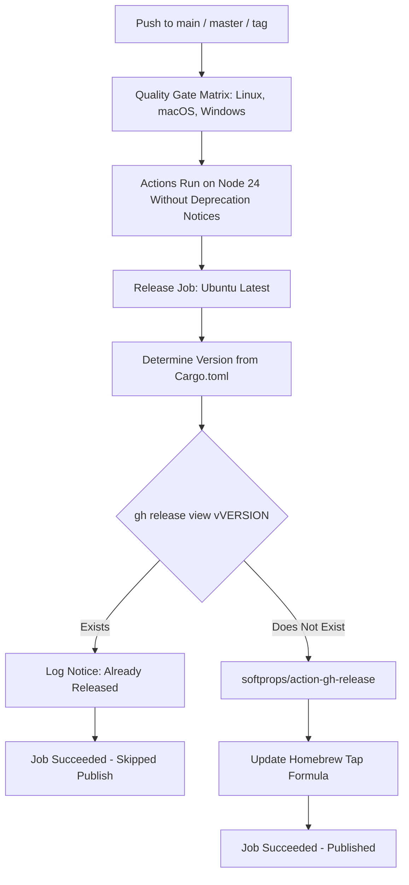

# Architecture & Technical Design

## 1. Overview & Invariants
- **Context**: In `.github/workflows/ci.yml`, the `release` job runs on push to `main` or version tags. Workflow jobs across Linux, macOS, and Windows also invoke checkout, artifact management, and toolchain actions currently triggering Node 20 deprecation warnings and tracking Ubuntu 26 runner migration.
- **Key Invariants**:
  - `release_exists == true` MUST bypass asset upload and Homebrew tap update steps without failing the job.
  - Releases MUST only be published when tag `v${VERSION}` does not exist.
  - Action dependency bumps MUST preserve all existing action parameters and inputs without breaking backward compatibility.
  - Zero changes to Rust crates; `lgtm_core` remains pure and unaffected.

## 2. Domain Models, State & Interface Contracts

### 2.1 Release Job Idempotency
- **Step ID**: `check_release`
- **Output**: `exists` (`'true'` | `'false'`)
- **Evaluation Command**:
  ```bash
  VERSION="${{ steps.get_version.outputs.VERSION }}"
  TAG="v${VERSION}"
  if gh release view "$TAG" >/dev/null 2>&1; then
    echo "exists=true" >> "$GITHUB_OUTPUT"
    echo "Release $TAG already exists on GitHub. Skipping release assets & Homebrew formula update."
  else
    echo "exists=false" >> "$GITHUB_OUTPUT"
    echo "Release $TAG does not exist. Proceeding with publication."
  fi
  ```
- **Conditional Guard**:
  - `Create / Update GitHub Release`: `if: steps.check_release.outputs.exists != 'true'`
  - `Update Homebrew Tap Formula`: `if: success() && steps.check_release.outputs.exists != 'true'`

### 2.2 Action Upgrades & Deprecation Remediation
Audit and update action versions in `.github/workflows/ci.yml` and sibling workflows:
- `actions/checkout`: verify latest release (e.g. `actions/checkout@v4.2.2` or newer) targeting Node 24 runtime.
- `actions/upload-artifact` & `actions/download-artifact`: audit latest v4 patches supporting Node 24.
- `softprops/action-gh-release`: audit latest v2 release tags supporting Node 24.
- Validate `ACTIONS_RUNNER_FORCE_ACTIONS_NODE_VERSION: "node24"` environment variable necessity and clean execution.

### 2.3 Runner OS Migration Readiness
- Retain `ubuntu-latest` label with explicit tracking of actions/runner-images#14748.
- Verify packages, toolchain installations (`cargo`, `dtolnay/rust-toolchain`, `llvm-cov`), and shell utilities execute with zero reliance on Ubuntu-deprecated apt packages.

### Rejected Alternatives
- **Tag-Only Workflow**: Rejected because maintainers currently rely on trunk pushes to auto-release when `Cargo.toml` is bumped. Forcing manual git tag pushes would alter existing release operational procedures.
- **Overwriting via GitHub API token with elevated admin permissions**: Rejected because release asset immutability is an organization/repo security policy to prevent supply chain tampering.
- **Pinning Legacy Node 20 Runner**: Rejected because GitHub is deprecating Node 20 runner execution, making native Node 24 alignment mandatory.

## 3. Architecture Diagram & Data Flow



## 4. Boundary Rules & Budgets
- **Pure Core vs. I/O Shell**: Workflow change only. No changes to `lgtm_core`, `lgtm-ast`, or CLI code. `lgtm_core` remains completely free of network, I/O, or GitHub dependencies.
- **Concurrency, Latency & Resource Budgets**: The `gh release view` check completes in < 1 second. When skipped, avoids downloading ~100MB of release artifacts and eliminates runner execution time.

## 5. Testing Strategy
1. **BDD Scenarios**:
   - Scenario 1: Re-running CI on an existing release tag outputs `exists=true` and cleanly skips release upload.
   - Scenario 2: Action steps run without emitting runtime deprecation warnings.
   - Scenario 3: Quality gate runs on latest runner matrix definitions cleanly.
2. **Unit & Workflow Verification**:
   - Validate workflow YAML syntax with schema/action linters.
   - Test step shell snippet locally or via dry-run script.
3. **Mutation Testing**:
   - N/A for workflow YAML. Core Rust crates are untouched, maintaining 100% mutant kill rate.

## Review Gate
- [ ] **Gate 3 Approval**: Architecture & design reviewed and approved by human before task breakdown.
