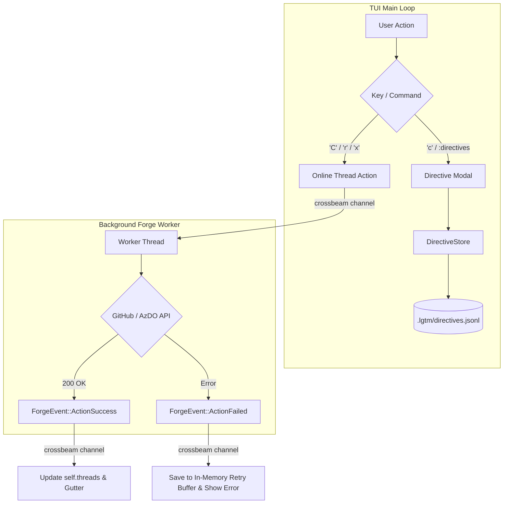

# Architecture & Technical Design

## 1. Overview & Invariants
- **Context**: Decouples local agent directives (`.lgtm/directives.jsonl`) from remote forge PR reviews (GitHub / Azure DevOps).
- **Key Invariants**:
  - Directives MUST NEVER require an active PR or perform network I/O.
  - Comments MUST NEVER write drafts to local disk (`.lgtm/drafts/` is eliminated).
  - All forge HTTP calls MUST execute asynchronously off the TUI main loop.
  - Hot-path budgets (< 1us keystroke, < 16ms frame) MUST be preserved.
  - `lgtm_core` remains free of direct network or framework dependencies.

## 2. Domain Models, State & Interface Contracts

### 2.1 Directive Subsystem (`crates/lgtm-core/src/directive/`)
- Rename module `crates/lgtm-core/src/comment/` → `crates/lgtm-core/src/directive/`.
- **Domain Models**:
  ```rust
  pub struct Directive {
      pub id: String,
      pub path: PathBuf,
      pub line_number: Option<u32>,
      pub old_line_number: Option<u32>,
      pub text: String,
      pub is_resolved: bool,
      pub created_at: String,
  }

  pub struct DirectiveStore {
      file_path: PathBuf, // .lgtm/directives.jsonl
  }
  ```
- **Static Scan Alert Ingestion**:
  ```rust
  impl Directive {
      pub fn from_guard_alert(alert: &GuardAlert) -> Self {
          Self {
              id: new_id(),
              file_path: PathBuf::from(&alert.file_path),
              line_no: alert.line_no,
              text: format!("[{}] {}: {}", alert.severity.label(), alert.title, alert.description),
              rule_id: Some(alert.rule_id.clone()),
              is_resolved: false,
              created_at: now_utc(),
          }
      }
  }
  ```
- **TUI State**: `self.directives: Vec<Directive>`, `ActiveView::DirectiveInput`, `ActiveView::DirectiveList`.

### 2.2 Online PR Discussion Subsystem
- **Direct Dispatch Architecture**:
  Remove `src/app/drafts.rs` and `crates/lgtm-core/src/discussion/store.rs`. Replace with immediate forge actions:
  ```rust
  pub enum ForgeAction {
      PostInline { pr: u64, sha: String, path: String, line: u32, side: CommentSide, body: String },
      Reply { pr: u64, thread_id: String, comment_id: u64, body: String },
      SetResolved { pr: u64, thread_id: String, resolved: bool },
  }

  pub enum ForgeEvent {
      ActionSuccess { action: ForgeAction, thread: Option<Thread> },
      ActionFailed { action: ForgeAction, error: String },
  }
  ```
- **In-Memory Retry Buffer**:
  ```rust
  pub struct CommentRetryBuffer {
      pub path: String,
      pub line: u32,
      pub side: CommentSide,
      pub body: String,
      pub target_thread_id: Option<String>,
  }
  ```

### Rejected Alternatives
- **In-Memory Batch Review Modal**: Rejected because requiring a secondary `:thread submit` step is confusing when working with live PR threads.
- **Local SQLite Cache for Drafts**: Rejected as excessive over-engineering; git forges are already the source of truth for online PR discussions.

## 3. Architecture Diagram & Data Flow



## 4. Boundary Rules & Budgets
- **Pure Core vs. I/O Shell**:
  - `crates/lgtm-core` contains pure directive models and forge interface traits (`PrDiscussion`).
  - Network operations and filesystem storage are contained within `src/app/` background workers and storage drivers.
- **Concurrency & Latency Budgets**:
  - Keystroke latency remains < 1us.
  - TUI frame rendering remains < 16ms; network latency never blocks the UI thread.
  - Zero disk I/O when creating or submitting PR comments.

## 5. Testing Strategy
1. **BDD Scenarios**:
   - Verify offline directive addition and MCP export.
   - Verify online thread post, reply, and resolution with mocked forge server.
   - Verify network failure populates in-memory retry buffer without writing disk files.
2. **Unit Tests (>= 95% line & branch coverage)**:
   - Full test coverage for `DirectiveStore` and `Directive` serialization.
   - Channel worker and retry buffer unit tests.
3. **Mutation Testing (100% kill score)**:
   - 100% kill rate on `lgtm-core::directive`.

## Review Gate
- [ ] **Gate 3 Approval**: Architecture & design reviewed and approved by human before task breakdown.
