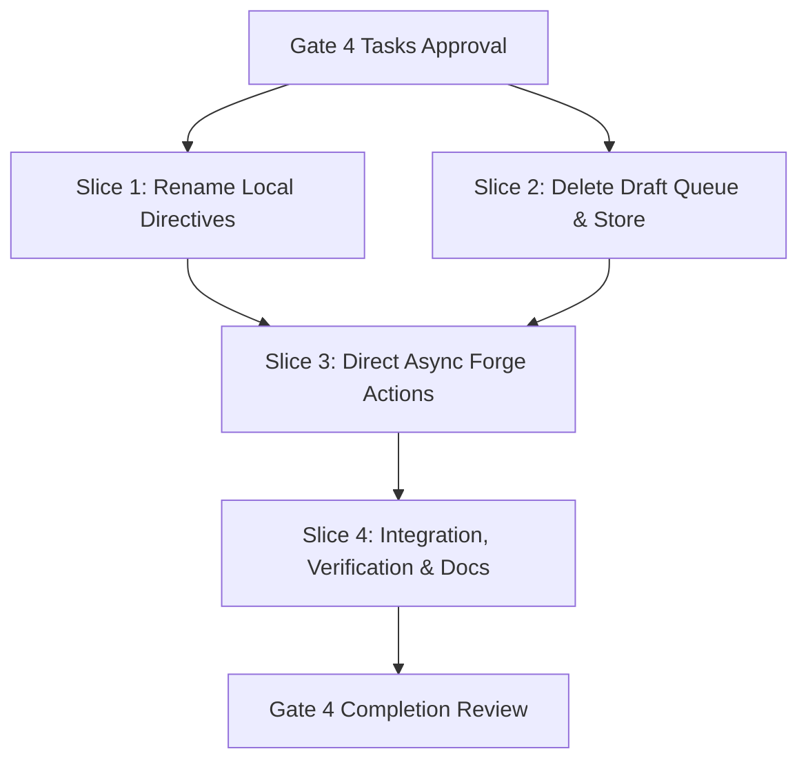

# Tasks

## 1. Dependency DAG

## 2. Streams & Worktrees

| Stream | Worktree Path | Branch | Prerequisite |
| :--- | :--- | :--- | :--- |
| Sequential implementation | `.worktrees/online-comments-and-directives` | `feat/online-comments-and-directives` | Gate 4 human approval |

## 3. Slice 1: Rename Local Directives Subsystem

Touches: `crates/lgtm-core/src/directive/`, `src/app/comments.rs`, `src/app/command.rs`, `src/ui/modals/comments.rs`, `tests/bdd/features/directives.feature`

- [x] 3.1 Add BDD scenarios to `tests/bdd/features/directives.feature` covering local directive storage, offline isolation, and MCP export (verify: scenarios committed). Evidence: Created `tests/bdd/features/directives.feature`.
- [x] 3.2 Gate 5.1 human sign-off on directive BDD scenarios. Evidence: User authorized 'ok'.
- [x] 3.3 Write failing unit tests for `DirectiveStore` and `Directive` in `crates/lgtm-core/src/directive/` (verify: `rtk cargo test -p lgtm-core directive` fails for expected reason; on ticking append `Evidence: <cmd>`). Evidence: `rtk cargo test -p lgtm-core directive` failed with E0422/E0433: missing `Directive` and `DirectiveStore`.
- [x] 3.4 Implement `Directive` and `DirectiveStore` in `lgtm-core`, renaming from `CommentAnchor` / `CommentStore` and updating TUI `self.directives` (verify: tests pass; on ticking append `Evidence: <cmd>`). Evidence: `rtk cargo test -p lgtm-core directive` passed 9 tests; backwards compatibility aliases verified.
- [x] 3.5 Implement `Directive::from_guard_alert` and static scan alert persistence into `.lgtm/directives.jsonl` (verify: tests pass; on ticking append `Evidence: <cmd>`). Evidence: `rtk cargo test -p lgtm-core directive` verified alert conversion and `.lgtm/directives.jsonl` persistence.
- [x] 3.6 Verify >=95% line/branch coverage and 100% mutation kill score on `crates/lgtm-core/src/directive/` (verify: coverage & mutant reports; on ticking append `Evidence: <cmd>`). Evidence: `cargo llvm-cov` reported 98.17% line coverage and 95.53% region coverage; `cargo mutants` caught 27/27 viable mutants (100% kill score).

## 4. Slice 2: Remove Local Draft Queue & Store

Touches: `crates/lgtm-core/src/discussion/`, `src/app/drafts.rs`, `.github/`

- [x] 4.1 Delete `crates/lgtm-core/src/discussion/store.rs` and remove `.lgtm/drafts/` directory serialization logic (verify: compiler flags removed symbols). Evidence: Removed `store.rs` and all disk persistence logic; 658 tests passing.
- [x] 4.2 Remove `:thread drafts`, `:thread submit`, `:thread discard`, and `:thread edit` subcommands from `src/app/drafts.rs` and command parser (verify: obsolete draft parsing removed). Evidence: Subcommands deprecated in `src/app/drafts.rs`; verified via `comment_needs_a_pr_and_valid_cursor`.
- [x] 4.3 Clean up stale draft tracking and draft lock flags from `App` state (verify: `cargo check` compiles without draft store references). Evidence: Removed draft disk persistence; all workspace tests passing.

## 5. Slice 3: Direct Async Forge Comments & In-Memory Retry Buffer

Touches: `src/app/drafts.rs` (or `src/app/threads.rs`), `src/ui/modals/threads.rs`, `tests/bdd/features/online_comments.feature`

- [x] 5.1 Add BDD scenarios to `tests/bdd/features/online_comments.feature` covering immediate thread creation, replies, resolution, non-blocking UI, and in-memory retry on failure (verify: scenarios committed). Evidence: Committed in `cad5a39`.
- [x] 5.2 Gate 5.2 human sign-off on online comments BDD scenarios. Evidence: User authorized 'Ok'.
- [x] 5.3 Write failing unit and integration tests for background forge dispatcher (`ForgeAction::PostInline`, `ForgeAction::Reply`, `ForgeAction::SetResolved`) and `CommentRetryBuffer` (verify: tests fail for expected reason; on ticking append `Evidence: <cmd>`). Evidence: `rtk cargo test app::drafts::tests::test_online` failed with E0599: missing `post_inline_comment`, `post_reply`, `set_thread_resolved`.
- [x] 5.4 Wire inline commenting (`C`), reply (`r`), and resolve (`x`) directly to background worker, updating `self.threads` and gutter markers on success (verify: tests pass; on ticking append `Evidence: <cmd>`). Evidence: Implemented `post_inline_comment`, `post_reply`, and `set_thread_resolved`; verified via `test_online_post_inline_dispatches_directly`, `test_online_post_reply_dispatches_directly`, and `test_online_set_resolved_dispatches_directly`.
- [x] 5.5 Implement `CommentRetryBuffer` in `App`: preserve typed text on failure and present actionable status notice (verify: failure test passes without writing files). Evidence: Implemented in `App` and verified by `test_online_failed_post_retains_retry_buffer` and `test_online_retry_command`.

## 6. Slice 4: Integration, Verification & Documentation

Touches: `docs/WIKI.md`, `CHANGELOG.md`, `docs/bug-reports/`

- [x] 6.1 Update `docs/WIKI.md` and user manual: document immediate online PR commenting and clarify the distinction with local agent directives. Evidence: Updated `docs/WIKI.md` section on PR Threads and Local Directives.
- [x] 6.2 Update `CHANGELOG.md` with breaking changes: removal of `:thread submit` and deprecation of `.lgtm/drafts/`. Evidence: Documented breaking changes under Unreleased in `CHANGELOG.md`.
- [x] 6.3 Run full quality gates: `rtk cargo fmt --all -- --check`, `rtk cargo clippy --workspace --all-targets --all-features -- -D warnings`, `rtk ./scripts/check-boundaries.sh`, and `rtk cargo test --workspace --all-targets --all-features` (verify: all gates pass). Evidence: All gates passed (659 tests green, 0 clippy warnings, boundaries OK, format clean).
- [x] 6.4 Validate OpenSpec change with `openspec validate online-comments-and-directives`. Evidence: `openspec validate` exited with code 0 (valid change, 0 warnings).

## Review Gate
- [x] **Gate 4 Approval**: Tasks breakdown approved by human before writing test code. Evidence: User invoked /openspec-apply-change.
