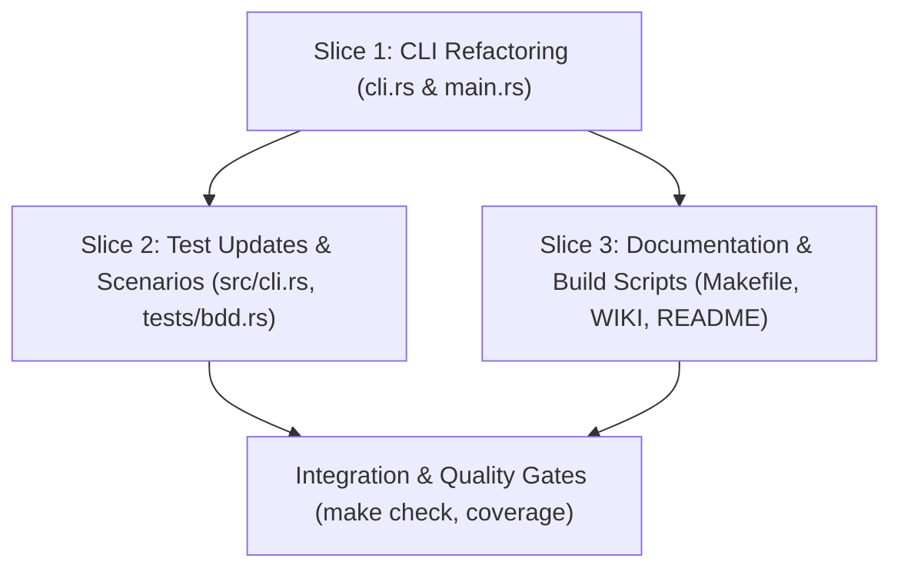

# Tasks

## 1. Dependency DAG

## 2. Streams & Worktrees
| Stream | Worktree Path | Branch | Prerequisite |
| :--- | :--- | :--- | :--- |
| `cli-consolidation` | `.worktrees/cli-cleanup` | `feat/cli-command-cleanup` | None |

## 3. Slice 1: CLI Definition & Dispatch Refactoring

- [x] 3.1 Red unit tests in `src/cli.rs` failing on removed subcommands and flags (`serve`, `prs`, `status`, `ci`, `--init`, `--pr`) (verify: `cargo test --bin lgtm cli::tests`)
- [x] 3.2 Purge `Commands::Serve`, `Commands::Prs`, `Commands::Status`, `Commands::Ci` from `src/cli.rs` and `src/main.rs` (verify: compiler flags missing arms)
- [x] 3.3 Remove top-level `--init` and `--pr` flags from `Cli` struct in `src/cli.rs` and update `main.rs` initialization checks (verify: `cargo check`)
- [x] 3.4 Require explicit action (`export` or `import`) on `Commands::Review` (verify: `lgtm review` fails with usage string)
- [x] 3.5 Fold `Commands::Risk` into `Commands::Check` or redirect to canonical diff audit (verify: `lgtm check` handles diff auditing)
- [x] 3.6 Green unit tests in `src/cli.rs` (verify: `cargo test --bin lgtm cli::tests`)

## 4. Slice 2: Integration & BDD Scenario Updates

- [x] 4.1 Update BDD scenario `bdd_cli_010` in `tests/bdd.rs` to use `lgtm init [--repo <path>]` instead of `--init` (verify: `cargo test --test bdd bdd_cli_010`)
- [x] 4.2 Update `docs/bdd-scenarios.md` to reflect `lgtm init` command usage (verify: doc entry matches code)
- [x] 4.3 Ensure all existing CLI and BDD test suites pass cleanly (verify: `cargo test`)

## 5. Slice 3: Build Scripts & Documentation

- [x] 5.1 Update `Makefile` targets (`ci:`, `risk:`) to invoke canonical `lgtm check` (verify: `make ci` and `make risk` succeed)
- [x] 5.2 Update `README.md` and `docs/WIKI.md` to remove all references to `lgtm serve --mcp`, `lgtm prs`, and `lgtm status` (verify: ripgrep finds no obsolete command mentions)
- [x] 5.3 Update `CHANGELOG.md` with breaking CLI changes and migration notes (verify: notes added under unreleased)

## 6. Integration & Final Verification

- [x] 6.1 Run full quality check: `make check` (fmt + clippy + tests)
- [x] 6.2 Verify line coverage gate >= 90%: `make coverage` (achieved: 93.80%)
- [ ] 6.3 Sync delta spec and archive change: `openspec sync clean-commands-shortcuts`

## Review Gate
- [x] **Gate 4 Approval**: Tasks breakdown approved by human before writing test code.
