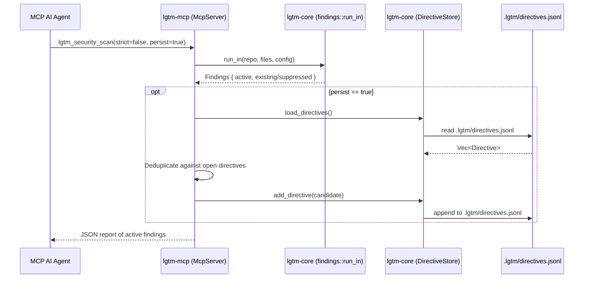

# Architecture & Technical Design

## 1. Overview & Invariants
- **Purpose**: Enable MCP agents calling `lgtm_security_scan` with `persist: true` to persist active findings into `.lgtm/directives.jsonl` while preventing duplicate open directives and respecting baseline suppressions.
- **Key Invariants**:
  - `persist: false` (default) preserves pure read-only scanning behavior with zero disk mutations.
  - `lgtm-core` remains free of direct file I/O; `DirectiveStore` handles local `.lgtm/directives.jsonl` persistence.
  - Active findings are pre-filtered against the repository baseline by `lgtm_core::findings::run_in`.
  - Existing open/unresolved directives with matching `(file_path, target_line_no, comment_text)` are deduplicated so subsequent scan calls are idempotent.

## 2. Domain Models, State & Interface Contracts

### MCP Tool Schema Extension (`crates/lgtm-mcp/src/lib.rs`)
```json
{
  "name": "lgtm_security_scan",
  "description": "Run AST and regex static analysis guardrails for OWASP security vulnerabilities, hardcoded secrets, cognitive complexity spikes, test neutering, and typo hallucinations.",
  "inputSchema": {
    "type": "object",
    "properties": {
      "strict": {
        "type": "boolean",
        "description": "Flag only Critical and High severity alerts if true."
      },
      "persist": {
        "type": "boolean",
        "description": "Persist active findings as review directives in .lgtm/directives.jsonl if true."
      }
    }
  }
}
```

### Handler Logic Flow (`crates/lgtm-mcp/src/lib.rs`)
```rust
"lgtm_security_scan" => {
    let alerts = self.active_findings()?;
    let strict = args.get("strict").and_then(|s| s.as_bool()).unwrap_or(false);
    let persist = args.get("persist").and_then(|p| p.as_bool()).unwrap_or(false);

    let filtered: Vec<_> = if strict {
        alerts.into_iter().filter(|a| matches!(a.severity, lgtm_core::guard::Severity::Critical | lgtm_core::guard::Severity::High)).collect()
    } else {
        alerts
    };

    if persist {
        let store = self.store();
        let existing = store.load_directives();
        for alert in &filtered {
            let candidate = lgtm_core::directive::Directive::from_guard_alert(alert);
            let already_open = existing.iter().any(|d| {
                !d.is_resolved
                    && d.file_path == candidate.file_path
                    && d.target_line_no == candidate.target_line_no
                    && d.comment_text == candidate.comment_text
            });
            if !already_open {
                store.add_directive(&candidate)?;
            }
        }
    }

    let report = serde_json::to_string_pretty(&filtered)?;
    Ok(report)
}
```

### Rejected Alternatives
- **Alternative 1: Dedicated MCP tool (`lgtm_persist_security_scan`)**: Rejected because it doubles tool definitions, increases LLM context overhead, and separates scanning from remediation triggering without ergonomic benefit.
- **Alternative 2: Auto-resolving directives when alerts disappear**: Rejected as YAGNI and dangerous; directives require human or agent resolution confirmation via `toggle_resolved` or `lgtm_directive_status`.

## 3. Architecture Diagram & Data Flow



## 4. Boundary Rules & Budgets
- **Pure Core vs. I/O Shell**: `lgtm-core` conversion functions (`Directive::from_guard_alert`) remain pure with zero external dependencies. File writes are contained in `DirectiveStore` within `.lgtm/directives.jsonl`.
- **Latency & Resource Budgets**: Directives file is line-delimited JSON (`.jsonl`). Reading and appending open directives adds < 5ms even for large repositories, well within MCP tool execution SLAs (< 200ms).

## 5. Testing Strategy
1. **BDD Scenarios**:
   - `REQ-DIR-4; Scenario: Guard scan populates directives` verified in integration tests.
   - MCP client querying `lgtm_list_directives` and `lgtm_directive_status` reflects persisted scan directives.
2. **Unit Tests (`crates/lgtm-mcp/src/lib.rs`)**:
   - `test_security_scan_persist_creates_directives`: Verify `persist: true` populates `.lgtm/directives.jsonl`.
   - `test_security_scan_persist_idempotency`: Verify calling scan with `persist: true` twice does not duplicate directives.
   - `test_security_scan_baseline_suppression_not_persisted`: Verify baseline findings remain suppressed and unpersisted.
   - Coverage: maintain >= 95% line coverage in `crates/lgtm-mcp`.
3. **Mutation Testing**:
   - Verify 100% mutant kill rate across `lgtm-core` directive modules.

## Review Gate
- [x] **Gate 3 Approval**: Architecture & design approved by user.
