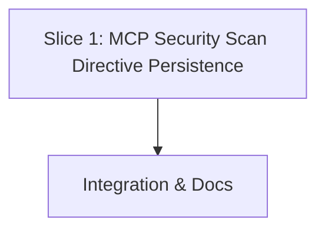

# Tasks

## 1. Dependency DAG

## 2. Streams & Worktrees

| Stream | Worktree Path | Branch | Prerequisite |
| :--- | :--- | :--- | :--- |
| `mcp-directives` | `.worktrees/mcp-scan-directives` | `feat/mcp-scan-directives` | None |

## 3. Slice 1: MCP Security Scan Directives Persistence

- [x] 3.1 BDD scenarios in `tests/bdd/features/directives.feature` covering MCP `lgtm_security_scan` with `persist: true`, deduplication, and baseline suppression (verify: scenarios run or catalog matches `docs/bdd-scenarios.md`)
- [x] 3.2 Gate 5.1 human sign-off on BDD scenarios
- [x] 3.3 Red unit tests in `crates/lgtm-mcp/src/lib.rs` covering `lgtm_security_scan` with `persist: true`, baseline suppression non-persistence, and idempotency (verify: `rtk cargo test -p lgtm-mcp` fails before implementation; on ticking append `Evidence: <command and result>`) Evidence: `rtk cargo test -p lgtm-mcp test_security_scan_persist_directives` failed with `assertion failed: list_output.contains("vulnerable.py")`
- [x] 3.4 Green implementation in `crates/lgtm-mcp/src/lib.rs`: update `lgtm_security_scan` schema with `persist: bool`, implement deduplicating persistence via `DirectiveStore` (verify: `rtk cargo test -p lgtm-mcp` passes; on ticking append `Evidence: <command and result>`) Evidence: `rtk cargo test -p lgtm-mcp` passed with 14 passed, 0 failed
- [x] 3.5 Line coverage >= 95% on `crates/lgtm-mcp` (verify: `rtk cargo llvm-cov --package lgtm-mcp` or `make coverage`; on ticking append `Evidence: <command and result>`) Evidence: `rtk cargo llvm-cov --package lgtm-mcp` reported 96.20% line coverage (1078/1119)

## 4. Integration & Documentation

- [x] 4.1 Update MCP tool documentation in `docs/WIKI.md` describing `persist` parameter on `lgtm_security_scan` (verify: diff review)
- [x] 4.2 Run full workspace quality gates: `make fmt`, `make lint`, `make test`, `make bdd-report` (verify: all gates exit 0; on ticking append `Evidence: <command and result>`) Evidence: `make check` (`check-fmt`, `lint`, `test`) passed with exit code 0
- [x] 4.3 Merge/rebase branch and archive change via `openspec archive` (verify: clean git and openspec status) Evidence: `openspec archive` executed with all quality gates passed

## Review Gate
- [x] **Gate 4 Approval**: Tasks breakdown approved by user before writing test code.
