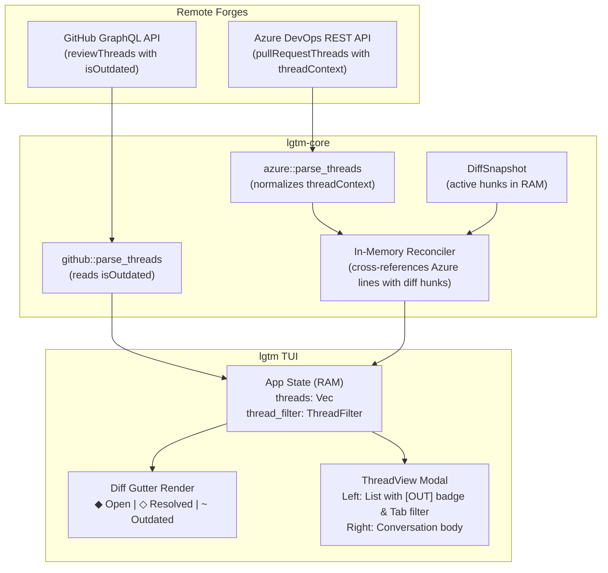

# Architecture & Technical Design

## 1. Overview & Invariants
This design introduces first-class detection and TUI visualization for obsolete/outdated PR review threads, unifies remote discussion behavior across GitHub and Azure DevOps without local disk storage, cleans up the `:thread` command namespace, and purges superseded draft-queue code.

### Core Invariants
1. **Zero Disk Storage**: Remote review threads, replies, resolutions, and outdated states live purely in RAM during the TUI session.
2. **Pure Domain Logic**: Thread parsing, marker classification, and diff reconciliation remain pure. Existing forge adapters in `lgtm-core` perform transport I/O; this change adds no local PR persistence.
3. **Hot-Path Budgets**: Keystroke latency < 1µs; diff reconciliation and gutter marker mapping on diff reload < 1ms; frame rendering budget < 16ms.

## 2. Domain Models, State & Interface Contracts

### Domain Model Updates (`crates/lgtm-core/src/github/mod.rs`)
```rust
#[derive(Debug, Clone, PartialEq, Eq)]
pub struct Thread {
    pub id: String,
    pub path: String,
    pub line: Option<u32>,
    pub resolved: bool,
    pub outdated: bool, // New in-memory flag
    pub comments: Vec<ThreadComment>,
}

#[derive(Debug, Clone, Copy, PartialEq, Eq)]
pub enum ThreadMarkerKind {
    Open,
    Resolved,
    Outdated,
}

pub fn thread_marker(threads: &[Thread], path: &str, line: u32) -> Option<ThreadMarkerKind> {
    let here: Vec<&Thread> = threads
        .iter()
        .filter(|t| t.path == path && t.line == Some(line))
        .collect();
    if here.is_empty() {
        return None;
    }
    if here.iter().any(|t| t.outdated && !t.resolved) {
        Some(ThreadMarkerKind::Outdated)
    } else if here.iter().any(|t| !t.resolved) {
        Some(ThreadMarkerKind::Open)
    } else {
        Some(ThreadMarkerKind::Resolved)
    }
}
```

### UI Modal State (`src/app/comments.rs` / `src/app/mod.rs`)
```rust
#[derive(Debug, Clone, Copy, PartialEq, Eq, Default)]
pub enum ThreadFilter {
    #[default]
    All,
    Open,
    Outdated,
}
```

## 3. Architecture Diagram & Data Flow



## 4. Boundary Rules & Budgets
- **Pure Core vs. I/O Shell**:
  - `crates/lgtm-core`: Parses GraphQL/JSON responses into `Thread` structs with `outdated: bool`. `thread_marker` is a pure function.
  - `src/app/` (Shell): Asynchronously queries forges via `spawn_job`, holds in-memory `threads`, cycles `thread_filter`, and renders TUI.
- **Performance Budgets**:
  - Gutter rendering uses the cached per-file annotation index rather than scanning threads per visible line.
  - Outdated navigation uses the existing diff-row cache's sorted `(new_line, raw_row)` mapping and binary searches only outdated, unresolved threads. Thread state is read live; the row mapping is invalidated with diff content and file selection.
  - `outdated_thread_performance_budgets` measures 100 threads over 1,000 diff lines at 120x40 in a release build: reconciliation plus cold gutter indexing (<1ms), cold full-frame rendering (<16ms), and full-handler Tab/o and final T navigation keystrokes (<1µs). Each result is the median of seven samples after one warm-up; key timings average repeated events within each sample. Navigation measures the final T separately from the cheap chord prefix. Setup and network are outside measurement.

## 5. Architecture Decisions & Alternatives Rejected (ADR)

### ADR 1: Native Server `isOutdated` vs Client-Only Line Matching
- **Decision**: Query native `isOutdated` on GitHub; use in-memory diff hunk matching on Azure DevOps.
- **Why**: GitHub computes rebase line shifts server-side that client regex cannot reliably reproduce without full commit histories.
- **Alternatives Rejected**:
  - *Client-Only Matching*: Fails on GitHub PRs where lines shift across commits without conflicts.
  - *Multi-Iteration Azure REST*: Rejected due to high network latency (>2s) and rate-limit penalties.

### ADR 2: Complete Purge of Legacy Draft Queue
- **Decision**: Completely delete `crates/lgtm-core/src/discussion/` (`DraftSet`, `Draft`, etc.), `App.drafts`, and `submit_confirm`.
- **Why**: Comments dispatch online directly with in-memory retry; keeping dead draft machinery causes confusion and violates YAGNI.
- **Alternatives Rejected**:
  - *Retaining Stubs*: Keeping `DraftSet` with empty vectors adds maintenance debt and misleading dead code paths.

### ADR 3: Explicit Local Directive and Remote Thread Commands
- **Decision**: Bare `:reply`, `:resolve`, and `:unresolve` act only on local directives; remote thread actions use the explicit `:thread` namespace.
- **Why**: Cursor-dependent command routing makes the same command silently target local or remote state, obscuring the distinction between `:directives` and PR discussions.
- **Alternatives Rejected**:
  - *Polymorphic Routing*: Retains ambiguous behavior based on whichever object happens to occupy the cursor line.

## 6. Testing Strategy

1. **BDD Scenarios (`crates/lgtm-core/tests/bdd.rs`)**:
   - `bdd_core_008_provider_threads_show_equivalent_status_and_outdated_markers` verifies that both GitHub (`isOutdated: true`) and Azure DevOps (line outside diff hunks) map to `outdated: true` and produce `ThreadMarkerKind::Outdated`; catalog entry: `bdd_core_008` in `docs/bdd-scenarios.md`.

2. **Unit Tests (>= 95% coverage)**:
   - `crates/lgtm-core/src/github/tests.rs`: Test GraphQL parsing of `isOutdated`.
   - `crates/lgtm-core/src/forge/azure.rs`: Test thread reconciliation against `DiffSnapshot`.
   - `src/app/drafts.rs`: Test `:threads [open|outdated|all]` command parsing and navigation.
   - `src/app/command.rs`: Verify bare directive commands never dispatch to a remote thread on the same line.
   - `src/ui/modals/threads.rs`: Test `Tab`/`o` filter cycling and `[⚠ Outdated]` badge rendering.

3. **Mutation Testing (100% kill)**:
   - Full-module mutation pass on `crates/lgtm-core/src/github/mod.rs` and `crates/lgtm-core/src/forge/azure.rs`, including parsing and marker classification. Focused outdated-condition runs alone do not satisfy task 3.5.
   - Measure at least 95% line and branch coverage on these modified provider modules in a single fresh branch-instrumented run. Report whole-core coverage separately, without claiming that it meets the module gate.

### Executable Scenario References
- Filter cycling: `thread_view_filter_cycles_all_open_outdated`, `src/app/input.rs`.
- Forward/backward navigation: `bracket_capital_t_jumps_between_outdated_threads`, `src/app/input.rs`; resolved/current-line exclusion: `outdated_thread_jump_skips_current_and_resolved_threads`, `src/app/motion.rs`.
- Absent-line header fallback: `outdated_thread_enter_jumps_to_file_header_when_line_is_gone`, `src/app/input.rs`.
- Yellow gutter marker: `outdated_threads_render_the_yellow_gutter_marker`, `src/ui/diff/regression.rs`.

### Performance Acceptance
   - Run `cargo test --release --features perf-budgets --bin lgtm outdated_thread_performance_budgets -- --nocapture`; mapping is recorded under `NFR-COM-1` in `docs/bdd-scenarios.md`.

## Review Gate
- [x] **Gate 3 Approval**: Architecture & design reviewed and approved by human.
