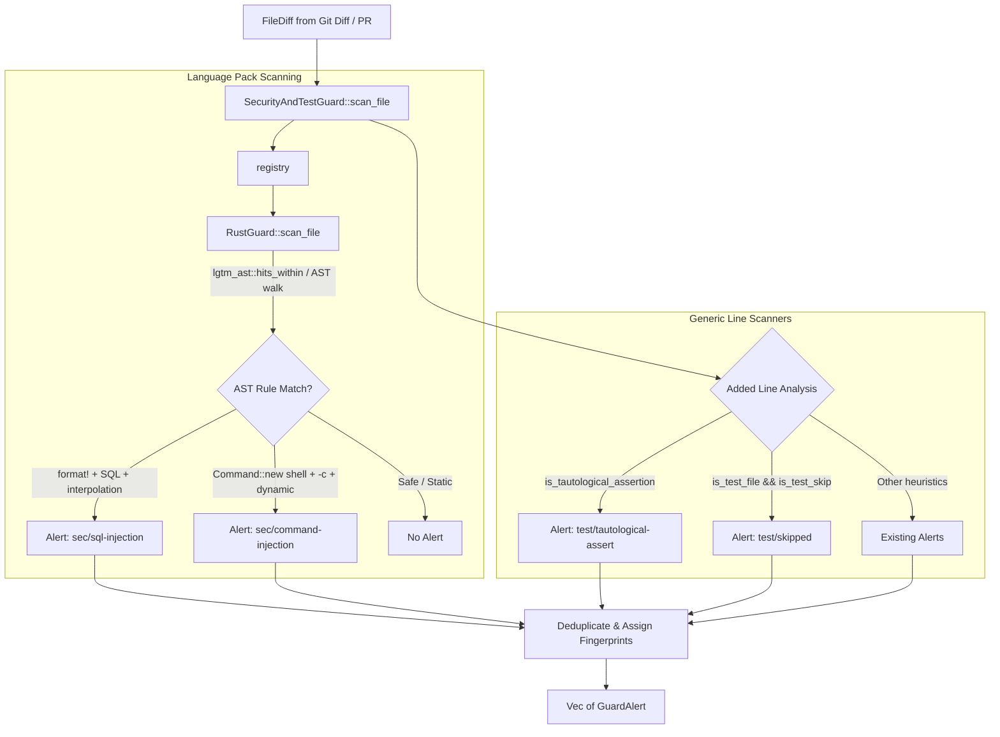

# Architecture & Technical Design

## 1. Overview & Invariants

This change introduces static AST analysis and semantic test fraud detection for Rust source code in `lgtm-core`. It addresses the gaps reported in Issue #82 where `format!`-based SQL queries, `Command::new("sh").arg("-c")` command injections, and inline tautological test assertions escaped detection in Rust files (`src/*.rs`).

### Key Invariants
1. **Generic Rule IDs**: Findings must use canonical, language-agnostic rule identifiers (`sec/sql-injection`, `sec/command-injection`, and `test/tautological-assert`) to maintain parity across MCP consumers and CI summary reports.
2. **Pure Core In-Memory Processing**: All AST inspection and semantic checks execute 100% in memory on `FileDiff` hunks using `lgtm-ast` (`tree-sitter-rust`). No subprocesses, external linters, or filesystem reads are permitted.
3. **Zero False Positives on Idiomatic Rust**:
   - Parameterized SQL (e.g., `sqlx::query("SELECT ... $1").bind(...)`) must never be flagged as SQL injection.
   - Direct process execution (e.g., `Command::new("git").arg("status")`) or literal shell commands must never be flagged as command injection.
   - Legitimate test assertions (e.g., `assert!(ready)`, `assert_eq!(actual, expected)`) must never be flagged as tautological assertions.
4. **Path-Agnostic Tautological Detection**: `assert!(true)`, `assert!(1 == 1)`, and `assert_eq!(x, x)` must be flagged regardless of whether the file path contains `"test"`, ensuring inline tests (`#[test]`) inside `src/*.rs` are properly audited.

---

## 2. Domain Models, State & Interface Contracts

### Rust Guard Pack (`crates/lgtm-core/src/guard/rust.rs`)
`RustGuard` implements the standard `Guard` trait:

```rust
pub struct RustGuard;

impl Guard for RustGuard {
    fn scan_file(&self, file: &FileDiff) -> Vec<GuardAlert>;
}
```

Registered into the central guard registry in `crates/lgtm-core/src/guard/mod.rs:registry()`:
```rust
&rust::RustGuard,
```

### AST Queries & Semantic Matchers
1. **SQL Injection (`sec/sql-injection`, Severity: Critical)**:
   - Target: `format!` macro invocations containing SQL keywords (`SELECT`, `INSERT`, `UPDATE`, `DELETE`) with dynamic format parameters or format arguments.
   - Tree-sitter query:
     ```scheme
     (macro_invocation
       macro: (identifier) @macro_name (#eq? @macro_name "format")
       (token_tree) @tokens) @hit
     ```
   - Validation predicate: Verifies that `@tokens` contains SQL DML keywords alongside dynamic interpolation placeholders (`"{}"`, `"{:"`, or non-literal interpolated expressions).
2. **Command Injection (`sec/command-injection`, Severity: Critical)**:
   - Target: `std::process::Command` calls invoking a shell interpreter (`sh`, `bash`, `cmd`, `powershell`, `zsh`) with a command-evaluating flag (`-c`, `/C`, `-Command`) and dynamic arguments.
   - Tree-sitter query:
     ```scheme
     (call_expression
       function: (field_expression field: (field_identifier) @method)
       arguments: (arguments) @args) @hit
     ```
   - Validation predicate: Verifies `Command::new("sh" | "bash" | ...)` paired with `.arg("-c")` and a variable / non-literal command payload.
3. **Tautological Assertions (`test/tautological-assert`, Severity: High)**:
   - Evaluated unconditionally on added lines in `crates/lgtm-core/src/guard/mod.rs` by removing the `if is_test_file` gate from `is_tautological_assertion(text)`.
   - Flags `assert!(true)`, `assert!(1 == 1)`, `assert!(false == false)`, `assert_eq!(x, x)`, `assert_ne!(x, x)` in any file.

---

## 3. Architecture Diagram & Data Flow



---

## 4. Boundary Rules & Budgets

- **Pure Core vs. I/O Shell**:
  - `lgtm-core` contains zero I/O, network calls, filesystem access, or external command execution.
  - AST parsing is done in-memory via `lgtm_ast` which binds statically compiled Tree-sitter grammars.
- **Concurrency, Latency & Resource Budgets**:
  - `NFR-STATIC-1`: AST evaluation must complete in under 5ms per diff hunk.
  - `RustGuard` operates on in-memory hunk slices (`Addition` and `Context` lines) without full-repo AST re-parsing.
  - Multi-file scans utilize existing thread pool parallelism in `scan_snapshot`.

---

## 5. Testing Strategy

1. **BDD Scenarios**:
   - Add scenario `BDD-SEC-010`: Detecting dynamic SQL injection via `format!` in Rust source files.
   - Add scenario `BDD-SEC-011`: Detecting shell command injection via `Command::new("sh").arg("-c")` in Rust.
   - Add scenario `BDD-TEST-004`: Detecting tautological assertions (`assert!(true)`) in non-test file paths (`src/lib.rs`).
   - Add scenario `BDD-SEC-012`: Verifying zero false positives on parameterized SQL and direct executable invocations.
2. **Unit Tests (>= 95% line & branch coverage)**:
   - `crates/lgtm-core/src/guard/rust.rs`: Unit tests for positive and negative cases of SQL injection and command injection.
   - `crates/lgtm-core/src/guard/mod.rs`: Unit tests verifying tautological assert detection on `src/*.rs` files.
3. **Mutation Testing (100% kill rate)**:
   - Run `cargo test -p lgtm-core --lib guard::rust` and ensure all mutants are eliminated.

---

## 6. Rejected Alternatives

- **Option B (Line-based regex only)**: Rejected because regex cannot reliably distinguish between safe string formatting, multiline macros, or variable identifiers versus string literals.
- **Option C (External linters / `cargo-audit`)**: Rejected because invoking external CLI binaries violates the zero-I/O pure core invariant and introduces multi-second execution latency.

---

## Review Gate
- [x] **Gate 3 Approval**: Architecture & design reviewed and approved by human before task breakdown.
