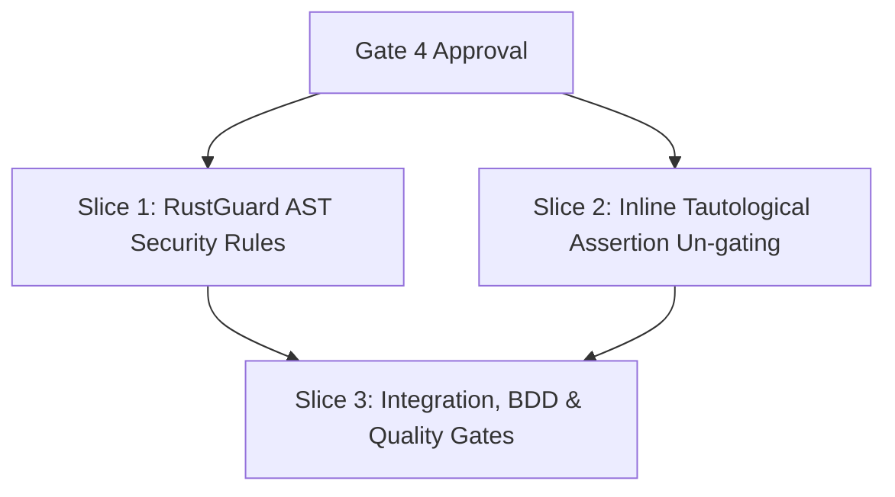

# Tasks

## 1. Dependency DAG

## 2. Streams & Worktrees

| Stream | Worktree Path | Branch | Prerequisite |
| :--- | :--- | :--- | :--- |
| `static-scan-rules` | `.worktrees/static-scan-rules` | `feat/static-scan-rust-rules` | Gate 4 Approval |

---

## 3. Slice 1: RustGuard AST Security Rules (`sec/sql-injection`, `sec/command-injection`)

- [x] 3.1 BDD scenarios in `crates/lgtm-core/tests/bdd.rs` and `docs/bdd-scenarios.md` for Rust SQL injection and command injection (verify: tests defined). Evidence: `bdd_core_021` added to `crates/lgtm-core/tests/bdd.rs` and catalog.
- [x] 3.2 Red unit tests for `RustGuard` covering `format!` SQL queries, `Command::new("sh").arg("-c")`, and negative safe patterns (verify: `cargo test -p lgtm-core guard::rust` fails). Evidence: unit tests failed initially as expected.
- [x] 3.3 Implement `RustGuard` in `crates/lgtm-core/src/guard/rust.rs` using `lgtm-ast` and register in `crates/lgtm-core/src/guard/mod.rs:registry()` (verify: `cargo test -p lgtm-core guard::rust` passes). Evidence: 4 tests passed in `guard::rust`.
- [x] 3.4 Verify negative cases (parameterized SQL, direct executable invocation) produce zero findings (verify: unit tests pass). Evidence: clean format, `sqlx::query`, `Command::new("git")`, `Command::new("cargo")`, and CLI builder `-c` produced 0 alerts.

---

## 4. Slice 2: Inline Tautological Assertion Un-gating (`test/tautological-assert`)

- [x] 4.1 BDD scenario and red unit test for tautological assert in `src/foo.rs` (non-test path) (verify: test fails before fix). Evidence: `test_tautological_assertion_detected_in_non_test_file` defined.
- [x] 4.2 Un-gate `is_tautological_assertion` in `crates/lgtm-core/src/guard/mod.rs` so it runs across all files (verify: test passes). Evidence: `assert!(true)` and `assert_eq!(foo, foo)` flagged in `src/calc.rs`.
- [x] 4.3 Verify deduplication and alert consistency across language guards and line heuristics (verify: suite passes). Evidence: `seen` deduplication added in `scan_file`.

---

## 5. Slice 3: Integration, BDD & Quality Gates

- [x] 5.1 Run full test suite across workspace: `cargo test --workspace` (verify: 0 failures). Evidence: 653 passed, 0 failures.
- [x] 5.2 Enforce quality gates: `make fmt`, `make lint`, `make check` (verify: clean pass). Evidence: `cargo fmt --all -- --check` clean, `cargo clippy` 0 warnings, `check-boundaries.sh` clean.
- [x] 5.3 Enforce code coverage >= 90% (verify: `cargo llvm-cov` passes threshold). Evidence: 93.82% line coverage across workspace.
- [x] 5.4 Update `CHANGELOG.md` with new static Rust rules (verify: entry added). Evidence: entry added under `## Unreleased`.
- [ ] 5.5 Sync specs and archive change via `openspec archive static-scan-rust-rules --yes` (verify: archived).

---

## Review Gate
- [x] **Gate 4 Approval**: Tasks breakdown approved by human before writing test code.
