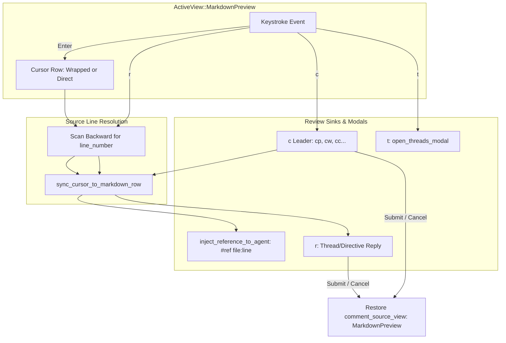

# Architecture & Technical Design

## 1. Overview & Invariants

This design bridges Markdown preview mode (`ActiveView::MarkdownPreview`) and the review action surface.
Key invariants:
- **Cursor Determinism**: Every interaction anchored to a line (`Enter`, `c`, `r`, `R`, `x`) resolves the 1-based source line by matching the row's `line_number`, or by scanning backward across wrapped continuation rows (`line_number: None`) to the parent paragraph/block start line.
- **View Return Continuity**: Submitting or canceling comment input, directive reply input, or thread replies restores `self.comment_source_view` (`ActiveView::MarkdownPreview` when launched from preview), eliminating unintentional kicks to `ActiveView::Diff`.
- **Render Budget Invariance**: Rendering inline PR threads and directives reuses the cached row heights mechanism in `MarkdownPreviewState`, preserving the 16 ms frame render and < 1 µs scroll latency budgets.

## 2. Domain Models, State & Interface Contracts

### Source Line Resolution
Add helper to `App`:
```rust
impl App {
    /// Resolves the 1-based source line and diff kind for the current markdown preview cursor row,
    /// scanning backward if the cursor is positioned on a wrapped continuation row.
    pub(crate) fn markdown_preview_cursor_source_line(&self) -> Option<(u32, markdown::MarkdownDiffKind)> {
        let preview = &self.markdown_preview;
        let rows = &preview.rendered_rows;
        let cursor = preview.cursor_row;
        for r in rows[..=cursor.min(rows.len().saturating_sub(1))].iter().rev() {
            if let Some(line) = r.line_number {
                return Some((line, r.diff_kind));
            }
        }
        None
    }
}
```

### Action Binding Updates
- In `handle_markdown_preview_key()`:
  - `KeyCode::Enter`: Resolves source line via `sync_cursor_to_markdown_row()` and calls `self.inject_reference_to_agent()`.
  - `KeyCode::Char('c')`: Sets `self.pending_leader = Some('c')`.
  - When `pending_leader == Some('c')`:
    - Handles `'p'`, `'w'`, `'s'`, `'r'`, `'a'`, `'c'`, `Enter` by setting prefilled `comment_input`, `comment_source_view = ActiveView::MarkdownPreview`, and activating `ActiveView::CommentInput`.
  - `KeyCode::Char('r')`: Syncs cursor first via `sync_cursor_to_markdown_row()`, checks `thread_at_cursor()` / `comment_idx_at_cursor()`, and launches reply with `comment_source_view = ActiveView::MarkdownPreview`.
  - `KeyCode::Char('t')`: Calls `self.open_threads_modal()`.
- In `handle_comment_reply_key()`:
  - On `Esc` or `Enter`: Restores `self.active_view = self.comment_source_view;`.

### Inline UI Expansion
In `src/ui/markdown.rs`:
- Query `file_threads` for `file_name` from `app.threads`.
- Collect threads matching `row.line_number` (excluding deletions).
- Render `🧵 [@author (Open|Resolved)] thread_text` and indented `↳ reply_text`.
- Account for thread lines and replies in `app.markdown_preview.set_row_heights(...)`.

## 3. Architecture Diagram & Data Flow



## 4. Boundary Rules & Budgets

- **Pure Core vs. I/O Shell**:
  - `lgtm-core` remains free of I/O, network, and ratatui UI dependencies.
  - Interaction and visual changes are confined to `lgtm` crate (`src/app/input.rs`, `src/app/mod.rs`, `src/ui/markdown.rs`).
- **Budgets**:
  - Hot path keystroke latency MUST remain < 1 µs.
  - Frame rendering with inline thread and directive decorators MUST remain < 16 ms.

## 5. Testing Strategy

1. **BDD Scenarios**:
   - `tests/bdd/features/markdown_preview.feature`: Add scenarios for `Enter` ref blast on direct and wrapped lines, `c` leader templates (`cp`, `cw`, `cc`), `r` reply persistence in preview, `t` modal launch, and inline PR thread rendering.
2. **Unit Tests (>= 95% line & branch coverage)**:
   - `src/app/input.rs`: Test preview key handling for `Enter`, `c` leader prefixes, `r`, and `t`.
   - `src/ui/markdown.rs`: Test inline rendering of active and outdated PR threads alongside local directives, and row height cache coherency.
   - `src/app/mod.rs`: Test backward line scanning for wrapped continuation rows.
3. **Mutation Testing**: Scoped mutation testing on modified logic ensuring 100% kill rate.

## Review Gate
- [ ] **Gate 3 Approval**: Architecture & design reviewed and approved by human before task breakdown.
