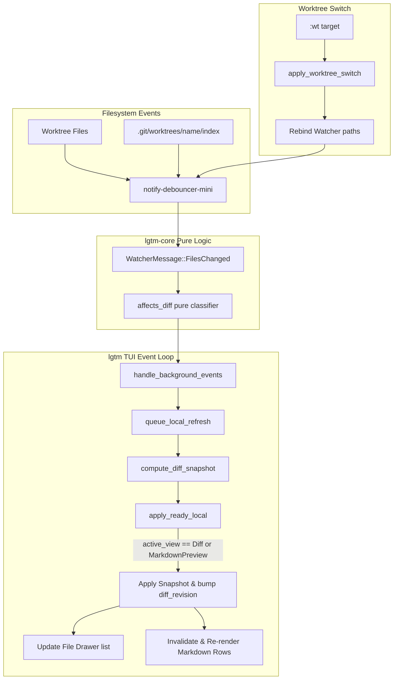

# Architecture & Technical Design

## 1. Overview & Invariants
This design resolves real-time refresh gaps during Markdown Preview and inside Git worktrees:
1. **Markdown Preview Live Application**: `local_ready_to_apply` and `apply_ready_local` treat `ActiveView::MarkdownPreview` as an eligible view alongside `ActiveView::Diff` when `!self.visual_mode`.
2. **Preview Cache Invalidation**: `MarkdownPreviewState` tracks `cached_diff_revision: u64`. When `diff_revision` changes, `render_markdown_preview` rebuilds rendered rows for the active file while preserving and clamping `cursor_row` and `scroll_offset`.
3. **Dual-Path Worktree Watching**: When initializing or switching worktrees, `GitEngine` discovers the worktree working directory (`repo.workdir()`) and the administrative directory (`repo.path()`). `RepoWatcher` watches both paths.
4. **Worktree Switch Re-binding**: `App` holds a watcher controller handle (or communication channel) allowing `apply_worktree_switch` to re-bind file watching to the new worktree target without dropping UI events.
5. **Pure Classification Invariant**: `lgtm_core::watcher::affects_diff` remains pure and free of I/O, matching both standard `.git/(index|HEAD)` and linked worktree `.git/worktrees/<name>/(index|HEAD)`.

## 2. Domain Models, State & Interface Contracts

### App View Gating
```rust
// src/app/refresh.rs
pub(super) fn local_ready_to_apply(&self) -> bool {
    self.local_refresh.ready.is_some()
        && matches!(self.active_view, ActiveView::Diff | ActiveView::MarkdownPreview)
        && !self.visual_mode
}
```

### Markdown Preview Cache Tracking
```rust
// src/app/markdown.rs
pub struct MarkdownPreviewState {
    // ... existing fields ...
    pub cached_diff_revision: u64,
}
```
In `src/ui/markdown.rs`:
```rust
let needs_rebuild = app.markdown_preview.rendered_rows.is_empty()
    || app.markdown_preview.cached_file_idx != Some(app.selected_file_idx)
    || app.markdown_preview.cached_width != width
    || app.markdown_preview.cached_diff_revision != app.diff_revision;
```

### Pure Core Watcher Classification
```rust
// crates/lgtm-core/src/watcher/mod.rs
pub fn affects_diff(root: &Path, path: &Path) -> bool {
    let relative = path.strip_prefix(root).unwrap_or(path);
    if relative.components().any(|c| c.as_os_str() == ".lgtm" || c.as_os_str() == "target") {
        return false;
    }
    if let Ok(git_path) = relative.strip_prefix(".git") {
        let s = git_path.to_str().unwrap_or("");
        if s == "index" || s == "HEAD" || s.starts_with("refs/heads") {
            return true;
        }
        if let Some(wt_git) = s.strip_prefix("worktrees/") {
            let rest = wt_git.split_once('/').map(|(_, r)| r).unwrap_or(wt_git);
            return rest == "index" || rest == "HEAD" || rest.starts_with("refs/heads");
        }
        return false;
    }
    true
}
```

### Watcher Controller Handle
```rust
pub struct WatcherHandle {
    pub tx: crossbeam_channel::Sender<WatcherCommand>,
}

pub enum WatcherCommand {
    Rebind { workdir: PathBuf, git_dir: Option<PathBuf> },
}
```

## 3. Architecture Diagram & Data Flow



## 4. Boundary Rules & Budgets
- **Pure Core vs. I/O Shell**: `lgtm_core::watcher::affects_diff` performs zero filesystem operations. All watcher spawning, path resolution, and terminal layout rendering remain in `lgtm-core::watcher` (I/O component) and `src/` (shell).
- **Concurrency & Latency Budgets**:
  - Hot paths: Keystroke response remains < 1 µs.
  - Frame render: < 16 ms budget preserved; markdown row re-parsing is performed on diff arrival, never in the per-frame render loop when unchanged.
  - Worktree switch: < 100 ms total switch time for repositories up to 10,000 files.
- **Rejected Alternatives**:
  - *Periodic git status polling*: Rejected due to high CPU load and battery drain violating background efficiency rules.
  - *Auto-closing markdown preview on diff reload*: Rejected as jarring to the reviewer; maintaining preview mode with clamped cursor preserves reading continuity.

## 5. Testing Strategy
1. **BDD Scenarios**:
   - `features/markdown_preview_live_refresh.feature`: Verify preview content and drawer refresh when file is updated on disk while preview is open.
   - `features/worktree_live_refresh.feature`: Verify worktree file edits and `git add` index modifications trigger automatic diff snapshot reloads.
2. **Unit Tests (>= 95% coverage)**:
   - `crates/lgtm-core/src/watcher/mod.rs`: Test `affects_diff` across standard `.git/index`, worktree `.git/worktrees/feat/index`, and ignored artifacts.
   - `src/app/refresh.rs`: Test `local_ready_to_apply` and `apply_ready_local` under `ActiveView::MarkdownPreview` and ensure visual mode gating is preserved.
   - `src/ui/markdown.rs`: Test that `diff_revision` increment triggers row rebuild and maintains cursor clamping.
   - `src/app/worktree.rs`: Test watcher rebinding and path observation after `:wt` switch.
3. **Mutation Testing (100% kill)**:
   - Run `rtk cargo mutants` against `lgtm-core` watcher path classification.

## Review Gate
- [ ] **Gate 3 Approval**: Architecture & design reviewed and approved by human before task breakdown.
