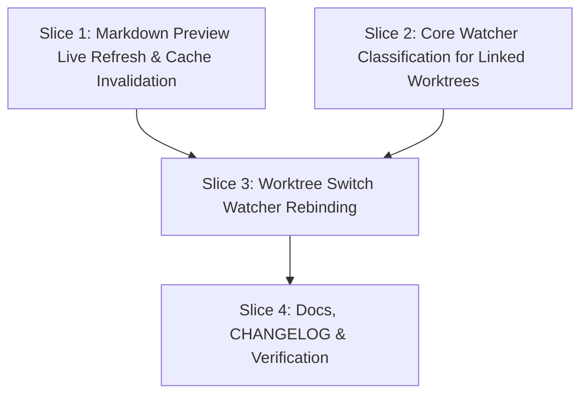

# Tasks

## 1. Dependency DAG

## 2. Streams & Worktrees

| Stream | Worktree Path | Branch | Prerequisite |
| :--- | :--- | :--- | :--- |
| `preview-refresh` | `.worktrees/preview-refresh` | `feat/preview-refresh` | Base branch |
| `worktree-refresh` | `.worktrees/worktree-refresh` | `feat/worktree-refresh` | Slice 2 |

## 3. Slice 1: Markdown Preview Live Refresh & Cache Invalidation

- [x] 3.1 BDD scenarios for preview live refresh and drawer updates during preview (verify: `docs/bdd-scenarios.md` updated)
- [x] 3.2 Gate 5.1 human sign-off on BDD scenarios
- [x] 3.3 Red unit tests: verify `local_ready_to_apply` accepts `ActiveView::MarkdownPreview` and `diff_revision` change triggers preview row rebuild (verify: `rtk cargo test -p lgtm refresh` fails as expected)
- [x] 3.4 Green implementation: update `src/app/refresh.rs`, `src/app/markdown.rs`, `src/ui/markdown.rs` to allow diff apply in markdown preview and track `cached_diff_revision` (verify: tests pass)
- [x] 3.5 Line and branch coverage >= 95% on touched modules (verify: `rtk cargo llvm-cov --package lgtm`)

## 4. Slice 2: Core Watcher Classification for Linked Worktrees

- [x] 4.1 BDD scenarios for worktree gitdir index and HEAD path classification (verify: `docs/bdd-scenarios.md` updated)
- [x] 4.2 Gate 5.2 human sign-off on BDD scenarios
- [x] 4.3 Red unit tests: `affects_diff` test cases for `.git/worktrees/<name>/index` and `.git/worktrees/<name>/HEAD` (verify: `rtk cargo test -p lgtm-core watcher` fails)
- [x] 4.4 Green implementation: update `crates/lgtm-core/src/watcher/mod.rs` to recognize worktree git administrative files (verify: tests pass)
- [x] 4.5 Mutation testing 100% kill on `crates/lgtm-core/src/watcher/` (verify: `rtk cargo mutants --package lgtm-core --file crates/lgtm-core/src/watcher/mod.rs`)

## 5. Slice 3: Worktree Switch Watcher Rebinding

- [x] 5.1 BDD scenarios for `:wt` switch re-binding the active watcher (verify: `docs/bdd-scenarios.md` updated)
- [x] 5.2 Gate 5.3 human sign-off on BDD scenarios
- [x] 5.3 Red unit tests: `apply_worktree_switch` rebinds active watcher paths and watches linked gitdir (verify: `rtk cargo test -p lgtm worktree` fails)
- [x] 5.4 Green implementation: update `src/app/worktree.rs`, `src/app/input.rs`, `src/main.rs` to pass watcher controller and rebind on switch (verify: tests pass)
- [x] 5.5 Line and branch coverage >= 95% on touched modules (verify: `rtk cargo llvm-cov`)

## 6. Slice 4: Documentation, CHANGELOG & Verification

- [x] 6.1 Update `CHANGELOG.md` with markdown preview live refresh and worktree watcher fix
- [x] 6.2 Update `README.md` and user docs if necessary
- [x] 6.3 Full quality gate run: `make check`, `make lint`, `make test`, `make bdd-report`
- [x] 6.4 Human sign-off on change before archive

## Review Gate
- [x] **Gate 4 Approval**: Tasks breakdown approved by human before writing test code.
