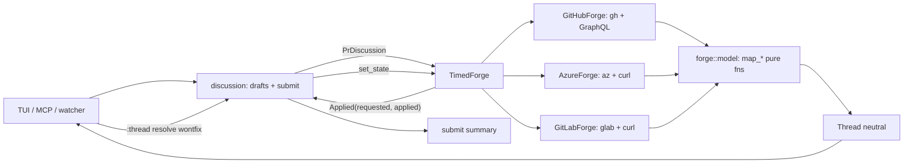

# Architecture & Technical Design

## 1. Overview & Invariants

Introduce a provider-neutral thread model in `lgtm-core::forge::model`, route all three providers (GitHub, Azure DevOps, new GitLab) through it, and make resolution a settable state end to end. Provider-specific parsing is pure functions over JSON; process and network calls stay in the existing runner-injected adapters.

Invariants:
- No UI or discussion logic branches on `ForgeKind`; it only sees `Thread`.
- `lgtm_core::github::{Thread, ThreadComment}` keep compiling (re-export).
- Unknown capability is `None`/`Open`, never an error; unsupported operations `bail!` with an explicit message (existing default trait methods).
- Legacy drafts with `SetResolved { resolved: bool }` load unchanged.
- Each submit item succeeds or fails independently (unchanged); a resolution fallback is a success that carries a note.

## 2. Domain Models, State & Interface Contracts

```rust
// forge/model.rs (pure)
pub enum Resolution { Done, WontFix, Other(String) }
pub enum ThreadState { Open, Resolved(Resolution) }

pub struct Thread {
    pub id: String,
    pub path: String,
    pub line: Option<u32>,
    pub state: ThreadState,
    pub outdated: bool,
    pub can_resolve: Option<bool>,
    pub can_unresolve: Option<bool>,
    pub comments: Vec<ThreadComment>,
}
impl Thread { pub fn resolved(&self) -> bool { matches!(self.state, ThreadState::Resolved(_)) } }
```

- The public `resolved: bool` field is replaced by `resolved()`; call sites (about 20, mostly tests) migrate mechanically. `thread_marker` keeps its contract.
- Settable resolutions: `Done`, `WontFix`. `Other` is read-only (validated in the draft constructor and command parser).

Trait change:

```rust
fn set_state(&self, pr: u64, thread_id: &str, state: ThreadState) -> Result<Applied>;
pub struct Applied { pub requested: ThreadState, pub applied: ThreadState } // differs on fallback
```

`set_resolved(bool)` is removed from `PrDiscussion`, `ForgeImpl` and `TimedForge`; the default body bails with "Thread resolution is not supported by this provider".

Drafts:

```rust
DraftKind::SetResolved { thread_id, resolved: bool, #[serde(default)] resolution: Option<Resolution> }
```

- Unset `resolution` with `resolved: true` reads as `Done`; `resolved: false` is unresolve. New drafts always write `resolution` for resolve. Serde default keeps old files loadable and old files rewritten in the new shape on next save.
- Label stays `resolve`/`unresolve`; `wontfix` shown as `resolve (wontfix)`.
- Permission check happens when drafting against the live thread: `can_resolve == Some(false)` or `can_unresolve == Some(false)` rejects with a reason; `None` allows.

Provider mapping (pure functions, unit-tested with fixtures):

| Provider | Open | Done | WontFix | Other | outdated | permissions |
|---|---|---|---|---|---|---|
| GitHub | `isResolved=false` | `isResolved=true` | n/a (write falls back to Done) | n/a | `isOutdated` | `viewerCanResolve/Unresolve` |
| Azure | `active`, `pending`, unknown | `fixed` | `wontFix` | `closed`, `byDesign` | false | None |
| GitLab | `resolved=false` | `resolved=true` (all resolvable notes) | n/a (fallback to Done) | n/a | false | None |

Write mapping: Azure `Done` to `fixed`, `WontFix` to `wontFix`, `Open` to `active`; GitHub `resolveReviewThread`/`unresolveReviewThread`; GitLab `PUT discussions/:id?resolved=true|false`. Fallback sets `Applied.applied != requested`, and the submit summary renders "requested WontFix, applied Done".

GitLab provider (`forge/gitlab.rs`, `ForgeKind::GitLab`, `ForgeImpl::GitLab`):
- Detect `gitlab.com` and hosts containing `gitlab` before the GitHub fallback.
- Thread id is the discussion id (string); comment id is the numeric note id (fits `reply(..., u64, ..)`).
- Position: `old_line` is `LEFT`, `new_line` is `RIGHT`; inline create needs `base_sha`, `start_sha`, `head_sha` from the MR `diff_refs`, obtained in `head_sha`/a small helper.
- List MRs and diff via the same runner pattern as Azure. `checks` keeps the unsupported default.
- No batch endpoint is used; `post_inline_batch` uses the default per-item `post_each`.
- Auth (REQ-COMMENTS-3): token from `glab auth token`/config for the host, `GITLAB_TOKEN` overrides; sent via a `PrivateTempFile` header like Azure; 401 maps to Authentication with remediation `glab auth login` (add `glab` to the program check in `forge/failure.rs`).

## 3. Architecture Diagram & Data Flow



Flow for a resolve: command parse, check the live thread's permission and settable resolution, store the draft (last per thread wins), confirm at `:thread submit`, `set_state`, summary with fallback note, refetch threads.

## 4. Boundary Rules & Budgets

- **Pure Core vs. I/O Shell**: `forge/model.rs`, the `map_*` parsers, the draft schema and permission logic are pure and need no I/O. Process and HTTP calls stay inside the provider adapters behind the existing injected `runner`, as today; no new I/O in the model or `discussion` modules. No new dependencies (`serde`, `serde_json` already present).
- **Concurrency, Latency & Resource Budgets** (NFR-COMMENTS-1): all forge calls stay off the UI thread via the existing background fetch/submit; the thread list gains two bools and an enum per thread, negligible against the 16 ms frame; keystroke handling is unchanged (< 1 us). GitHub queries add three scalar fields. GitLab fetch uses one paginated discussions call per MR with the shared cache/TTL pattern from Azure.
- CI: no path or line-ending logic changes; GitLab fixtures are static JSON, so the ubuntu, macos and windows matrix is unaffected.

## 5. Testing Strategy

1. **BDD Scenarios**: add to `tests/bdd.rs` the spec scenarios: Azure and GitLab status mapping, GitHub flags mapping, WontFix fallback on GitHub and GitLab, Azure `wontFix` write, permission rejection and unknown allowance, legacy draft load, GitLab host detection and unsupported checks, per-item GitLab submit, GitLab auth failure message, `:thread resolve wontfix`, MCP output fields.
2. **Unit Tests (>= 95% coverage)**: fixtures per provider for `map_*` and write payloads; draft serde round trip including legacy files; command parser (`resolve`, `resolve wontfix`, rejects other words); `OUTDATED` versus `STALE` rendering in the thread view; `failure.rs` glab mapping. Red first, then Green.
3. **Mutation Testing (100% kill)**: `cargo mutants` on `forge/model.rs`, mapping functions, draft permission and fallback logic, and `discussion` changes; survivors fixed by tests or deleted code. Live GitLab calls are excluded and only exercised via the runner fake (as for Azure).

Rejected alternatives:
- Keep `resolved: bool` and add a side `status: String`: leaks provider strings into UI.
- Keep `set_resolved(bool)` and add `set_resolution`: two write paths drift; one `set_state` is simpler.
- Native OAuth for GitLab: out of scope per proposal.
- Derive Azure `outdated` from iteration data: unreliable, left false.

## Review Gate
- [x] **Gate 3 Approval**: Architecture & design reviewed and approved by human before task breakdown.
