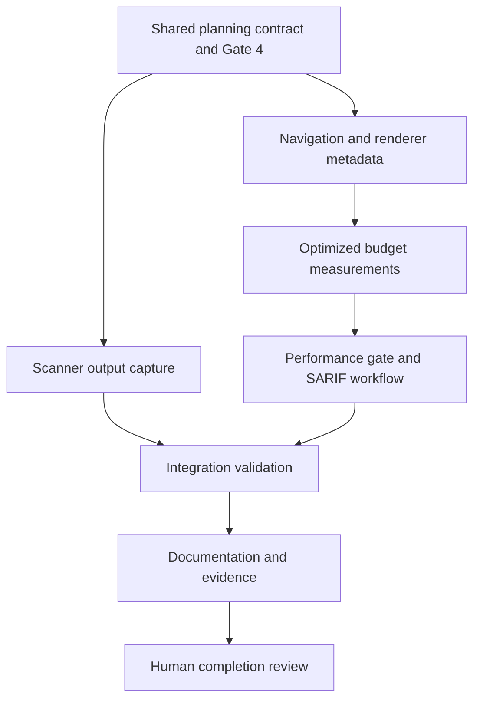

# Tasks

## 1. Dependency DAG

The user's `go` approves progression from Gate 3 to task breakdown, not implementation. Human review checkboxes remain untouched. Implementation requires a separate apply request, Gate 4 approval, and per-slice BDD approval.

## 2. Streams & Worktrees

| Stream | Worktree Path | Branch | Prerequisite |
| :--- | :--- | :--- | :--- |
| Integration/shared contract | `.worktrees/ci-performance-investigation` | `fix/ci-performance-budget` | Existing isolated branch; Gate 4 and explicit apply |
| Navigation, measurement, workflow (sequential) | `.worktrees/ci-performance-navigation` | `fix/ci-performance-navigation` | Shared contract committed with user authorization |
| Scanner annotation isolation | `.worktrees/ci-performance-annotations` | `fix/ci-performance-annotations` | Shared contract committed with user authorization |

Parallel streams are optional, not authorization to launch agents. Use the existing integration worktree sequentially unless parallel execution is requested. Create isolated streams only after the shared contract is committed; commits, rebases, pushes, and archive actions require explicit user authorization. Navigation and measurement share files and therefore stay in one sequential stream; the workflow follows measurement so its selector is real.

- [x] 2.1 Confirm Gate 4 approval and explicit apply authorization; record the approved contract and base revision (verify: approval recorded and `rtk git status --short` reviewed without touching unrelated work). Evidence: User's subsequent `go` approves Gate 4 and applying this change; base `fa124c63a58c83d72e417ba7721e959b029dbcf0` on `fix/ci-performance-budget`; status showed only this change's untracked planning directory.
- [x] 2.2 If parallel execution is authorized, commit the shared planning contract only with commit authorization and create the two independent worktrees from that revision (verify: both branches have the same contract revision and distinct paths; otherwise record sequential execution). Evidence: Sequential execution selected in the existing `.worktrees/ci-performance-investigation`; no commits, parallel streams, or additional worktrees authorized or created.

## 3. Slice 1: Cached Navigation

Touches: `tests/bdd/features/markdown_preview.feature`, `src/app/markdown.rs`, `src/ui/markdown.rs`, and directly dependent height-setting callers/tests.

- [x] 3.1 Add keyed BDD scenarios for populated uniform heights, directive/reply expansion, rebuild/resize, tall rows, empty rows, and zero viewport; map each scenario to a Rust test (verify: feature diff and test mapping cover `REQ-MDPERF-1/2`). Evidence: Added seven keyed scenarios to `tests/bdd/features/markdown_preview.feature`, each naming its planned Rust test; execution awaits Gate 5.1 and Red tests.
- [ ] 3.2 Obtain Gate 5.1 human sign-off on navigation BDD scenarios (verify: explicit approval; only human checks this item).
- [x] 3.3 Write failing regression/unit tests against a reference bounds calculation; include metadata replacement, cursor jumps, source attribution, and unchanged row/span buffers (verify: targeted `rtk cargo test -p lgtm markdown` fails for the expected regression; append exact command/result evidence). Evidence: `rtk cargo test -p lgtm navigation_` failed with exit 101, E0599 for missing `set_row_heights`; user requested autonomous continuation after Gate 5.1 pause, approving progression. Human checkbox remains untouched.
- [x] 3.4 Implement uniform O(1) bounds and expanded prefix/binary-search bounds; replace direct height assignments through coherent preparation and handle empty/zero viewport safely (verify: the same focused tests pass, rendering/navigation semantics match reference cases, and all height setters are accounted for; append evidence). Evidence: `rtk cargo test -p lgtm markdown` passed 29 tests; formatting and Clippy passed; user authorized committing the implementation with its tests.
- [ ] 3.5 Measure changed navigation logic at >=95% line and branch coverage and strengthen boundary tests against off-by-one/stale-index mutations (verify: scoped coverage report and mutation results recorded; unchanged core mutation scope marked not applicable, or changed core achieves 100% kill).

Navigation implementation evidence: `rtk cargo test -p lgtm markdown` passed 29 tests; `rtk cargo clippy -p lgtm --all-targets --all-features -- -D warnings` passed; `rtk cargo fmt --all` passed. Uniform bounds use O(1) arithmetic and expanded bounds use prepared prefix binary searches. Renderer height replacements and rebuilds reset metadata. User requested a separate `markdown-parser-coverage` feature for the remaining whole-module coverage work; task 3.5 remains incomplete, not waived.

Coverage/mutation evidence (3.5 remains unchecked because whole-module branch target is not met): `rtk cargo llvm-cov -p lgtm --summary-only -- markdown` passed, app Markdown line coverage 97.43%; nightly focused branch coverage reported whole-module 82% (123/150), including unchanged parser branches. Changed navigation source locations have all 10/10 outcomes covered; duplicate unexecuted compiled instances appear in raw exports. `rtk cargo mutants -p lgtm --file src/app/markdown.rs --re MarkdownPreviewState --timeout 60 --jobs 2 -- markdown` passed with 24/24 caught, no survivors. No core logic changed.

## 4. Slice 2: Optimized Measurement

Depends on Slice 1. Touches: Markdown application/renderer tests, `Cargo.toml`, and a focused performance runner under `scripts/`.

- [ ] 4.1 Add BDD scenarios and executable checks for default/instrumented behavioral runs, explicit optimized measurement, zero-match rejection, and observable representative workloads (verify: feature-to-test mapping covers `REQ-CIQR-1/2` and `NFR-MDPERF-1`).
- [ ] 4.2 Obtain Gate 5.2 human sign-off on measurement BDD scenarios (verify: explicit approval; only human checks this item).
- [ ] 4.3 Establish Red tests for missing/mismatched selectors and unsafe debug measurement invocation; preserve deterministic assertions from the existing timing test (verify: expected failures recorded and navigation behavior remains tested independently).
- [ ] 4.4 Add opt-in `perf-budgets` tests and explicit runner selection; ensure debug `--all-features` tests, coverage, Clippy, and pre-commit do not execute timing checks (verify: dedicated timing cases are opt-in/ignored by normal execution, debug explicit invocation rejects the build, and the runner fails on no matches; append evidence).
- [ ] 4.5 Implement warmed-up seven-sample measurements with black-boxed observable state, moving forward/backward workloads, uniform/empty/expanded heights, cursor jumps, 5,000-line parsing, and cached in-memory rendering (verify: release runner reports all samples and median values, enforcing <1 microsecond navigation, <50 ms parsing, and <16 ms rendering without instrumented flags).
- [ ] 4.6 Verify preparation is outside navigation timing, buffers are reused, and total rendered-memory accounting includes metadata within the existing 10x ceiling; meet >=95% line/branch coverage for changed deterministic helpers (verify: focused assertions and coverage evidence; document any pre-existing ceiling violation rather than relaxing it; core mutation scope remains unchanged).

Only dedicated measurement tests may be excluded from default execution; no behavioral assertion may be skipped. This explicit opt-in is necessary because existing CI and pre-commit use `--all-features`.

## 5. Slice 3: Scanner Annotation Isolation

Independent of Slices 1/2 after the shared contract. Touches: `src/headless.rs`, nearby scanner/CLI tests, and `tests/bdd/features/ci_quality_reporting.feature`.

- [ ] 5.1 Add BDD scenarios for synthetic annotations, genuine CLI annotations, provider precedence, blocking status, and output failures (verify: mapping covers `REQ-CIQR-4`).
- [ ] 5.2 Obtain Gate 5.3 human sign-off on annotation BDD scenarios (verify: explicit approval; only human checks this item).
- [ ] 5.3 Write failing tests capturing audit stdout and safely quoted failure diagnostics, including synthetic `b.py` fixtures under GitHub environment detection (verify: expected Red evidence without active workflow commands or process-global environment mutation).
- [ ] 5.4 Add the private writer-taking audit path, preserve the CLI stdout wrapper and filesystem/error semantics, and route synthetic tests through captured output (verify: `rtk cargo test -p lgtm headless` and relevant captured CLI tests pass; genuine annotations and finding status are asserted; append evidence).
- [ ] 5.5 Validate >=95% line/branch coverage for changed output logic and failure paths (verify: report recorded and raw synthetic commands do not appear under `--nocapture`, including failing-test diagnostics; unchanged core mutation scope recorded).

## 6. Slice 4: CI Gates and SARIF Availability

Depends on Slice 2's runner contract. Touches: `.github/workflows/ci.yml`, focused runner checks, and CI reporting BDD scenarios.

- [ ] 6.1 Add BDD scenarios for each platform's optimized gate, coverage remaining 90%, missing report after upstream failure, and available report after blocking findings (verify: mapping covers `REQ-CIQR-1/3`).
- [ ] 6.2 Obtain Gate 5.4 human sign-off on CI BDD scenarios (verify: explicit approval; only human checks this item).
- [ ] 6.3 Reproduce missing/present SARIF eligibility cases and scanner clean/blocking/tool-failure statuses in focused local checks (verify: old missing-file condition is shown incorrect and exact failing evidence recorded without uploading synthetic reports).
- [ ] 6.4 Wire the release/non-instrumented runner on Ubuntu, macOS, and Windows with isolated target output; add report existence to existing upload conditions without swallowing scanner failures (verify: workflow syntax and runner checks pass, coverage command retains `--fail-under-lines 90`, and missing/present report cases yield intended eligibility).
- [ ] 6.5 Verify workflow cases preserve failure status and PR/platform restrictions; cover changed runner logic to >=95% line/branch where applicable (verify: recorded local case results and CI matrix evidence; declarative YAML coverage and unchanged core mutation marked not applicable).

## 7. Integration & Rebase Plan

- [ ] 7.1 Integrate only authorized stream changes after their focused checks pass; if a newer main requires rebase, obtain authorization and preserve unrelated edits (verify: reviewed diff, correct base, no duplicate file ownership, no dropped changes).
- [ ] 7.2 Run `rtk cargo fmt --all -- --check`, `rtk cargo clippy --workspace --all-targets --all-features -- -D warnings`, and `rtk ./scripts/check-boundaries.sh` (verify: exact commands/results appended; fix only introduced or tightly coupled failures).
- [ ] 7.3 Run `rtk cargo test --workspace --all-targets --all-features -- --nocapture` and `rtk cargo llvm-cov --workspace --all-features --fail-under-lines 90 --summary-only` (verify: behavioral tests pass, no fixture annotations, existing coverage threshold enforced, and changed-logic >=95% line/branch evidence retained).
- [ ] 7.4 Run the dedicated optimized budget command and inspect all three CI platform results when a push/run is authorized (verify: named workloads actually execute, budgets pass, and SARIF skips/uploads correctly; report unavailable matrix evidence plainly rather than claiming resolution).
- [ ] 7.5 Update `CHANGELOG.md`, benchmark/CI instructions in `docs/WIKI.md`, and focused `docs/bug-reports/2026-11-01-*.md` reports with reproduced symptoms, fixes, and exact validation results (verify: documentation matches implemented behavior and records remaining limitations).
- [ ] 7.6 Obtain human completion review; commit/push only when requested and sync/archive only on explicit request (verify: approved implementation evidence, OpenSpec validation, intentional worktree status, and required Copilot trailer on authorized commits).

Append `Evidence: <exact command and result>` when checking executable tasks; never mark a test passed merely because the command is listed. BDD feature files are scenario contracts, not evidence of execution unless mapped tests run. Do not add a new BDD framework solely for this change.

## Review Gate

- [ ] **Gate 4 Approval**: Tasks breakdown approved by human before writing test code.
