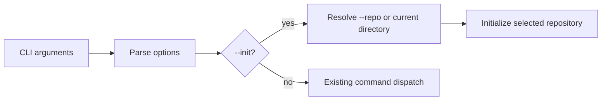

# Architecture & Technical Design

## 1. Overview & Invariants

Route `--init` through the same parsed repository selection as other CLI behavior. The current directory remains the default when no `--repo` is given. Initialization must not affect a different repository than the parsed target.

## 2. Domain Models, State & Interface Contracts

- Parse the CLI options once.
- Resolve the initialization target from the parsed repository option, defaulting to the current directory using existing behavior.
- Invoke the existing initialization routine with that target.
- Preserve the existing `--init` output and exit behavior.

## 3. Architecture Diagram & Data Flow

## 4. Boundary Rules & Budgets
- **Pure Core vs. I/O Shell**: CLI parsing and initialization remain in the `lgtm` application crate; no changes to `lgtm-core`.
- **Concurrency, Latency & Resource Budgets**: No additional work or dependencies; initialization uses the existing code path.

## 5. Testing Strategy
1. **BDD Scenarios**: Verify selected target and default target behavior.
2. **Unit Tests (>= 95% coverage)**: Cover `--init --repo <path>` without touching the process current directory, and preserve the no-`--repo` default; run targeted tests.
3. **Mutation Testing (100% kill)**: No core logic changes; no new mutation target.

## Review Gate
- [ ] **Gate 3 Approval**: Architecture & design reviewed and approved by human before task breakdown.
