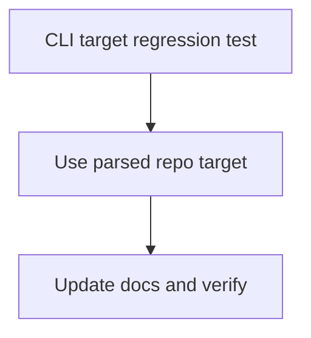

# Tasks

## 1. Dependency DAG

## 2. Streams & Worktrees

| Stream | Worktree Path | Branch | Prerequisite |
| :--- | :--- | :--- | :--- |
| CLI init repository target | `.worktrees/impl-cli-init` | `fix/cli-init-repo-target` | Shared CLI contract |

## 3. Slice 1: Honor `--repo` with `--init`

- [x] 3.1 Add a regression test for `--init --repo <path>` that fails when the current directory is initialized instead (Evidence: `cargo test -p lgtm --test bdd bdd_cli_010_init_flag_respects_repo_and_defaults_to_current_directory` passed: 1 test).
- [ ] 3.2 Gate 5.1 human sign-off on the repository-target scenario.
- [x] 3.3 Use parsed arguments for `--init`, retaining current-directory default behavior (Evidence: targeted BDD test passed).
- [x] 3.4 Run formatting and workspace tests (Evidence: `cargo fmt --all -- --check && cargo test --workspace --quiet` passed).
- [x] 3.5 Update changelog and CLI help/documentation if needed (Evidence: `CHANGELOG.md`, `docs/WIKI.md`, and bug report updated).

## 4. Integration & Rebase Plan

- [x] 4.1 Integrate after runtime changes in `src/main.rs`, resolve the shared-file edits, and rerun CLI and workspace tests (Evidence: `cargo test --workspace --quiet` passed).

## Review Gate
- [ ] **Gate 4 Approval**: Tasks breakdown approved by human before writing test code.
