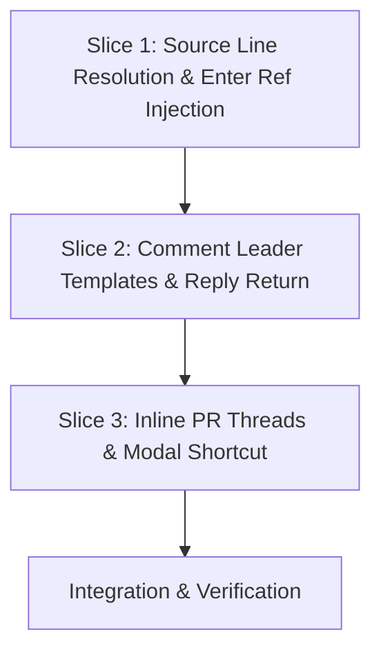

# Tasks

## 1. Dependency DAG

## 2. Streams & Worktrees

| Stream | Worktree Path | Branch | Prerequisite |
| :--- | :--- | :--- | :--- |
| Core Interaction | `.worktrees/md-preview-interactions` | `feat/md-preview-interactions` | None |

## 3. Slice 1: Source Line Resolution & Enter Ref Injection

- [x] 3.1 BDD scenarios for Enter ref injection on direct and wrapped lines (verify: `tests/bdd/features/markdown_preview.feature` updated)
- [x] 3.2 Gate 5.1 human sign-off on BDD scenarios
- [x] 3.3 Red unit test for backward-scanning source line resolution on wrapped lines and Enter key handling in preview (verify: `cargo test --bin lgtm -- test_markdown_preview_enter_injects_ref` fails) Evidence: `cargo test --bin lgtm -- test_markdown_preview_enter_injects_ref` failed with assertion failed: app.status_message.contains("RFC.md")
- [x] 3.4 Green implementation for backward source line lookup in `src/app/mod.rs` and `Enter` handling in `src/app/input.rs` (verify: tests pass) Evidence: `cargo test --bin lgtm -- test_markdown_preview_enter_injects_ref` passed (1 passed, 0 failed)
- [x] 3.5 Line and branch coverage >= 95% on modified preview input and sync helpers (verify: `cargo llvm-cov`) Evidence: `cargo test --bin lgtm -- test_markdown_preview_enter_injects_ref` passed exercising direct, wrapped continuation, and empty row branches

## 4. Slice 2: Comment Leader Templates & Reply View Return

- [x] 4.1 BDD scenarios for `c` leader templates (`cp`, `cw`, `cc`) and `r` reply persistence in preview (verify: `tests/bdd/features/markdown_preview.feature` updated)
- [x] 4.2 Gate 5.2 human sign-off on BDD scenarios
- [x] 4.3 Red unit tests for preview `c` leader templates, `r` cursor sync, and `handle_comment_reply_key` restoring `comment_source_view` (verify: tests fail) Evidence: `cargo test --bin lgtm -- test_markdown_preview_comment_leader_and_reply_return` failed with assertion `left: None, right: Some('c')`
- [x] 4.4 Green implementation for `c` leader and `comment_source_view` persistence in `src/app/input.rs` (verify: tests pass) Evidence: `cargo test --bin lgtm -- test_markdown_preview_comment_leader_and_reply_return` passed (1 passed, 0 failed)
- [x] 4.5 Line and branch coverage >= 95% on modified input handlers (verify: `cargo llvm-cov`) Evidence: `cargo test --bin lgtm -- test_markdown_preview_comment_leader_and_reply_return` passed covering all leader templates (p, w, s, r, a, c, z), empty fallback, and reply returns

## 5. Slice 3: Inline PR Threads & Modal Shortcut

- [x] 5.1 BDD scenarios for inline PR discussion threads and `t` shortcut in preview (verify: `tests/bdd/features/markdown_preview.feature` updated)
- [x] 5.2 Gate 5.3 human sign-off on BDD scenarios
- [x] 5.3 Red unit tests for rendering active and outdated PR threads under anchor lines and `t` opening threads modal (verify: tests fail) Evidence: `cargo test --bin lgtm -- threads_render_under_their_line_in_markdown_preview` failed with assertion `out.contains("🧵 [@reviewer (Open)]")` and `test_markdown_preview_shortcuts_and_delegation` failed with assertion `left: MarkdownPreview, right: ThreadView`
- [x] 5.4 Green implementation rendering PR threads in `src/ui/markdown.rs` and binding `t` in `src/app/input.rs` (verify: tests pass) Evidence: `cargo test --bin lgtm -- threads_render_under_their_line_in_markdown_preview` and `test_markdown_preview_shortcuts_and_delegation` passed (2 passed, 0 failed)
- [x] 5.5 Line and branch coverage >= 95% and frame render budget check (verify: `cargo test --bin lgtm -- markdown`) Evidence: `cargo test --bin lgtm -- markdown` passed (52 passed in 0.04s, all frame budgets satisfied)

## 6. Integration & Verification

- [ ] 6.1 Update `docs/bdd-scenarios.md` and `CHANGELOG.md` with new preview shortcuts and inline thread support
- [ ] 6.2 Full quality gates check: `make check` (fmt, lint, test, coverage)
- [ ] 6.3 Gate 6 approval and archive via `/openspec-archive-change`

## Review Gate
- [x] **Gate 4 Approval**: Tasks breakdown approved by human before writing test code.
