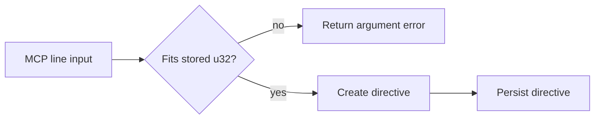

# Architecture & Technical Design

## 1. Overview & Invariants

Validate the requested MCP line before converting it into the directive's stored `u32`. Invalid values must fail before any storage write; accepted values must be preserved exactly.

## 2. Domain Models, State & Interface Contracts

- Input contract: MCP `line` is an unsigned integer.
- Storage contract: directive line remains `u32`.
- Convert with a checked conversion at the request boundary. On failure, return the existing explicit MCP argument-error form before invoking persistence.
- On success, pass the converted value into the existing directive creation and persistence flow.

## 3. Architecture Diagram & Data Flow

## 4. Boundary Rules & Budgets
- **Pure Core vs. I/O Shell**: Validation belongs at the MCP request boundary in `lgtm-mcp`; existing storage behavior remains unchanged.
- **Concurrency, Latency & Resource Budgets**: Checked integer conversion is constant-time and adds no dependencies or I/O.

## 5. Testing Strategy
1. **BDD Scenarios**: Submit the maximum representable value and an overflowing value through the tool handler.
2. **Unit Tests (>= 95% coverage)**: Assert maximum value is stored exactly; overflow returns an error and does not change the stored directive set.
3. **Mutation Testing (100% kill)**: No changes to `lgtm-core` logic.

## Review Gate
- [ ] **Gate 3 Approval**: Architecture & design reviewed and approved by human before task breakdown.
