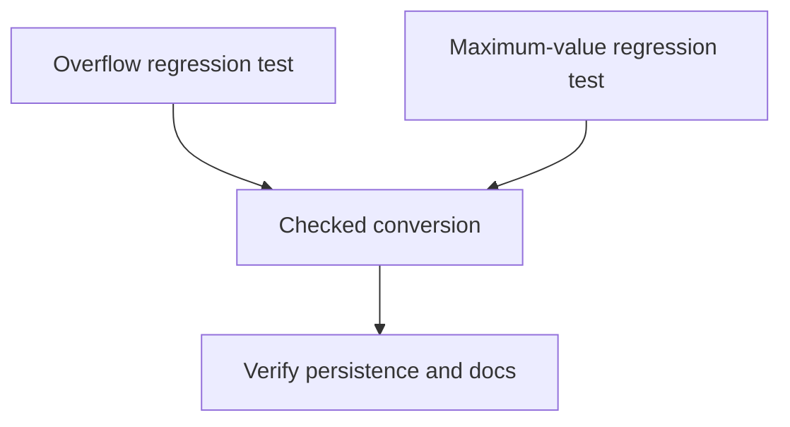

# Tasks

## 1. Dependency DAG

## 2. Streams & Worktrees

| Stream | Worktree Path | Branch | Prerequisite |
| :--- | :--- | :--- | :--- |
| MCP directive line validation | `.worktrees/impl-mcp-line` | `fix/mcp-directive-line-bounds` | Shared MCP input contract |

## 3. Slice 1: Reject unrepresentable directive lines

- [x] 3.1 Add an overflow test proving the tool rejects values above `u32::MAX` before persistence (Evidence: `cargo test -p lgtm-mcp test_add_directive_rejects_line_overflow_without_persisting --quiet` passed).
- [x] 3.2 Add a maximum-value test proving `u32::MAX` is preserved exactly (Evidence: same targeted test passed).
- [ ] 3.3 Gate 5.1 human sign-off on MCP argument-validation scenarios.
- [x] 3.4 Use checked conversion and return an explicit argument error before storage (Evidence: overflow and maximum-value assertions passed).
- [x] 3.5 Run MCP and workspace tests (Evidence: targeted MCP test and `cargo test --workspace --quiet` passed).
- [x] 3.6 Update changelog and MCP tool documentation (Evidence: `CHANGELOG.md`, `docs/WIKI.md`, and bug report updated).

## 4. Integration & Rebase Plan

- [x] 4.1 Integrate the MCP stream with other changes and run `cargo fmt --all -- --check` plus `cargo test --workspace` (Evidence: both commands passed).

## Review Gate
- [ ] **Gate 4 Approval**: Tasks breakdown approved by human before writing test code.
