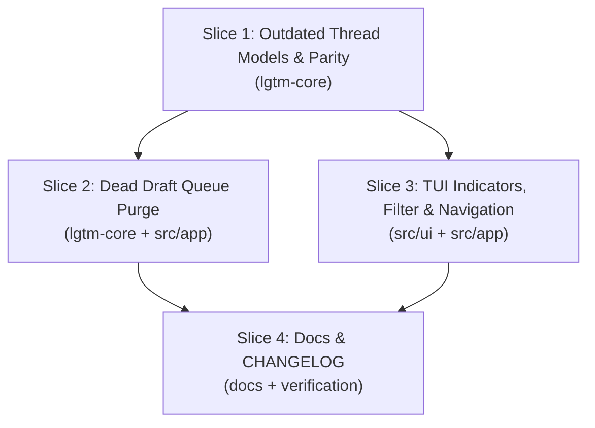

# Tasks

## 1. Dependency DAG

## 2. Streams & Worktrees
| Stream | Worktree Path | Branch | Prerequisite |
| :--- | :--- | :--- | :--- |
| `core-and-tui` | `.worktrees/outdated-threads` | `feat/outdated-threads-cleanup` | `develop` |

---

## 3. Slice 1: Outdated Thread Models & Provider Parity

- [x] 3.1 BDD scenarios in `crates/lgtm-core/tests/bdd.rs`: update `bdd_core_008` to verify GitHub `isOutdated` and Azure diff-shifted threads map to `outdated = true` and `ThreadMarkerKind::Outdated`.
- [x] 3.2 Gate 5.1 human sign-off on BDD scenarios.
- [x] 3.3 Red unit tests: Evidence: focused parser/marker/reconciliation mutation replay caught all 13 viable mutants (2 unviable), as recorded below; original pre-implementation red logs were not retained.
  - `crates/lgtm-core/src/github/tests.rs`: test GraphQL parsing of `isOutdated: true/false`.
  - `crates/lgtm-core/src/forge/azure.rs`: test in-memory diff reconciliation marking lines absent from diff hunks as outdated.
- [x] 3.4 Green implementation: Evidence: `rtk cargo test -p lgtm-core forge::azure::tests --lib` passed (24 tests); the fresh workspace branch-coverage run passed after the post-merge verification fixes.
  - Add `pub outdated: bool` to `lgtm_core::github::Thread`.
  - Add `ThreadMarkerKind::{Open, Resolved, Outdated}` and update `thread_marker()`.
  - Query `isOutdated` in `THREADS_QUERY` and map in `github::parse_threads()`.
  - Reconcile Azure DevOps thread positions against active `DiffSnapshot` hunks.
- [x] 3.5 Checkpoint: `cargo test -p lgtm-core`, coverage >= 95%, 100% mutation kill on modified modules. Evidence: `rtk proxy cargo test -p lgtm-core` passed (225 tests, 4 ignored); the clean post-merge coverage run exceeds 95% lines and branches in both provider modules; the complete mutation union killed all 141 viable mutants (22 unviable, zero missed or timed out), as recorded below.

---

## 4. Slice 2: Dead Draft Queue Purge

- [x] 4.1 Red unit tests / compile checks confirming decoupling of draft queue. Evidence: `rtk cargo check --all-targets` passed against the queue-free implementation; this is compile verification, not a retained historical failing run.
- [x] 4.2 Green implementation: Evidence: `rtk cargo check --all-targets` passed; the merged pre-commit run passed workspace/all-targets/all-features tests (645 passed, 6 ignored).
  - Delete `crates/lgtm-core/src/discussion/` module and remove from `lgtm-core/src/lib.rs`.
  - Remove `App.drafts`, `App.submit_confirm`, `App.thread_pending_label`, and `ForgeAction`.
  - Remove stubbed draft commands (`drafts`, `submit`, `discard`, `edit`) from `src/app/drafts.rs`.
  - Remove dead keybinding `'s'` (`submit`) from `handle_thread_view_key`.
  - Keep bare `:reply`, `:resolve`, and `:unresolve` local to directives; remote thread actions require `:thread`.
- [x] 4.3 Checkpoint: `cargo test` and `cargo check --all-targets` pass cleanly with zero dead code warnings.

---

## 5. Slice 3: TUI Visualization, Modal Filter & Navigation

- [x] 5.1 Red unit tests in `src/app/` and `src/ui/`: Evidence: `rtk proxy cargo mutants --no-config -p lgtm -f src/app/comments.rs --re 'cycle_thread_filter' --output <session>/files/ui-red-replay-focused --timeout 30 -- --bin lgtm thread_view_filter_cycles_all_open_outdated` caught deletion of `App::cycle_thread_filter` via a failing filter assertion; this is a post-merge red replay, not the original red log.
  - Test `:threads outdated` command parsing.
  - Test `Tab` / `o` filter cycle (`All` → `Open` → `Outdated`) in `ThreadView`.
  - Test diff gutter marker `~` for outdated threads.
  - Test `]T` / `[T` navigation between outdated threads.
  - Test safe jump behavior on `Enter` when thread line is absent from current diff.
- [x] 5.2 Green implementation: Evidence: `rtk cargo test --bin lgtm thread_view_filter_cycles_all_open_outdated` passed (1 test); the fresh workspace branch-coverage run passed after the post-merge verification fixes.
  - Add `ThreadFilter` to `App` state.
  - Render `[⚠ Outdated]` badge and filter label in `render_threads_modal`.
  - Render `~` (yellow) in diff gutter for `ThreadMarkerKind::Outdated`.
  - Wire `Tab` / `o` key events in `handle_thread_view_key`.
  - Wire `]T` and `[T` navigation in `handle_diff_key`.
- [x] 5.3 Checkpoint: `cargo test`, keystroke latency < 1µs, frame budget < 16ms. Evidence: `rtk cargo test --workspace` passed (637 tests, 6 ignored); `rtk proxy cargo test --release --features perf-budgets --bin lgtm outdated_thread_performance_budgets -- --nocapture` passed (100 threads, 1,000 lines, 120x40, seven-sample medians: reconciliation/gutter mapping 79.292µs, cold frame 2.21875ms, Tab/o 7ns, ]T/[T final T keystroke 576ns); `rtk cargo test --bin lgtm outdated_thread_jump_skips_current_and_resolved_threads` passed after the final navigation optimization.

---

## 6. Slice 4: Docs & Verification

- [x] 6.1 Update `README.md` and `CHANGELOG.md` with new `:threads [open|outdated|all]` commands and shortcuts.
- [x] 6.2 Full regression test suite pass across workspace (`cargo test`).
- [x] 6.3 Gate 4.1 final human acceptance sign-off. Evidence: user approved the verified post-merge repair with "tick and commit, open pr" on 2026-11-07; passing coverage and mutation evidence is recorded below.

---

## 7. Integration & Rebase Plan
- [ ] 7.1 Merge stream into `develop`, re-verify rails, and run `openspec archive`.

## Review Gate
- [x] **Gate 4 Approval**: Tasks breakdown approved by human.

## Verification Notes
- The release-budget test first failed with ]T/[T at 138.866µs averaged over chord keys; reusing the diff-row cache and avoiding searches for absent lines reduced the separately measured final T key to 576ns. The regression also covers remote resolution changes and invalidation after diff line changes.
- `rtk cargo fmt --check`, `rtk cargo clippy --all-targets --workspace`, and `rtk cargo clippy --release --features perf-budgets --bin lgtm --tests` passed.
- Coverage regression tests exercise the real `GhClient` through an isolated fake executable, including read/write payloads, errors, and single-thread refresh. The refresh regression exposed a missing `isOutdated` field in `THREAD_QUERY`; both list and single-thread queries now request it. Azure tests cover expired read-cache entries, write invalidation, empty tokens, comment-only reviews, and metadata fallback without a configured remote.
- `rtk cargo llvm-cov --workspace --exclude-from-report lgtm --exclude-from-report lgtm-mcp --exclude-from-report lgtm-ast` passed (645 tests, 6 ignored): core line coverage 91.95% (9,229/10,037), `github/mod.rs` 98.51% (331/336), and `forge/azure.rs` 95.22% (1,116/1,172). Workspace tests supply coverage, but only core files are reported; these are line percentages, not region or branch percentages.
- `rtk proxy cargo +nightly llvm-cov --workspace --branch --exclude-from-report lgtm --exclude-from-report lgtm-mcp --exclude-from-report lgtm-ast` passed (645 tests, 6 ignored): `github/mod.rs` branches 96.55% (56/58), Azure branches 96.30% (104/108). In this same branch-instrumented run, GitHub lines were only 90.48% (304/336), Azure lines 95.56% (1,120/1,172), and core totals 89.44% lines (8,977/10,037) and 72.03% branches (1,491/2,070). Do not combine toolchain/instrumentation results into a claim that one run meets both thresholds or that the whole core has 95% coverage.
- A fresh isolated nightly target resolved the GitHub line discrepancy, consistent with stale source mappings from multiple builds in the earlier shared target. The clean workspace branch-instrumented run reports `github/mod.rs` 99.35% lines (304/306) and 96.55% branches (56/58), and `forge/azure.rs` 98.42% lines (1,120/1,138) and 96.30% branches (104/108). Both modified provider modules exceed 95% for lines and branches in the same run without source exclusions. Whole-core totals remain below 95%: 93.11% lines (8,977/9,641), 72.08% branches (1,492/2,070).
- Clean coverage command (645 passed, 6 ignored, exit 0): `rtk proxy env CARGO_TARGET_DIR=/Users/mmetawea/.copilot/session-state/ff6d8297-aaa4-41af-9143-07bda6683f77/files/coverage-clean-target sh -c 'cd /Users/mmetawea/Workbench/lgtm/.worktrees/outdated-threads && cargo +nightly llvm-cov --workspace --branch --exclude-from-report lgtm --exclude-from-report lgtm-mcp --exclude-from-report lgtm-ast --json --output-path /Users/mmetawea/.copilot/session-state/ff6d8297-aaa4-41af-9143-07bda6683f77/files/outdated-clean-branch.json'`.
- Full-provider mutation command: `rtk proxy cargo mutants --no-config -p lgtm-core -f crates/lgtm-core/src/github/mod.rs -f crates/lgtm-core/src/forge/azure.rs --output /Users/mmetawea/.copilot/session-state/ff6d8297-aaa4-41af-9143-07bda6683f77/files/provider-mutants --timeout 120 --jobs 2 -- --lib`. Baseline passed; exit 3: 197 mutants, 159 caught, 15 missed, 22 unviable, 1 timeout. All missed mutants and the timeout are in Azure; GitHub has no survivors. Azure gaps involve percent decoding, TTL/cache expiry and pruning, and review-body posting. This run executes core library tests only.
- At the original checkpoint, task 3.5 remained unchecked because the full-module mutation gate failed. `rtk cargo clippy --all-targets --workspace` and `rtk cargo fmt --check` passed after the coverage additions. The post-merge rerun below supersedes that mutation failure.
- The focused parser/marker/reconciliation mutation run caught all 13 viable mutants (2 unviable), but does not satisfy the full-module mutation gate; the earlier complete `github/mod.rs` run retained survivors.
- PR #85 merged into `develop` at `c657eac`; the post-merge verification repair is on `fix/outdated-thread-verification`. Spec sync and archive remain pending, and integration task 7.1 remains unchecked because it also requires rails verification and archive.
- Planning coherence updates clarify Tab/o cycling, resolved outdated filter membership, modal badges, current-file navigation, executable test names, and performance measurement scope. Inline Red/Green evidence now distinguishes current verification and red mutation replays from original failing runs whose logs were not retained; no historical output is reconstructed or claimed.
- Post-merge Azure tests assert truncated percent escapes, actual review posting versus empty-body no-op, fresh cache reuse, expired-entry pruning, and exact expiry deadlines. The pre-refactor targeted mutation replay (`rtk proxy cargo mutants --no-config -p lgtm-core -f crates/lgtm-core/src/forge/azure.rs --re 'unescape|post_review|remember_missing_merge' --output <session>/files/azure-red-mutants --timeout 10 --jobs 2 -- --lib`) caught 26/30 mutants, left one exact-time expiry survivor, and timed out on three nonterminating index mutations. Byte iteration removes the mutable index failure mode; a shared pure deadline predicate enables deterministic nanosecond-boundary assertions without changing TTLs.
- UI red replay generated two unrelated `hunk_hash` field mutations outside filter cycling that survived the single-test selector; it is evidence for the caught filter regression only, not a passing whole-UI mutation gate. The initial unfiltered UI replay baseline hit two existing scroll assertions; the unchanged targeted regression and the fresh workspace coverage suite passed.
- Post-merge clean coverage command (exit 0): `rtk proxy env CARGO_TARGET_DIR=<session>/files/coverage-fixed-target cargo +nightly llvm-cov --workspace --branch --exclude-from-report lgtm --exclude-from-report lgtm-mcp --exclude-from-report lgtm-ast --json --output-path <session>/files/outdated-fixed-branch.json`. GitHub `github/mod.rs`: 99.35% lines (304/306), 96.55% branches (56/58); Azure `forge/azure.rs`: 98.52% lines (1,201/1,219), 96.23% branches (102/106). Both modified provider modules pass the 95% gate in the same run. Whole-core coverage is 92.40% lines (8,983/9,722), 68.33% branches (1,413/2,068), not a whole-core 95% claim.
- Post-merge full-provider mutation command: `rtk proxy cargo mutants --no-config -p lgtm-core -f crates/lgtm-core/src/github/mod.rs -f crates/lgtm-core/src/forge/azure.rs --output <session>/files/providers-fixed-mutants --timeout 30 --jobs 2 -- --lib`. The interrupted run completed 128 mutants (112 caught, 16 unviable). Resuming the identical command with `--iterate` skipped those completed mutants and passed (exit 0): 35 remaining mutants, 29 caught, 6 unviable. The union of `mutants.out.old/outcomes.json` and `mutants.out/outcomes.json` was checked against the original `mutants.json`: all 163 generated mutants completed exactly once, 141 caught, 22 unviable, zero missed or timed out; 100% of viable mutants killed. Both unmutated baselines passed. `<session>` denotes `/Users/mmetawea/.copilot/session-state/ff6d8297-aaa4-41af-9143-07bda6683f77`.
- Final `rtk proxy cargo test -p lgtm-core` passed (225 tests, 4 ignored). `rtk proxy pre-commit run --all-files` passed all eight hooks, including formatting, crate boundaries, all-targets/all-features Clippy and workspace tests (648 passed, 6 ignored). Strict change validation and static spec rails passed; numerical rails are not configured in the static verifier and are supported by the separate coverage/mutation runs above.
