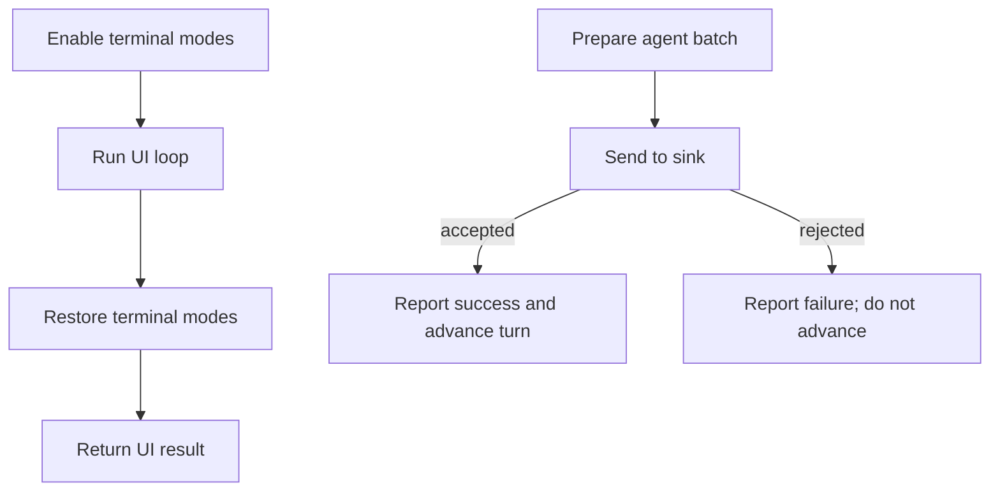

# Architecture & Technical Design

## 1. Overview & Invariants

Keep the fixes in the application I/O shell. Terminal restoration must run after terminal setup on both success and failure, while the originating UI error remains visible. Agent turn advancement and success feedback must happen only after a successful sink send.

## 2. Domain Models, State & Interface Contracts

- Terminal lifecycle: terminal setup → UI loop → restoration → return the loop result. Restoration errors are surfaced without replacing an earlier UI-loop error.
- Agent delivery: pending batch → sink send → on success, show success and advance turn; on failure, surface the send error and retain the current turn.
- No public command or persisted data format changes.

## 3. Architecture Diagram & Data Flow

## 4. Boundary Rules & Budgets
- **Pure Core vs. I/O Shell**: Terminal operations and agent sink delivery remain in the application shell; no I/O is added to `lgtm-core`.
- **Concurrency, Latency & Resource Budgets**: No new background work or retries; cleanup is bounded by the existing terminal calls.

## 5. Testing Strategy
1. **BDD Scenarios**: Exercise an event-loop failure and sink rejection through the corresponding application paths.
2. **Unit Tests (>= 95% coverage)**: Add focused tests for cleanup on error and for no success/turn advancement after a rejected send; run targeted tests and workspace tests as feasible.
3. **Mutation Testing (100% kill)**: No core logic changes; do not introduce I/O into core for mutation coverage.

## Review Gate
- [ ] **Gate 3 Approval**: Architecture & design reviewed and approved by human before task breakdown.
