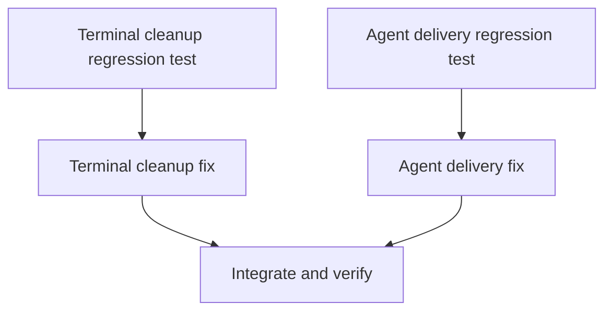

# Tasks

## 1. Dependency DAG

## 2. Streams & Worktrees

| Stream | Worktree Path | Branch | Prerequisite |
| :--- | :--- | :--- | :--- |
| Runtime terminal and agent delivery | `.worktrees/impl-runtime` | `fix/runtime-error-handling` | Shared runtime contract |

## 3. Slice 1: Runtime failure handling

- [x] 3.1 Add a regression test that fails when a UI-loop error skips terminal restoration (verify: `cargo test -p lgtm --bin lgtm terminal_cleanup --quiet` passed: 2 tests).
- [ ] 3.2 Gate 5.1 human sign-off on the failure scenario.
- [x] 3.3 Add a regression test that rejects sink delivery and verifies no success or turn advancement (verify: `cargo test -p lgtm --bin lgtm app::external::tests --quiet` passed: 21 tests).
- [ ] 3.4 Gate 5.2 human sign-off on the delivery scenario.
- [x] 3.5 Restore terminal state on all UI exit paths while preserving the original error (Evidence: `cargo test -p lgtm --bin lgtm terminal_cleanup --quiet` passed: 2 tests).
- [x] 3.6 Handle sink rejection explicitly without reporting success or advancing the turn (Evidence: `cargo test -p lgtm --bin lgtm app::external::tests --quiet` passed: 21 tests).
- [x] 3.7 Run workspace tests and inspect platform-sensitive terminal behavior (Evidence: `cargo fmt --all -- --check && cargo test --workspace --quiet` passed).
- [x] 3.8 Update changelog and relevant runtime documentation (Evidence: `CHANGELOG.md` and `docs/bug-reports/` updated).

## 4. Integration & Rebase Plan

- [x] 4.1 Integrate the runtime stream with CLI changes, resolve shared `src/main.rs` edits, then run `cargo fmt --all -- --check` and `cargo test --workspace` (Evidence: both commands passed).

## Review Gate
- [ ] **Gate 4 Approval**: Tasks breakdown approved by human before writing test code.
