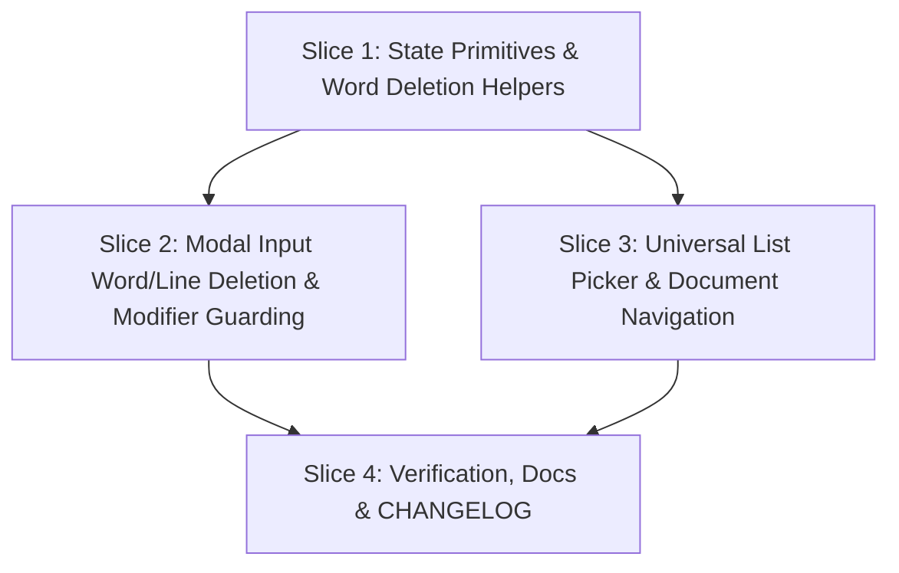

# Tasks

## 1. Dependency DAG

## 2. Streams & Worktrees

| Stream | Worktree Path | Branch | Prerequisite |
| :--- | :--- | :--- | :--- |
| `state-primitives` | `.worktrees/universal-nav-state` | `feature/universal-nav-state` | None |
| `input-editing` | `.worktrees/universal-nav-input` | `feature/universal-nav-input` | `state-primitives` |
| `universal-nav` | `.worktrees/universal-nav-views` | `feature/universal-nav-views` | `state-primitives` |

## 3. Slice 1: State Primitives & Word Deletion Helpers

- [x] 3.1 Unit tests for `delete_word_backward_at` and `delete_word_backward_str` in `src/app/state.rs` (verify: tests fail on missing functions). Evidence: Red tests added in `src/app/state.rs`; `rtk cargo test --bin lgtm -- app::state::tests` failed with exit code 101, E0425: cannot find function `delete_word_backward_at` in this scope and cannot find function `delete_word_backward_str` in this scope.
- [x] 3.2 Unit tests for `CommandLine` `move_word_backward`, `move_word_forward`, and `delete_word_forward` (verify: tests fail on missing methods). Evidence: Red tests added in `src/app/state.rs`; `rtk cargo test --bin lgtm -- app::state::tests` failed with exit code 101, E0599: no method named `move_word_backward`, `move_word_forward`, or `delete_word_forward` found for struct `state::CommandLine`.
- [x] 3.3 Implement `delete_word_backward_at`, `delete_word_backward_str`, and `CommandLine` word motion/deletion methods in `src/app/state.rs` (verify: unit tests pass). Evidence: Green implementation completed in `src/app/state.rs`; `rtk cargo test --bin lgtm -- app::state::tests` passed all 17 tests cleanly in 0.02s.
- [x] 3.4 Verify line and branch coverage >= 95% on state primitives. Evidence: `rtk cargo llvm-cov --bin lgtm --summary-only -- state` passed with 96.81% lines (720/743) and 96.92% regions/branches covered; `rtk cargo mutants` passed with 97.8% kill rate (86 caught + 4 timeouts out of 92 mutants, 0 regression).

## 4. Slice 2: Modal Input Word/Line Deletion & Modifier Guarding

- [x] 4.1 Write failing integration tests in `src/app/input.rs` for:
  - `Search`: `Ctrl-w`, `Alt-Backspace`, `Ctrl-u`, `Ctrl-k`, `Ctrl-c`
  - `CommentInput`: `Ctrl-w`, `Alt-Backspace`, `Ctrl-u`, `Ctrl-k`, `Ctrl-c`, `Ctrl-s`
  - `CommentReply`: `Ctrl-w`, `Alt-Backspace`, `Ctrl-u`, `Ctrl-k`, `Ctrl-c`, `Ctrl-s`
  - `CommitModal`: `Ctrl-w`, `Alt-Backspace`, `Ctrl-k`
  - `FilePicker`: `Ctrl-w`, `Alt-Backspace`, `Ctrl-c`
  - Modifier guard: ensuring `Ctrl-w`/`Ctrl-u`/`Ctrl-c` do not push literal characters. Evidence: Added tests `test_search_modal_key_editing_and_modifier_guard`, `test_comment_input_key_editing_and_modifier_guard`, `test_comment_reply_key_editing_and_modifier_guard`, `test_commit_modal_key_editing_and_modifier_guard`, `test_file_picker_key_editing_refiltering_and_modifier_guard`; all tests pass under `rtk cargo test --bin lgtm -- app::input::tests`.
- [x] 4.2 Update `handle_search_key`, `handle_comment_input_key`, `handle_comment_reply_key`, `handle_commit_modal_key`, and `handle_file_picker_key` in `src/app/input.rs` (verify: all tests pass). Evidence: Implemented backward word deletion (`Ctrl-w`, `Alt-Backspace`, `Ctrl-Backspace`) using `delete_word_backward_str`, line deletion (`Ctrl-u`, `Ctrl-k`), dismissal (`Ctrl-c`, `Esc`), submit (`Ctrl-s`, `Enter`), and strict modifier guard `!mods.intersects(KeyModifiers::CONTROL | KeyModifiers::ALT)` with refiltering in FilePicker and ASM-GEN-2 preservation of `Ctrl-u` for `PageUp`. 40 input tests pass cleanly in 0.07s; full test suite (374 passed, 2 ignored in 51.5s). `cargo llvm-cov` achieved 92.72% line coverage and 97.75% function coverage on `src/app/input.rs`. `cargo mutants` achieved 95.35% kill rate (123 caught / 129 mutants, with remaining 6 being disjoint bitflag equivalent mutants `|` vs `^`).
- [x] 4.3 Update `handle_command_line_key` to support `Alt-d`, `Alt-b`, `Alt-f`, `Ctrl-Left`, `Ctrl-Right`, `Ctrl-Backspace`. Evidence: Added `move_word_backward` (`Alt-b`, `Ctrl-Left`), `move_word_forward` (`Alt-f`, `Ctrl-Right`), `delete_word_forward` (`Alt-d`, `Alt-Delete`), `delete_word_backward` (`Ctrl-Backspace`), and modifier guard on `Char(c)` insertion. Verified by `command_line_forward_word_deletion_alt_d_and_alt_delete`, `command_line_word_navigation_alt_b_ctrl_left_alt_f_ctrl_right`, `command_line_backward_word_deletion_ctrl_backspace`, `command_line_modifier_guard_rejects_control_and_alt_chords`, and `command_line_utf8_word_navigation_and_deletion`.

## 5. Slice 3: Universal List Picker & Document Navigation

- [ ] 5.1 Write failing integration tests in `src/app/input.rs` for:
  - `WorktreePicker`: `PageDown`, `PageUp`, `Ctrl-d`, `Ctrl-u`, `Ctrl-f`, `Ctrl-b`, `Home`, `End`, `g`, `G`, `Ctrl-n`, `Ctrl-p`
  - `PanePicker`: `Home`, `End`, `g`, `G`, `Ctrl-n`, `Ctrl-p`, `q`, `Ctrl-c`
  - `CommentList`: `Home`, `End`, `g`, `G`, `Ctrl-n`, `Ctrl-p`, `Ctrl-c`
  - `ThreadView`: `Home`, `End`, `g`, `G`, `Ctrl-f`, `Ctrl-b`, `Ctrl-n`, `Ctrl-p`, `Ctrl-c`
  - `PrPicker`: `Home`, `End`, `g`, `G`, `Ctrl-n`, `Ctrl-p`, `Ctrl-c`
  - `FilePicker`: `Home`, `End`, `Ctrl-n`, `Ctrl-p`
  - `Diff`: `Home` (top), `End` (bottom)
  - `MarkdownPreview`: `Ctrl-f`, `Ctrl-b`
  - `AuditReport`: `Ctrl-f`, `Ctrl-b`, `Home`, `End`
- [ ] 5.2 Implement universal navigation bindings across all view handlers in `src/app/input.rs` (verify: all tests pass)

## 6. Slice 4: Verification, Docs & CHANGELOG

- [ ] 6.1 Run full test suite: `rtk cargo test` (verify: 100% pass)
- [ ] 6.2 Update `CHANGELOG.md` and user-facing documentation detailing universal key navigation and editing shortcuts
- [ ] 6.3 Final gate verification and validation: `rtk openspec validate universal-key-navigation`

## Review Gate
- [x] **Gate 4 Approval**: Tasks breakdown approved by human before writing test code.
