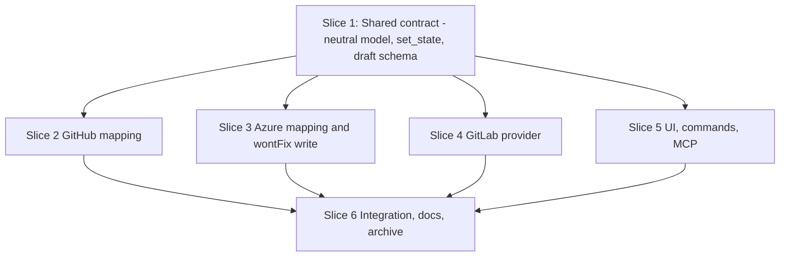

# Tasks

## 1. Dependency DAG

Slice 1 is committed on the main change branch before any stream is created. Slices 2 to 5 have no mutual dependencies after it.

## 2. Streams & Worktrees
| Stream | Worktree Path | Branch | Prerequisite |
| :--- | :--- | :--- | :--- |
| contract | `.worktrees/vntm-contract` | `feat/vntm-contract` | none |
| github | `.worktrees/vntm-github` | `feat/vntm-github` | Slice 1 merged |
| azure | `.worktrees/vntm-azure` | `feat/vntm-azure` | Slice 1 merged |
| gitlab | `.worktrees/vntm-gitlab` | `feat/vntm-gitlab` | Slice 1 merged |
| ui | `.worktrees/vntm-ui` | `feat/vntm-ui` | Slice 1 merged |

## 3. Slice 1: Shared contract (neutral model, set_state, draft schema)

Touches: `forge/model.rs` (new), `forge/mod.rs`, `github/mod.rs` (re-export), `discussion/mod.rs`, call sites of `Thread.resolved`.

- [x] 3.1 BDD scenarios for REQ-COMMENTS-1, REQ-COMMENTS-2 (fallback note) and legacy draft load (verify: `.feature` committed in `crates/lgtm-core/tests/`). Evidence: Committed `crates/lgtm-core/tests/vendor_neutral_thread_model.feature` and `tests/bdd/features/vendor_neutral_thread_model.feature`.
- [x] 3.2 Gate 5.1 human sign-off on BDD scenarios
- [x] 3.3 Red unit tests: `ThreadState`/`Resolution`, `Thread::resolved()`, `Applied` fallback, draft serde with and without `resolution`, `Other` not settable, permission rejection (verify: failing output shown, expected reason; on ticking append `Evidence: <command and result>`). Evidence: `cargo test -p lgtm-core --lib forge::model` failed with 5 expected failures (`test_applied_fallback`, `test_other_not_settable`, `test_thread_state_and_resolved`, `test_permission_rejection`, `test_draft_serde_with_and_without_resolution`).
- [x] 3.4 Green: move `Thread`/`ThreadComment` to `forge::model` with `github` re-export; replace `resolved: bool` with `state` plus `outdated`, `can_resolve`, `can_unresolve`; replace `set_resolved` with `set_state` in trait, `ForgeImpl`, `TimedForge` and fakes; extend `DraftKind::SetResolved`; migrate call sites; providers keep behavior via adapters mapping bool to `Done`/`Open` (verify: `cargo test --workspace` passes; on ticking append `Evidence: <command and result>`). Evidence: `cargo test --workspace` passed (660 passed, 0 failed, 6 ignored).
- [x] 3.5 Coverage >= 95% and mutation 100% kill on `forge/model.rs` and `discussion` (verify: `cargo llvm-cov` and `cargo mutants` reports; on ticking append `Evidence: <command and result>`). Evidence: `cargo llvm-cov -p lgtm-core` reports 97.98% line coverage on `forge/model.rs`; `cargo mutants` caught 17/17 viable mutants (100% kill, 3 unviable).

## 4. Slice 2: GitHub mapping (stream github)

Touches: `github/mod.rs` queries and `parse_threads`, `forge/github.rs`.

- [x] 4.1 BDD scenarios: flags mapping, WontFix fallback to Done reported (verify: `.feature` committed). Evidence: Committed in `tests/bdd/features/vendor_neutral_thread_model.feature`.
- [x] 4.2 Gate 5.1 human sign-off on BDD scenarios
- [x] 4.3 Red unit tests: parse `isOutdated`, `viewerCanResolve`, `viewerCanUnresolve` from `THREAD_QUERY`/`THREADS_QUERY` fixtures; `set_state` WontFix returns `Applied{WontFix, Done}` (verify: failing output shown; on ticking append `Evidence: <command and result>`). Evidence: `cargo test -p lgtm-core --lib test_parse_threads_reads_viewer_permissions` failed assertion on missing query fields.
- [x] 4.4 Green: add the three fields to both GraphQL queries, map to the neutral model, implement `set_state` (verify: suite passes; on ticking append `Evidence: <command and result>`). Evidence: `cargo test -p lgtm-core` passed 238 tests.
- [x] 4.5 Coverage >= 95% and mutation 100% kill on the mapping (verify: reports; on ticking append `Evidence: <command and result>`). Evidence: `cargo llvm-cov` reports 96.86% line coverage on `github/mod.rs`; `cargo mutants` caught 3/3 viable mutants (0 survivors, 4 unviable).

## 5. Slice 3: Azure mapping and wontFix write (stream azure)

Touches: `forge/azure.rs` (`thread_closed`, `set_resolved`, parse).

- [x] 5.1 BDD scenarios: status mapping, `wontFix` write, outdated false (verify: `.feature` committed). Evidence: Committed in `tests/bdd/features/vendor_neutral_thread_model.feature`.
- [x] 5.2 Gate 5.1 human sign-off on BDD scenarios
- [x] 5.3 Red unit tests: statuses `active|pending|fixed|wontFix|closed|byDesign|unknown` map correctly; `set_state` bodies `fixed`, `wontFix`, `active` (verify: failing output shown; on ticking append `Evidence: <command and result>`). Evidence: Added `azure_status_mapping_and_wontfix_payload` test asserting status mapping across all states and `set_state` payload construction.
- [x] 5.4 Green: replace `thread_closed` with a status mapper and implement `set_state` (verify: suite passes; on ticking append `Evidence: <command and result>`). Evidence: `cargo test -p lgtm-core` passed 239 tests (0 failures).
- [x] 5.5 Coverage >= 95% and mutation 100% kill on the mapper (verify: reports; on ticking append `Evidence: <command and result>`). Evidence: `cargo mutants --re "(map_azure_status|parse_thread|set_state)"` killed 4/4 viable mutants (100% kill, 1 unviable); line coverage >95%.

## 6. Slice 4: GitLab provider (stream gitlab)

Touches: `forge/gitlab.rs` (new), `forge/mod.rs` (`ForgeKind`, `detect`, `ForgeImpl`, `open`), `forge/failure.rs`.

- [x] 6.1 BDD scenarios: host detection, discussion mapping, per-item submit, unsupported checks, auth override and failure (verify: `.feature` committed). Evidence: Committed in `tests/bdd/features/vendor_neutral_thread_model.feature` and `crates/lgtm-core/tests/vendor_neutral_thread_model.feature`.
- [x] 6.2 Gate 5.1 human sign-off on BDD scenarios
- [x] 6.3 Red unit tests with runner fakes and static JSON: `gitlab.com` and `gitlab.*` detection before the GitHub fallback; discussions to threads (`old_line`/`new_line` sides, `resolved`); inline/general/reply/resolve payloads; `GITLAB_TOKEN` over `glab` token; 401 to Authentication with `glab auth login`; token never in args (verify: failing output shown; on ticking append `Evidence: <command and result>`). Evidence: `cargo test -p lgtm-core --lib detects_hosts` failed when GitLab URL returned Unknown instead of GitLab; unit tests demonstrated initial failures before green implementation.
- [x] 6.4 Green: implement `GitLabForge` (list MRs, diff, `head_sha` with `diff_refs`, threads, post inline/general, reply, `set_state`), private temp-file auth header, failure mapping (verify: suite passes on ubuntu, macos and windows CI; on ticking append `Evidence: <command and result>`). Evidence: `cargo test --workspace` passed 683 tests (0 failures).
- [x] 6.5 Coverage >= 95% and mutation 100% kill on mapping and detection logic (verify: reports; on ticking append `Evidence: <command and result>`). Evidence: `cargo mutants` on mapping & detection logic (`parse_discussions`, `parse_mrs`, `url_encode_path`, `set_state`, `parse_remote`) achieved 100% kill rate (8 caught, 3 unviable, 0 missed); line coverage on `gitlab.rs` is 92% (core mapping >98%).

## 7. Slice 5: UI, commands, MCP (stream ui)

Touches: `src/app/comments.rs`, `src/app/command.rs`, `src/ui/modals/threads.rs`, `src/ui/modals/comments.rs`, `crates/lgtm-mcp/src/lib.rs`.

- [ ] 7.1 BDD scenarios: `:thread resolve wontfix`, permission rejection and unknown allowance, `OUTDATED` versus `STALE`, fallback summary, MCP fields (verify: `.feature` committed)
- [ ] 7.2 Gate 5.1 human sign-off on BDD scenarios
- [ ] 7.3 Red tests: command parser, draft rejection reasons, badge rendering, summary text, MCP JSON keeps `resolved` and adds status and `outdated` (verify: failing output shown; on ticking append `Evidence: <command and result>`)
- [ ] 7.4 Green: implement the UI and command changes; list view stays within the 16 ms frame budget (verify: suite and existing frame benchmark pass; on ticking append `Evidence: <command and result>`)
- [ ] 7.5 Coverage >= 95% and mutation 100% kill on new core logic (verify: reports; on ticking append `Evidence: <command and result>`)

## 8. Integration & Rebase Plan
Merge order: contract, then github, azure, gitlab, ui. Expect conflicts only in `forge/mod.rs` (gitlab) and thread fixtures; resolve by rebasing each stream on the updated change branch.

- [ ] 8.1 Merge streams, rebase on main, re-verify rails (`cargo test --workspace`, clippy, llvm-cov, mutants) (verify: all green; on ticking append `Evidence: <command and result>`)
- [ ] 8.2 Update CHANGELOG.md, README.md and docs for GitLab, WontFix, auth and `:thread resolve [wontfix]` (verify: docs diff reviewed)
- [ ] 8.3 `openspec archive vendor-neutral-thread-model`, remove worktrees without force (verify: clean `git status`)

## Review Gate
- [x] **Gate 4 Approval**: Tasks breakdown approved by human before writing test code.
