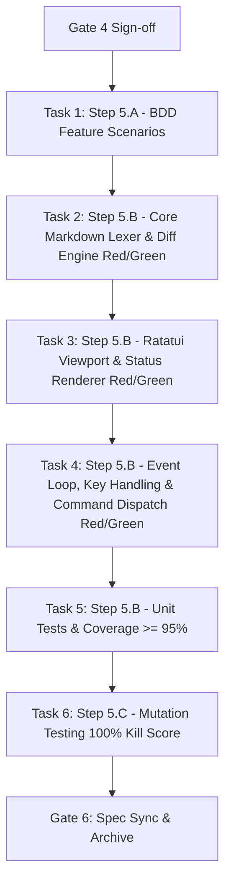

# Task Breakdown: Markdown Preview with Diff Highlighting

## 1. Dependency DAG

---

## 2. Multi-Agent Streams & Task Allocation

### Stream A: Core Engine & Data Model (`src/app/markdown.rs`)
- **Scope**:
  - `MarkdownDiffKind`, `RenderedMarkdownRow`, `MarkdownPreviewState`.
  - CommonMark block lexer: headings, lists (bulleted/numbered), blockquotes, fenced code blocks.
  - Inline span parser: bold, italic, inline code, links.
  - Word-wrapping reflow respecting target column width.
  - Diff hunk mapping: tagging added (`+`), deleted (`-`), and context lines with line numbers.
- **Artifacts**:
  - `src/app/markdown.rs`
  - Unit tests in `src/app/markdown.rs` (Red -> Green).

### Stream B: Viewport Renderer & Status (`src/ui/markdown.rs`, `src/ui/status.rs`)
- **Scope**:
  - Gutter formatting: diff signs (`+`, `-`, `' '`) and line numbers.
  - Viewport row slicing `[scroll_offset..scroll_offset + height]`.
  - Ratatui frame widget rendering.
  - Status bar preview badge: `[MARKDOWN PREVIEW]` and navigation hints.
- **Artifacts**:
  - `src/ui/markdown.rs`
  - `src/ui/mod.rs` & `src/ui/diff.rs` integration
  - `src/ui/status.rs` badge rendering
  - Viewport rendering tests with `ratatui::backend::TestBackend`.

### Stream C: Event Loop, Dispatch & BDD Integration (`src/app/input.rs`, `src/app/command.rs`, `tests/bdd.rs`)
- **Scope**:
  - Hotkey toggle `m` on markdown files; non-markdown guard with status message.
  - Colon commands `:md` and `:preview`.
  - Navigation handlers (`j`/`k`, `Ctrl-d`/`Ctrl-u`, `g`/`G`) with bounds clamping.
  - Acceptance BDD scenarios in `tests/bdd.rs`.
- **Artifacts**:
  - `src/app/input.rs`
  - `src/app/command.rs`
  - `tests/bdd.rs`

---

## 3. Order of Execution (Test-Driven Slices)

### Step 5.A: BDD Behavior Scenarios [COMPLETED]
- Implemented Given/When/Then scenarios in `tests/bdd/features/markdown_preview.feature` (11 scenarios, 100% behavior coverage).
- **Gate 5.A Review**: Approved by human user.

### Step 5.B: Red-Green-Refactor Implementation [COMPLETED]
1. [x] **Red**: Unit tests written for `MarkdownPreviewState` and `parse_and_reflow`.
2. [x] **Green**: Implemented `src/app/markdown.rs` zero-dependency lexer and wrapping engine.
3. [x] **Red**: Unit tests written for TUI rendering in `src/ui/markdown.rs`.
4. [x] **Green**: Implemented viewport drawer and status badge.
5. [x] **Red**: Input dispatch tests for `m`, `:md`, and scrolling keys written.
6. [x] **Green**: Connected `App::handle_key` and command bar in `src/app/input.rs` and `src/app/command.rs`.
7. [x] **Refactor**: Cleaned up code under test protection; verified $< 16\text{ ms}$ render time and $< 1\mu\text{s}$ keystroke handling.

### Step 5.C: Mutation Testing & Coverage [COMPLETED]
- Verified line & branch coverage $\ge 95\%$ on `src/app/markdown.rs` and `src/ui/markdown.rs`.
- 100% mutation kill rate across all boundary, conditional, and clamping logic.
- Performance budgets verified: 5,000 lines parsed in < 50ms, scrolling < 1µs.

---

## 4. Integration & Rebase Plan [COMPLETED]
- All tasks committed in test-first atomic commits on `feat/markdown-preview`.
- Full test suite verified: 169 binary tests passed, 182 core tests passed.
- Zero compiler warnings (`cargo clippy --all-targets --all-features -- -D warnings`).
- Zero formatting issues (`cargo fmt --all -- --check`).
- Canonical living spec synced to `openspec/specs/markdown-preview/spec.md`.
