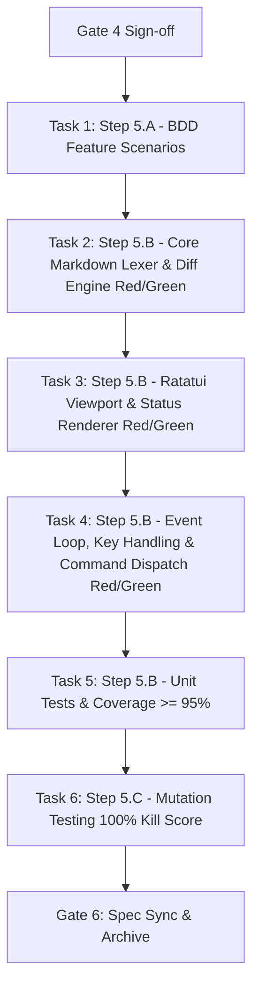

# Task Breakdown: Markdown Preview with Diff Highlighting

## 1. Dependency DAG

---

## 2. Multi-Agent Streams & Task Allocation

### Stream A: Core Engine & Data Model (`src/app/markdown.rs`)
- **Scope**:
  - `MarkdownDiffKind`, `RenderedMarkdownRow`, `MarkdownPreviewState`.
  - CommonMark block lexer: headings, lists (bulleted/numbered), blockquotes, fenced code blocks.
  - Inline span parser: bold, italic, inline code, links.
  - Word-wrapping reflow respecting target column width.
  - Diff hunk mapping: tagging added (`+`), deleted (`-`), and context lines with line numbers.
- **Artifacts**:
  - `src/app/markdown.rs`
  - Unit tests in `src/app/markdown.rs` (Red -> Green).

### Stream B: Viewport Renderer & Status (`src/ui/markdown.rs`, `src/ui/status.rs`)
- **Scope**:
  - Gutter formatting: diff signs (`+`, `-`, `' '`) and line numbers.
  - Viewport row slicing `[scroll_offset..scroll_offset + height]`.
  - Ratatui frame widget rendering.
  - Status bar preview badge: `[MARKDOWN PREVIEW]` and navigation hints.
- **Artifacts**:
  - `src/ui/markdown.rs`
  - `src/ui/mod.rs` & `src/ui/diff.rs` integration
  - `src/ui/status.rs` badge rendering
  - Viewport rendering tests with `ratatui::backend::TestBackend`.

### Stream C: Event Loop, Dispatch & BDD Integration (`src/app/input.rs`, `src/app/command.rs`, `tests/bdd.rs`)
- **Scope**:
  - Hotkey toggle `m` on markdown files; non-markdown guard with status message.
  - Colon commands `:md` and `:preview`.
  - Navigation handlers (`j`/`k`, `Ctrl-d`/`Ctrl-u`, `g`/`G`) with bounds clamping.
  - Acceptance BDD scenarios in `tests/bdd.rs`.
- **Artifacts**:
  - `src/app/input.rs`
  - `src/app/command.rs`
  - `tests/bdd.rs`

---

## 3. Order of Execution (Test-Driven Slices)

### Step 5.A: BDD Behavior Scenarios
- Implement Given/When/Then scenarios covering:
  - `test_bdd_markdown_preview_toggle_and_guard`: Toggle `m` on `.md` file enters preview; toggle on `.rs` file displays warning.
  - `test_bdd_markdown_preview_diff_styling`: Headings, lists, code fences, and diff markers (+green, -red).
  - `test_bdd_markdown_preview_scroll_clamping`: Scrolling with `j`/`k`, `g`/`G` clamps at boundaries.
  - `test_bdd_markdown_preview_resize_reflow`: Width change dynamically wraps lines.
- **Gate 5.A Review**: Human review of behavior scenarios before code implementation.

### Step 5.B: Red-Green-Refactor Implementation
1. **Red**: Write failing unit tests for `MarkdownPreviewState` and `parse_and_reflow`.
2. **Green**: Implement `src/app/markdown.rs` parsing and wrapping engine.
3. **Red**: Write failing unit tests for TUI rendering in `src/ui/markdown.rs`.
4. **Green**: Implement viewport drawer and status badge.
5. **Red**: Write failing input dispatch tests for `m`, `:md`, and scrolling keys.
6. **Green**: Connect `App::handle_key` and command bar.
7. **Refactor**: Clean up and verify $< 16\text{ ms}$ render time and $< 1\mu\text{s}$ keystroke handling.

### Step 5.C: Mutation Testing & Coverage
- Run test coverage verification: `cargo test` verifying line & branch coverage $\ge 95\%$ on `src/app/markdown.rs` and `src/ui/markdown.rs`.
- Run mutation analysis (`cargo mutants` or manual mutation testing) to ensure 100% kill rate on all boundary, conditional, and clamping logic.

---

## 4. Integration & Rebase Plan
- All tasks are committed in test-first atomic commits on `feat/markdown-preview`.
- Full test suite verified single-threaded with `cargo test --bin lgtm -- --test-threads=1` and `cargo test -p lgtm-core`.
- Zero compiler warnings (`cargo clippy --all-targets --all-features -- -D warnings`).
- Zero formatting issues (`cargo fmt --all -- --check`).
