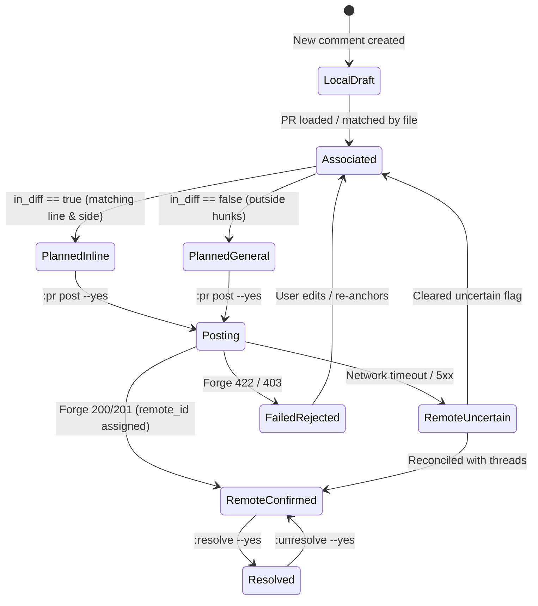

# Specification: Consolidated Comments Workflow

## Capability: `comments-workflow`

### 1. Requirements

#### REQ-CW-01 (CLI Execution & Subcommand Parsing)
- The CLI command `lgtm pr` MUST support both:
  1. Interactive PR diff review: `lgtm pr <NUMBER>` or `lgtm pr` (interactive picker).
  2. Headless PR subcommands: `lgtm pr post [NUMBER] [--yes]`, `lgtm pr reply <THREAD_ID> <TEXT> [NUMBER] [--yes]`, `lgtm pr resolve <THREAD_ID> [NUMBER] [--yes]`, `lgtm pr unresolve <THREAD_ID> [NUMBER] [--yes]`.
- When `[NUMBER]` is omitted in headless commands, `lgtm` MUST resolve the target PR using the following hierarchy:
  1. Explicit `--pr <NUMBER>` flag.
  2. Active unposted comments in `.lgtm/comments.jsonl` tied to a unique `pr_number`.
  3. Git branch association via the active code host forge.
  4. If resolution fails or is ambiguous, exit with status code `2` and print a diagnostic error message.
- If `--yes` is omitted on posting, replying, or resolving:
  - CLI MUST execute a dry-run preview, display planned actions, and exit with status code `0`.
  - TUI MUST display the planned action in the status message with instructions to append `--yes`.

#### REQ-CW-02 (Automatic PR Directive Association)
- Local review directives created before a PR is loaded or selected have `pr_number: None`.
- When a target PR is loaded in the TUI (`:pr <NUMBER>`) or targeted in headless mode (`lgtm pr post [NUMBER]`):
  - Directives with `pr_number: None`, `remote_id: None`, and `orphaned: false` whose `file_path` matches any file in the PR diff MUST be associated with the target PR (`pr_number = Some(target_pr)`).
  - The updated associations MUST be durably saved to `.lgtm/comments.jsonl`.
  - The planning report MUST explicitly state: `Associated N local unattached directive(s) with PR #<NUMBER>`.
- Directives targeting files NOT present in the PR diff MUST remain unassociated (`pr_number: None`) and be listed as skipped with reason `File not present in PR diff`.

#### REQ-CW-03 (Accurate Diff Line & Side Targeting)
- `CommentAnchor` MUST track diff line side using `CommentSide`:
  ```rust
  #[derive(Debug, Clone, Copy, PartialEq, Eq, Serialize, Deserialize, Default)]
  #[serde(rename_all = "UPPERCASE")]
  pub enum CommentSide {
      #[default]
      Right,
      Left,
  }
  ```
- Line detection rules at comment creation:
  - If cursor line is on a deletion (`LineType::Deletion`):
    - `side = CommentSide::Left`
    - `target_line_no = line.old_line_num.unwrap_or(1)`
  - If cursor line is on an addition (`LineType::Addition`) or context (`LineType::Context`):
    - `side = CommentSide::Right`
    - `target_line_no = line.new_line_num.or(line.old_line_num).unwrap_or(1)`
- Diff boundary and inline placement validation (`in_diff`):
  - `CommentSide::Left`: matches if the diff contains a deletion on `c.target_line_no` (`l.line_type == LineType::Deletion && l.old_line_num == Some(c.target_line_no)`).
  - `CommentSide::Right`: matches if the diff contains an addition or context on `c.target_line_no` (`l.line_type != LineType::Deletion && l.new_line_num == Some(c.target_line_no)`).
  - Directives matching diff hunks are designated `inline`.
  - Directives outside diff hunks are designated `general` and batched into a top-level PR conversation comment.
- Forge payload generation:
  - GitHub:
    - Pass `"side": "LEFT"` when `c.side == CommentSide::Left`.
    - Pass `"side": "RIGHT"` when `c.side == CommentSide::Right`.
  - Azure DevOps:
    - Populate `leftFileStart` / `leftFileEnd` when `c.side == CommentSide::Left`.
    - Populate `rightFileStart` / `rightFileEnd` when `c.side == CommentSide::Right`.

#### REQ-CW-04 (Consolidated Unified Commands in TUI & CLI)
- **Unified Resolution**:
  - Ex-command `:resolve [index] [--yes]` / `:unresolve [index] [--yes]`:
    - If `index` is omitted, targets the directive or thread at the current cursor line.
    - If targeting a remote thread (or directive with `remote_id: Some`):
      - In TUI without `--yes`: displays preview prompt. With `--yes`: queues remote resolution job via `PrDiscussion::set_resolved` and updates local state optimistically.
      - In CLI: executes resolution via forge.
    - If targeting an unposted local directive:
      - Toggles local `is_resolved` state immediately without requiring `--yes`.
- **Unified Reply**:
  - Ex-command `:reply [index] <TEXT> [--yes]`:
    - If `index` is omitted, targets the thread or directive at cursor.
    - If targeting a remote thread:
      - Stages draft in `reply_drafts` and previews unless `--yes` is specified.
      - With `--yes`: posts reply via `PrDiscussion::reply` and clears draft upon confirmation.
    - If targeting a local directive:
      - Appends reply string to directive's `replies` list immediately and persists to disk.
- **Unified Comment List Modal**:
  - Command `:c` / `:comments` / `:threads` opens a consolidated modal displaying both local directives and remote PR review threads.
  - Badges clearly indicate status:
    - `[Local]` (unposted local directive)
    - `[PR #42 (Pending)]` (local directive queued for post)
    - `[PR #42 (Remote #123)]` (confirmed remote thread)
    - `[Resolved]` vs `[Active]`

#### REQ-CW-05 (Actionable Error Reporting & Feedback)
- Post planning (`post::plan`) MUST return structured `PlanDetails`:
  - `inline`: items with file, line, side, code snippet.
  - `general`: items placed in general PR comment with reasons (e.g. `Line 54 is outside modified hunks`).
  - `skipped`: items skipped with specific enum reasons (`AlreadyPosted`, `Resolved`, `RemoteUncertain`, `FileNotInPr`, `Orphaned`).
- Post execution (`post::post`) MUST return detailed `Report`:
  - Counts of successfully posted inline and general comments.
  - If a forge call fails, return structured `PostError`:
    - For HTTP 422: `"Forge rejected comment on {file}:{line} ({side}): Line is outside active diff hunk or side is invalid. Consider re-anchoring or posting as a general comment."`
    - For HTTP 401/403: `"Forge rejected comment on {file}:{line}: Authentication failed or insufficient permissions. Run 'gh auth login' or verify access token."`
    - For ambiguous write / timeout: `"Write outcome uncertain; run ':threads' or 'lgtm pr reconcile' before retrying."`

---

### 2. State Transitions



---

### 3. Non-Functional Requirements & Performance Budgets

- **NFR-CW-01 (Durable Consistency)**:
  - Every successful remote receipt (`remote_id`) MUST be written to disk before dispatching the next comment in a batch.
- **NFR-CW-02 (CLI Startup & Execution Speed)**:
  - `lgtm pr post` dry-run planning MUST complete in $< 150\text{ ms}$ for diffs with $< 50$ files.
- **NFR-CW-03 (Backward Compatibility)**:
  - Existing `.lgtm/comments.jsonl` files lacking `side` MUST deserialize smoothly, defaulting to `CommentSide::Right`.

---

### 4. Behavioral Scenarios (Given / When / Then)

#### Scenario 4.1: CLI Post with Dry-Run and Confirmation
- **Given** `.lgtm/comments.jsonl` contains 2 unposted comments for PR #10 (1 inline on line 20, 1 on deleted line 35)
- **When** reviewer runs `rtk lgtm pr post 10`
- **Then** CLI outputs dry-run summary:
  ```text
  Plan for PR #10:
    [INLINE - RIGHT] src/main.rs:20 - "Check error handling"
    [INLINE - LEFT]  src/main.rs:35 - "Why was this removed?"
  Total: 2 inline, 0 general. Run 'lgtm pr post 10 --yes' to send.
  ```
- **When** reviewer runs `rtk lgtm pr post 10 --yes`
- **Then** comments are posted with correct `RIGHT` and `LEFT` sides, receipt IDs are recorded, and CLI exits with code `0`.

#### Scenario 4.2: Associating Unattached Local Directives
- **Given** reviewer creates a comment on `src/auth.rs:42` without loading a PR (`pr_number: None`)
- **When** reviewer later opens PR #8 (`:pr 8`) which modifies `src/auth.rs`
- **Then** directive is automatically updated with `pr_number: Some(8)` and saved to disk.
- **When** reviewer executes `:pr post`
- **Then** status message shows: `Associated 1 local directive with PR #8. Would post 1 inline comment to PR #8; run :pr post --yes to send`.

#### Scenario 4.3: Handling Forge Rejections Gracefully
- **Given** a comment is targeted at a line rejected by GitHub API with 422
- **When** `:pr post --yes` is executed
- **Then** posting stops immediately, the already posted comments retain their receipts, and error displays:
  `Comment on src/lib.rs:12 rejected by GitHub: 422 Unprocessable Entity (line not in diff hunk). Comment retained locally for re-anchoring.`

#### Scenario 4.4: Unified Resolution on Remote Thread
- **Given** reviewer is cursor-focused on a line containing a remote review thread
- **When** reviewer presses `<Space>` or executes `:resolve`
- **Then** TUI prompts `Would resolve thread #1042 on src/lib.rs:15; run :resolve --yes to send`
- **When** reviewer executes `:resolve --yes`
- **Then** remote resolution is dispatched asynchronously and thread displays `[Resolved]`.
