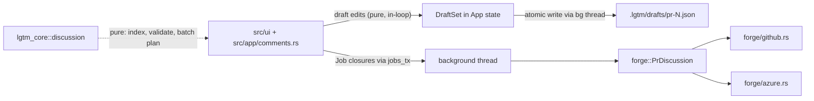

# Design: Online Comments

## 1. Architecture



Reuses the existing pattern: background thread does I/O, then sends `Box<dyn FnOnce(&mut App)>` over `jobs_tx`, guarded by `review_generation` / `thread_revision` / PR number (see `refresh_thread_job`).

### Crate layout
| Crate | Content |
|---|---|
| `lgtm_core::comment` (kept, trimmed) | Local agent directives only; store file `.lgtm/directives.jsonl`; PR fields removed; one-time legacy migration. |
| `lgtm_core::discussion` (new, replaces `github/post/`) | Pure types and logic: `Draft`, `DraftSet`, `ThreadIndex`, `validate`, `plan_submit`, `reconcile`, `SubmitReport`. No I/O. |
| `lgtm_core::forge` (extended) | Keep `PrDiscussion`. Add `post_review(pr, sha, &[InlineDraft]) -> Result<Vec<u64>>` (GitHub: one review; Azure default: loop `post_inline`). |
| `lgtm_core::drafts_store` (new, small) | Load/save `.lgtm/drafts/pr-<N>.json` (atomic temp+rename). The only file I/O for comments; lives outside the pure `discussion` module. |
| `src/app/comments.rs` | App wiring: fetch, draft commands, submit job, view state. |
| `src/ui/modals/comments.rs` (renamed from `threads.rs`) | Single comments view. |

## 2. Domain Model

```rust
pub enum DraftKind {
    Thread { path: String, line: u32, side: CommentSide, body: String },
    General { body: String },
    Reply { thread_id: String, comment_id: u64, body: String },
    SetResolved { thread_id: String, resolved: bool },
}
pub struct Draft { pub id: u32, pub kind: DraftKind, pub status: DraftStatus }
pub enum DraftStatus { Pending, Stale(String), Failed(String) }
pub struct DraftSet { pr: u64, repo_key: String, next_id: u32, items: Vec<Draft> }
```

- `CommentSide` is kept in core (already used by `post_inline`); everything else in `comment/` goes.
- Last `SetResolved` per `thread_id` wins (enforced in `DraftSet::add`).
- Drafts are serialized as JSON with `{ version, repo_key, pr, items }`; a file with a mismatched `repo_key`/version is ignored with a notice.

## 3. Flows

**Fetch / refresh**: `:comments`, `:refresh`, PR load, post-submit → bg `forge.threads(pr)` → job replaces `app.threads` and rebuilds `ThreadIndex` (`HashMap<(path,line), Marker>`) → drafts re-validated (`Stale` marking) in the same job.

**Draft**: pure in-loop edit of `DraftSet` (append + validation against already-loaded diff hunks). Persistence is queued to a single-slot bg writer (coalesced latest-wins) so no disk I/O on the event loop.

**Submit** (`:submit`):
1. Core `plan_submit(&DraftSet)` → ordered batch: threads, general, replies, resolves; skips `Stale`.
2. TUI shows the batch confirmation modal.
3. On confirm, a bg job: re-fetch `head_sha` and `threads` → pre-dedupe each item (REQ-OC-07) → `post_review` for inline items (GitHub: single review) → per-item `reply`/`post_general`/`set_resolved`.
4. After each item the job sends a progress job removing it from `DraftSet` (and persists). Failures set `Failed(reason)`. Final job stores `SubmitReport`, triggers refresh.
5. Generation guard drops results if the PR changed mid-flight (writes already acknowledged stay removed in the store since the removal is done in the worker via the store, keyed by `repo_key`+`pr`).

**Uncertain outcome (timeout)**: item stays `Pending` with `uncertain=true`; next submit runs pre-dedupe against fresh threads and drops the item if its body is already present. Replaces the current `uncertain_replies` map.

## 4. Error Model
`ForgeError { op, path, line, kind: Auth | LineMismatch | RateLimit | Network | NotFound | Unsupported | Other, detail }` with `remediation()` returning the user-facing hint. Built from the existing `forge/failure.rs` classification (extended, not rewritten).

## 5. Tech Stack
Rust, ratatui/crossterm, `serde_json` (already in the workspace), `crossbeam_channel` (existing), forge CLIs/REST via existing adapters. No new dependencies.

## 6. Boundary Rules
- `lgtm_core::discussion` has zero I/O/network deps; `drafts_store` and `forge` own all I/O.
- No ratatui/crossterm in core or MCP (`scripts/check-boundaries.sh`).
- `lgtm-mcp` and watcher read live threads via the `Forge` trait; they never read drafts.
- Deletion scope (REQ-OC-01): `github/post/`, PR fields/logic in `comment/` and `outcome/`, PR-sync code in `src/app/comments.rs`, `lgtm pr post` CLI and `headless.rs` post paths, old PR commands, tracked `.lgtm/comments.jsonl`, related tests/BDD/docs. Rename store to `directives.jsonl` (MCP, watcher, docs updated).

## 7. Performance, Concurrency & Main-Loop Invariants
- **Main loop budget**: render < 16ms. Rendering reads a prebuilt `ThreadIndex` + `DraftSet` index (`HashMap<(path,line),_>`); no scans per frame. Index rebuilt only in the fetch/draft job on the event loop (O(threads), 200 threads ≪ 1ms).
- **Keystroke latency**: typing into the draft prompt mutates a `String` in place; no thread hop, no I/O, no forge call.
- **Async offloading**: all forge calls, `head_sha`, file persistence run on background threads; results return via `jobs_tx`. Persistence uses a single-slot coalescing writer.
- **Hot-path allocations**: none added to diff row rendering; marker lookups borrow from the index. Allocations only on fetch/draft/submit events.
- **Ordering/concurrency**: one submit at a time (`submitting` flag disables `:submit`, edits to in-flight items are rejected). Stale results are discarded by PR + generation tokens.

## 8. Testing Strategy
- Core pure logic: unit tests (validation, batch ordering, last-wins resolve, stale marking, dedupe matching) + property test that `plan_submit` never emits a Stale or duplicate item.
- Store: roundtrip, atomic-write, version/repo mismatch.
- Forge: fake `PrDiscussion` for partial failure, timeout-then-dedupe, GitHub `post_review` payload, Azure side mapping.
- BDD (Gate 5.x): draft several threads → submit → partial failure → retry sends only the remainder.
- Latency test for keystroke and render with 200 threads + 50 drafts.

## 9. Delivery Slices (inputs to Gate 4)
1. **Strip**: delete `comments.jsonl` code, `lgtm pr post`, old commands; app compiles with comments view stubbed.
2. **Core**: `discussion` types, validation, plan, `drafts_store`.
3. **Forge**: `post_review`, error model, dedupe helpers.
4. **TUI**: comments view, commands/keys (REQ-OC-10), submit modal.
5. **MCP/watcher** live-thread sourcing, docs, changelog.

## 10. Assumptions
- ASM-D-01: GitHub `post_review` uses the REST/GraphQL review endpoint with event `COMMENT`; exact call confirmed during slice 3 (prototype against the live provider test).
- ASM-D-02: `thread_revision`/`review_generation` guards are retained unchanged.
- ASM-D-03: `repo_key` is the normalized remote URL.
- ASM-D-04: The current `ThreadComment.id` (u64) is sufficient as the reply target on both forges.
- ASM-D-05: Tier 0 baseline rule is N/A (no ML/NLP).
