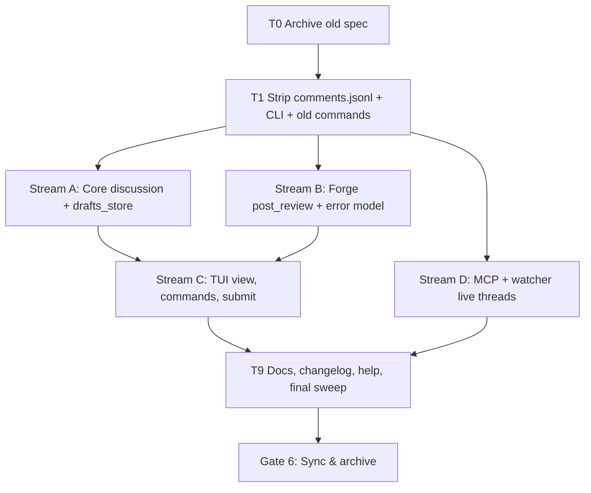

# Tasks: Online Comments

Branch: `feat/online-comments`. Every task is test-first (BDD gate 5.x → Red → Green → ≥95% coverage → 100% mutation kill on core logic). Commands use `rtk` per WORKFLOW.md.

## Dependency DAG

## Sequential: T0–T1 (feature branch, no worktree; no other agent running)

- **T0** Move `specs/features/comments-workflow/` → `specs/archive/comments-workflow/`.
- **T1 Strip & split** (REQ-OC-01)
  - T1.1 Red: tests for migration (`comments.jsonl` → `directives.jsonl`, one-time, then removed) and that directives serialize without `remote_id`/`side`/`remote_uncertain`.
  - T1.2 Rename store to `.lgtm/directives.jsonl` across core, MCP, watcher, docs; add migration.
  - T1.3 Delete PR-sync: `github/post/`, `associate_directives`, `plan/post/reconcile/clear_uncertain`, `remote_id`/`side`/`remote_uncertain` (`pr_number` kept as local PR scope), `lgtm pr post` CLI + `headless.rs` post paths, `:post`, PR paths of `:reply/:resolve/:unresolve`, related tests/BDD, `.gitignore` entry, tracked `.lgtm/comments.jsonl`.
  - T1.4 Keep `CommentSide`, `PrDiscussion`, `Thread`, `#ref` channel and local directive UX intact; stub the threads view to compile.
  - T1.5 Green: `cargo build && cargo test && cargo clippy` clean, no `dead_code` allowances; grep checks from REQ-OC-01 pass.

## Parallel streams (after T1; each in its own worktree)

### Stream A — Core (`.worktrees/online-comments-core`, branch `feat/online-comments/core`)
Covers REQ-OC-03..06, 06b (pure logic), NFR-OC-04/05.
- A1 BDD: draft/dedupe/last-wins/stale/batch-order scenarios → **Gate 5.A**.
- A2 `Draft`, `DraftKind`, `DraftSet::add` (validation: empty body, hunk bounds, side by line type, last-wins resolve).
- A3 `ThreadIndex` + stale marking against fresh threads.
- A4 `plan_submit` (order: threads, general, replies, resolves; skip Stale) + `SubmitReport`.
- A5 `drafts_store` load/save atomic, version/repo_key mismatch.
- A6 Coverage, mutation, property test (no Stale/duplicate emitted).

### Stream B — Forge (`.worktrees/online-comments-forge`, branch `feat/online-comments/forge`)
Covers REQ-OC-07, 08, ASM-D-01.
- B1 BDD: partial failure, timeout-then-dedupe, Azure side mapping → **Gate 5.B**.
- B2 `ForgeError` + `remediation()` built on `forge/failure.rs`.
- B3 `post_review` trait method: GitHub single review (`COMMENT`), Azure default loop; prototype against `tests/live_provider.rs`.
- B4 Pre-dedupe helper (author, body, path, line / reply body) on fresh threads.
- B5 Coverage, mutation.

### Stream D — MCP/watcher (`.worktrees/online-comments-mcp`, branch `feat/online-comments/mcp`)
Covers REQ-OC-09.
- D1 BDD → **Gate 5.D**; D2 `lgtm-mcp` comment tools read live `Forge::threads`; D3 watcher stops reading jsonl; D4 tests/coverage.

## Dependent stream: C — TUI (after A and B merged; `.worktrees/online-comments-tui`, rebased on feature branch)
Covers REQ-OC-02..06b, 10, NFR-OC-01..03.
- C1 BDD: multi-draft → submit → partial failure → retry remainder → **Gate 5.C**.
- C2 App state: `DraftSet`, `ThreadIndex`, `submitting` flag, coalescing persistence writer (bg).
- C3 Live fetch job (`:comments`, `:refresh`, PR load, post-submit) with PR/generation guards.
- C4 Commands/keys per REQ-OC-10; "Comments require a PR" guard.
- C5 Comments view (`src/ui/modals/comments.rs`): threads + `DRAFT/STALE/FAILED` badges, `e/d/s` actions.
- C6 Submit modal + worker job with per-item progress and report.
- C7 Gutter markers from `ThreadIndex`/draft index.
- C8 Latency tests: keystroke < 1µs, render with 200 threads + 50 drafts < 16ms.
- C9 Coverage, mutation on non-UI logic.

## Final: T9
- T9.1 Update help screen, command palette, README/docs, `CHANGELOG.md`.
- T9.2 One-line notice when legacy `comments.jsonl` exists (ASM-OC-02) (+test).
- T9.3 Final `grep` sweep and full test/coverage/mutation run (Gate 6).

## Integration & Rebase Plan
1. Merge order: T1 → (A, B, D in any order; `--ff-only`, rebase siblings onto the updated branch if they conflict) → C rebased on A+B → T9.
2. Checkpoints: after T1 (green build), after A+B merge (C may start), after C (full suite), before Gate 6.
3. Worktrees: created with `rtk git worktree add .worktrees/online-comments-<stream> -b feat/online-comments/<stream>`; removed with `rtk git worktree remove` (never `--force`); `.worktrees/` verified in `.gitignore`.
4. Blast-radius: A touches only `lgtm-core/discussion`+`drafts_store`; B only `forge/`; D only `lgtm-mcp`+`watcher`; C only `src/`.
5. Subagents pause at each gate and escalate via the Lead Orchestrator; none self-approve.

## Delivery notes (deviations, recorded at implementation)
- Streams A/B/D/C were implemented sequentially on the feature branch (no parallel worktrees were needed).
- B3 single GitHub review (`COMMENT`) is implemented for new inline Thread drafts only (≥2, via `PrDiscussion::post_inline_batch`; default = per-item sends, so Azure/others are unchanged). Safe because a rejected review (e.g. 422 line not in diff) creates nothing, so GitHubForge falls back to per-item posts and per-draft failures stay precise; an ambiguous outcome (timeout/no receipt) is reported for every item and `submit` re-fetches threads and dedupes before keeping any draft, so nothing is lost or double-posted. General comments, replies and resolves are still sent individually (the review API cannot carry them); the review has no body. Only the token (REST) path batches; the `gh` CLI path sends individually.
- C2 draft persistence is a synchronous atomic write on the command path (small file, no network); `x`/`e`/`d` view keys are covered by `:thread edit|discard`.
- Dedupe matches (path, line, body) / reply body, not author (current user unknown to the adapters). Body matches only dedupe drafts that already failed once (a fresh "Done" is always sent); resolve/unresolve compares state directly.
- T9.2 legacy notice is superseded by automatic migration of `comments.jsonl` to `directives.jsonl`.
